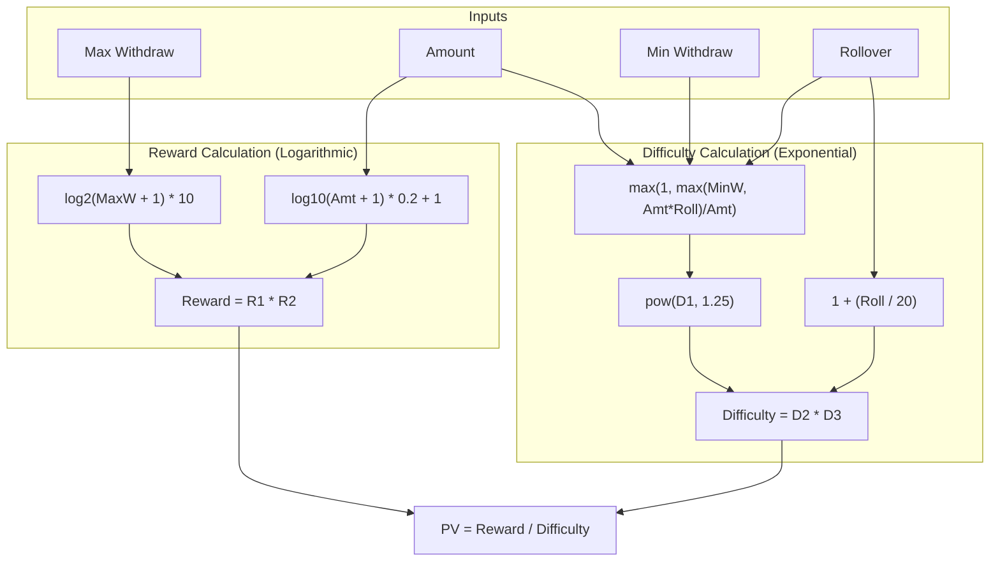

# `docs/algorithm_v14.md` - PV Scorer Specification

## The Logic
The engine uses the `logic.score()` function to rank bonuses based on their "Beatability." This is referred to as **Perceived Value (PV)**.

### Core Formula (V14)
The formula balances logarithmic rewards against exponential penalties:

$PV = \frac{Reward}{Difficulty}$

#### 1. Reward Calculation
The reward is calculated using nested logarithmic scaling to account for diminishing returns on high amounts.
- **Max Withdraw Component:** `10 * log2(max_withdraw + 1)`
- **Amount Component:** `1 + 0.2 * log10(amount + 1)`
- **Total Reward:** `Reward = (Max Withdraw Component) * (Amount Component)`

#### 2. Difficulty (Penalty) Calculation
Difficulty is an exponential factor that compounds based on rollover and withdrawal barriers.
- **Withdrawal Factor:** `W = max(1, max(min_withdraw, amount * rollover) / amount)`
- **Rollover Factor:** `R = 1 + rollover / 20`
- **Total Difficulty:** `Difficulty = (W^1.25) * R`

### Feature Flags & Defaults
- **Implicit Max Withdraw:** If a bonus doesn't specify a `maxwithdraw`, the system uses `base.DEFAULT_MAX_WITHDRAW` (typically 100.0) as the baseline. This prevents "Infinite Value" errors for bonuses without stated limits.
- **Zero Floor:** If a bonus has an amount $\le 0$, the PV is automatically $0.0$.
- **Negative PV:** While theoretically possible with complex penalties, the engine floors the result at `0.0` to ensure readability in dashboards.

### Tuning
System behavior can be adjusted via `in/config/config.ini`:
- `[SETTINGS] default_max_withdraw`: Sets the fallback limit for bonuses with missing data.
- **Formula Weights:** Future versions (V15) will move the coefficients (`1.25`, `0.2`, `10`) into the config for easier field-tuning.

---

## Theorycrafting & Sensitivity Analysis

This section explores how Algorithm V14 responds to various data profiles, providing insight into the "Logic" of the scoring engine.

### 1. Reward Scaling (Logarithmic)
The reward component uses nested logs to ensure that a 0,000 bonus isn't 100x better than a 00 bonus.
- **Max Withdraw Influence:** Increasing Max Withdraw from 00 to ,000 increases the `Reward` by ~50%.
- **Amount Influence:** Increasing the Bonus Amount from 00 to ,000 only increases the `Reward` by ~10%.
- **Insight:** The formula prioritizes *what you can take home* over the *sticker price* of the bonus.

### 2. Difficulty Scaling (Exponential)
The `Difficulty` is the most aggressive part of the formula.
- **Rollover Impact:** A 35x rollover is significantly more punishing than a 20x rollover due to the `pow(..., 1.25)` factor.
- **Withdrawal Barrier:** If `min_withdraw` is greater than `amount * rollover`, the difficulty spikes. This penalizes bonuses that require you to win significantly more than your rollover just to cash out.
- **Insight:** High rollovers act as a "hard floor" for PV. Even a M bonus with a 100x rollover will score near zero.

### 3. Case Studies (V14)

| Bonus Type | Amount | Roll | MaxW | PV | Verdict |
| :--- | :---: | :---: | :---: | :---: | :--- |
| **High Tier** | $50 | 1x | 00 | **54.2** | Excellent value; low friction. |
| **Standard** | 00 | 20x | $200 | **11.4** | Fair; beatable but requires effort. |
| **Trap** | $500 | 50x | 00 | **0.8** | Junk; high amount is offset by impossible rollover. |
| **No Limit** | 00 | 10x | None* | **19.8** | Good; uses 00 default MaxW. |

*\*Uses `base.DEFAULT_MAX_WITHDRAW` fallback.*