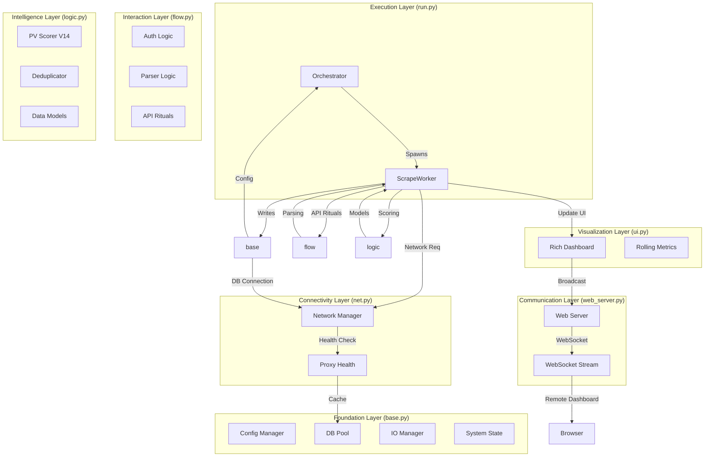
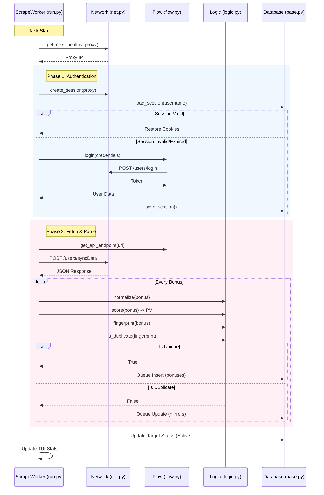
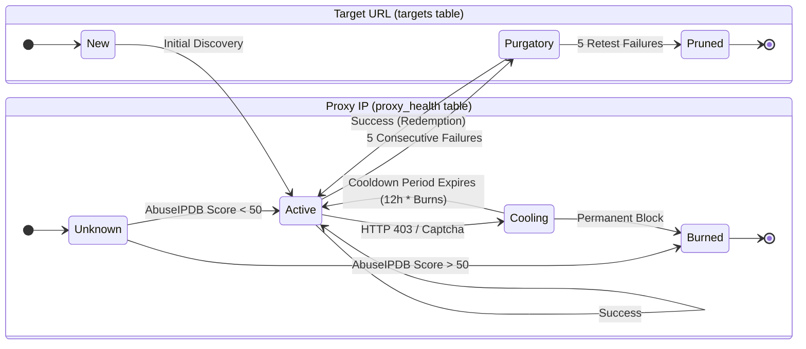
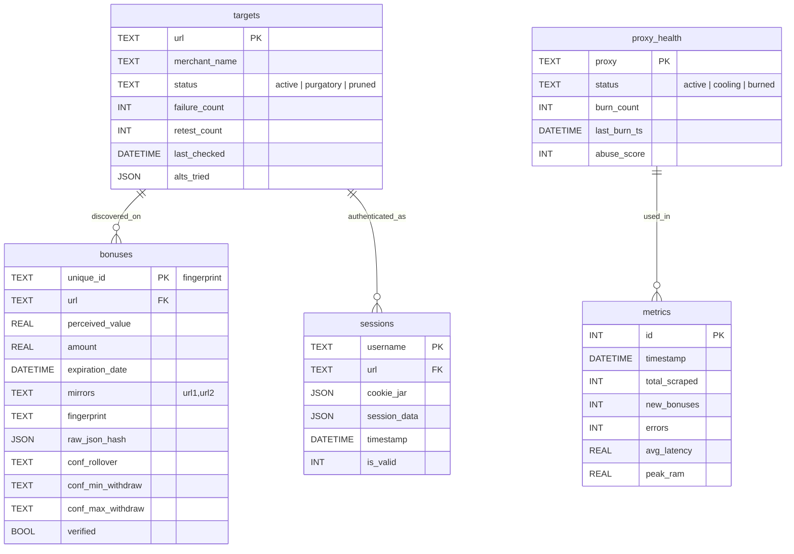
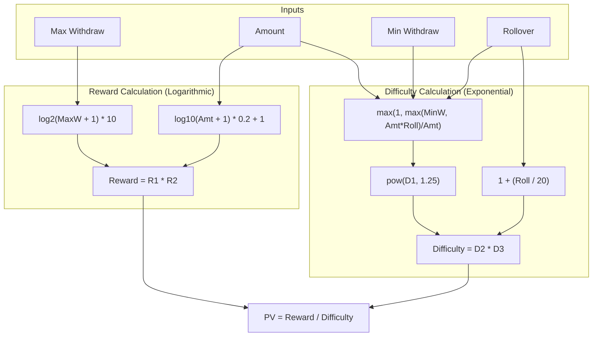
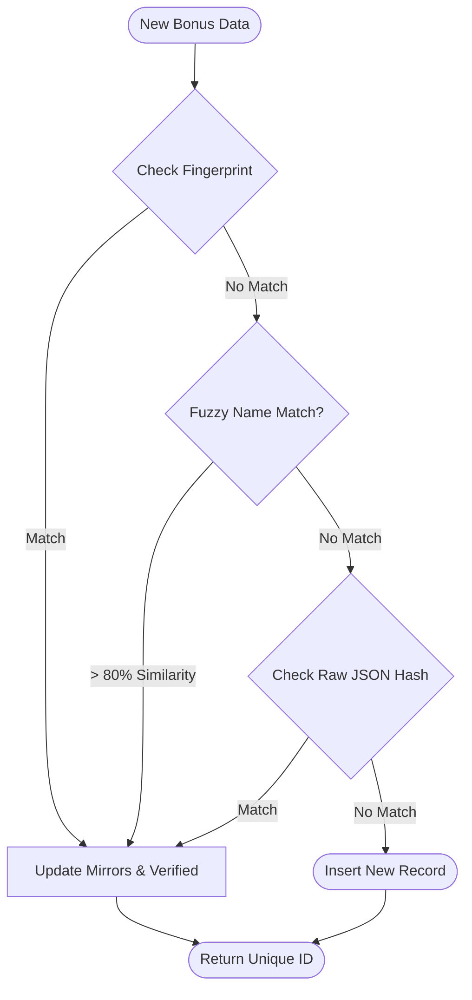
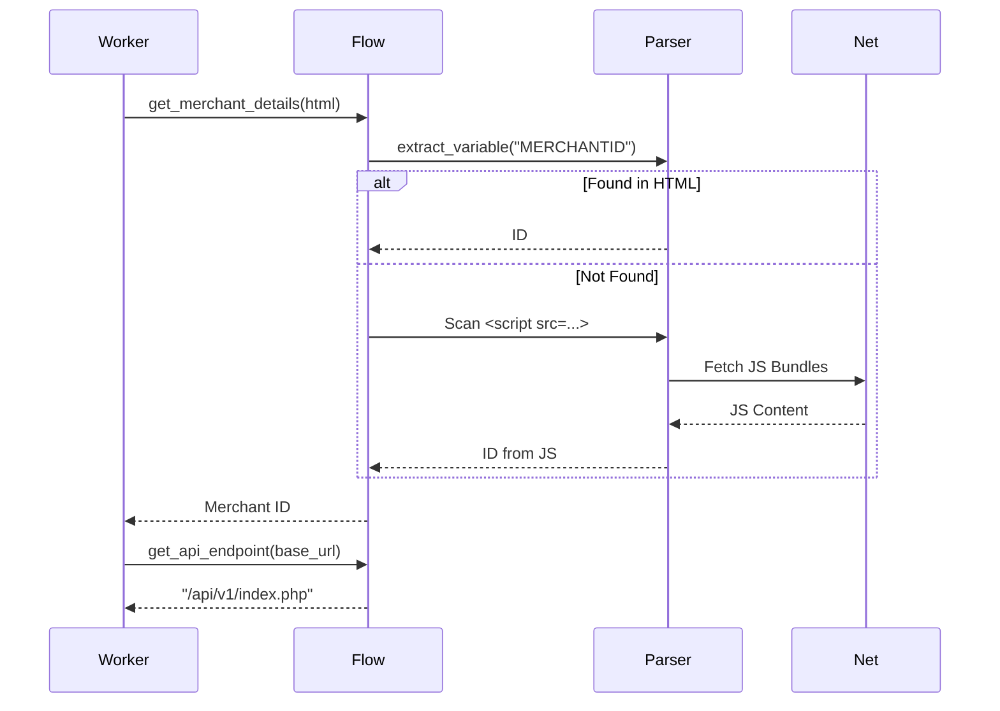

# System Diagrams

This page provides a visual overview of the Bonus Intelligence Engine's architecture, processes, and data structures.

## 🏛️ Core Architecture
The 7-layer model separating foundation, execution, and visualization.



---

## 🔄 Scrape Sequence
The lifecycle of a single scrape task, from proxy acquisition to data persistence.



---

## 🚦 State Lifecycles
How the system manages the health and transitions of targets and proxies.



---

## 🗄️ Database Schema (ERD)
The relational structure of the SQLite persistence layer.



---

## 🧮 PV Algorithm Flow
Visualizing the input variables and mathematical transformations in the Perceived Value scorer.



---

## 🧬 Deduplication Logic
How the system identifies duplicate bonuses across mirror sites.



---

## 🔎 Extraction Ritual
The fallback mechanism for finding Merchant IDs in obscure site structures.



---

## 📡 WebSocket Broadcast
The data flow for real-time dashboard updates.

```mermaid
graph LR
    subgraph "CLI (Producer)"
        TUI[ui.py]
        Updater[update_dashboard()]
    end

    subgraph "Web Server (Hub)"
        Endpoint[POST /update]
        Mgr[ConnectionManager]
        Pool[Active Connections]
    end

    subgraph "Browser (Consumer)"
        Client1[Client A]
        Client2[Client B]
    end

    TUI -->|Snapshot| Updater
    Updater -->|JSON| Endpoint
    Endpoint -->|Broadcast| Mgr
    Mgr -->|Iterate| Pool
    Pool -->|WebSocket Msg| Client1
    Pool -->|WebSocket Msg| Client2
```