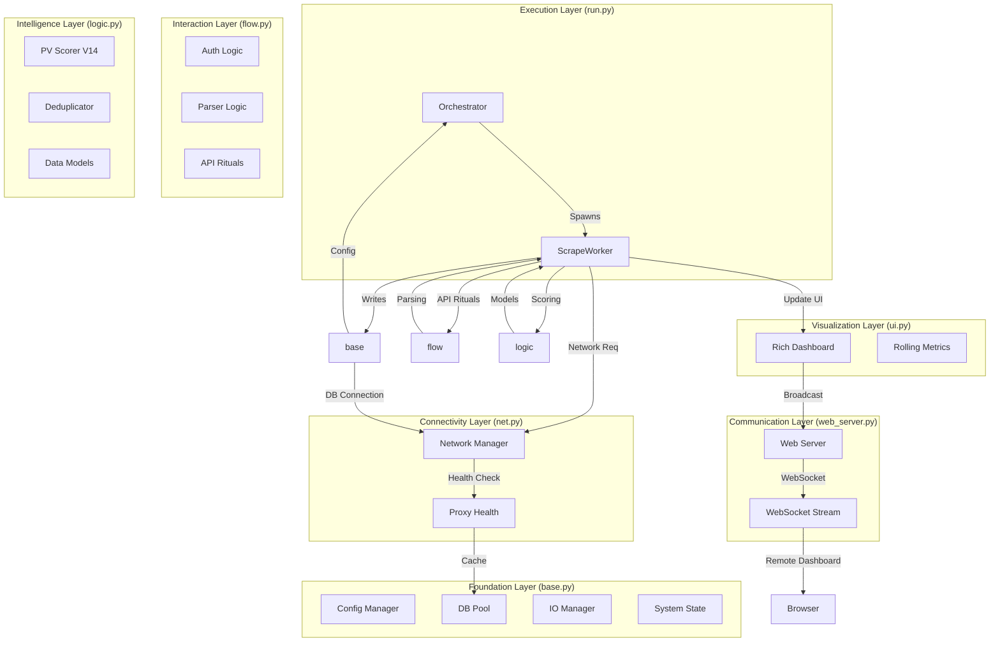

# Bonus Intelligence Engine Hub

Welcome to the central documentation hub. This index provides a high-level view of the entire system.

---

## 🏛️ System at a Glance

### [Foundation Layer (base.py)](source_code/base.md)
*The system's soil. Handles environment, state, and persistence.*
- **Logic:** Config loading, DB connection pooling, Session serialization.
- **Data:** Exports to `db/bonuses.csv`.

### [Execution Layer (run.py)](source_code/run.md)
*The system's heartbeat. Manages concurrency and lifecycles.*
- **Logic:** Orchestrates worker threads, manages I/O queues, handles main event loop.

### [Connectivity Layer (net.py)](source_code/net.md)
*The system's bridge. Handles HTTP traffic and proxy reputation.*
- **Logic:** Dual-stack Sync/Async HTTP, AbuseIPDB integration, Proxy burn logic.

### [Intelligence Layer (logic.py)](source_code/logic.md)
*The system's brain. Defines value and uniqueness.*
- **Logic:** PV Algorithm V14, Fingerprinting, Fuzzy Matching, Data Normalization.

### [Interaction Layer (flow.py)](source_code/flow.md)
*The system's voice. Handles the site-specific "rituals."*
- **Logic:** Authentication payloads, JavaScript variable parsing, SyncData requests.

### [Visualization Layer (ui.py)](source_code/ui.md)
*The system's eyes. Real-time terminal feedback.*
- **Logic:** Rich TUI layout, Rolling health metrics, Streak tracking.

### [Communication Layer (web_server.py)](source_code/web_server.md)
*The system's radio. Remote control and browser telemetry.*
- **Logic:** FastAPI endpoints, WebSocket broadcasting, Remote lifecycle control.

---

## 📖 Essential Guides
- **[Operator Manual](MANUAL.md)**: How to run the engine and manage targets.
- **[Codebase Dictionary](dictionary.md)**: Abbreviations, status codes, and directory roles.
- **[Troubleshooting Runbook](runbook.md)**: Deep dive into E-codes and recovery.
- **[Database Reference](schema_reference.md)**: Tables, columns, and SQL analytics.
- **[Algorithm V14 Whitepaper](algorithm_v14.md)**: The math of Perceived Value.
- **[Improvement Plan](NEXT_PHASE.md)**: Roadmap for future optimizations.

---

## 🛠️ Internal Specs
- **[OpSec Guide](opsec.md)**: How we stay undetected.
- **[API Reference](api_reference.md)**: Backend control and WebSocket protocol.
- **[UI Audit](ui_audit.md)**: Breakdown of every dashboard metric.
- **[Project Stats](stats.md)**: Line counts, evolution, and complexity analysis.

---

## 📡 Live Status
Access the real-time dashboard at: **[http://127.0.0.1:8000](http://127.0.0.1:8000)**