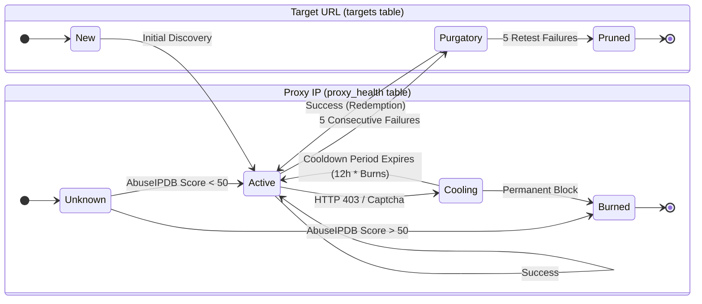

# Troubleshooting & Error Runbook

## 1. Error Codes (E-Codes)
The engine classifies failures using custom codes displayed in the TUI log panel:

- **E101-E104**: Connectivity (Timeout, DNS, Connection Refused). usually transient.
- **E201**: Merchant ID Failure. The scraper loaded the page but couldn't find the `MERCHANTID` variable. Often means the site layout changed.
- **E202**: Captcha / Cloudflare. The request was intercepted by a challenge.
- **E403**: Forbidden. The proxy IP is banned by the target.
- **E500**: Internal Server Error. The target site is down.

## 2. Recovery Procedures

### Understanding State Transitions

### Stalled / Paused Engine
1. Check the Dashboard at `http://127.0.0.1:8000`.
2. Click **Resume** or use the API: `POST /api/control/resume`.
3. If the TUI is unresponsive, use `Ctrl+C` to trigger a graceful shutdown.

### Database Locks (`sqlite3.OperationalError`)
1. Ensure no other processes (like `lab/util/search.py`) are holding a write lock.
2. The engine uses WAL mode by default, so readers should not block writers.
3. Check `err/log/scraper.log` for persistent lock errors.

### High Failure Rates (E403 / E202)
1. **Rotate Proxies:** Check `in/config/proxies.txt` and remove burnt IPs.
2. **Increase Delays:** Edit `in/config/config.ini` to raise `min_delay` (e.g., from 1.0 to 3.0 seconds).
3. **Check User-Agents:** Ensure `in/config/user_agents.txt` has recent strings.

## 3. Logs & Artifacts
- **Application Logs:** `err/log/scraper.log` contains detailed tracebacks.
- **Debug Snapshots:** `err/debug/E201_*.html` contains the raw HTML of failed pages for inspection.
