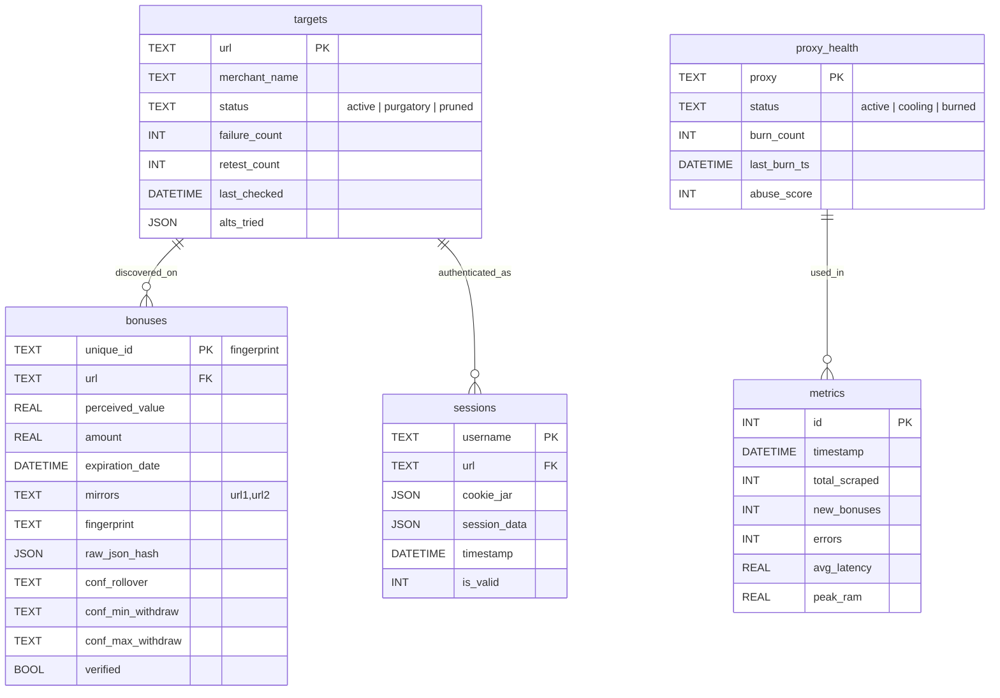

# Database Schema & Analytics Guide

## 1. Entity Relationship Overview
The system uses a flat but relational SQLite structure designed for high-concurrency access (WAL mode).



*   **Database Path:** `db/base.db`
*   **`targets`**: The master list of mirror URLs.
*   **`bonuses`**: Discovery table. Multiple bonuses per target.
*   **`sessions`**: Persistence layer. Stores JSON cookies.
*   **`metrics`**: Historical performance tracking.
*   **`logs`**: Error and system events.

---

## 2. Data Dictionary

### Table: `targets`
| Column | Type | Description |
| :--- | :--- | :--- |
| `url` | TEXT (PK) | Unique site URL. |
| `merchant_name` | TEXT | Human-readable name. |
| `status` | TEXT | 'active', 'purgatory', 'pruned'. |
| `failure_count` | INT | Sequential errors before penalty. |

### Table: `bonuses`
| Column | Type | Description |
| :--- | :--- | :--- |
| `unique_id` | TEXT (PK) | Fingerprint ID. |
| `perceived_value`| REAL | The score() result. |
| `amount` | REAL | Raw gift value. |
| `conf_*` | TEXT | Flattened JSON terms. |

### Table: `sessions`
| Column | Type | Description |
| :--- | :--- | :--- |
| `username` | TEXT | Account identifier. |
| `is_valid` | INT | Binary health flag (1/0). |
| `last_used_at` | DATETIME | Expiry check baseline. |

---

## 3. Analytics Cookbook (SQL)

### Find "Golden" Mirrors
```sql
SELECT url, COUNT(*) as bonus_count, AVG(perceived_value) as avg_pv
FROM bonuses
GROUP BY url
HAVING bonus_count > 2
ORDER BY avg_pv DESC;
```

### Rollover Heatmap
```sql
SELECT merchant_name, AVG(CAST(conf_rollover AS FLOAT)) as avg_rollover
FROM bonuses
WHERE conf_rollover IS NOT NULL
GROUP BY merchant_name
ORDER BY avg_rollover DESC;
```
