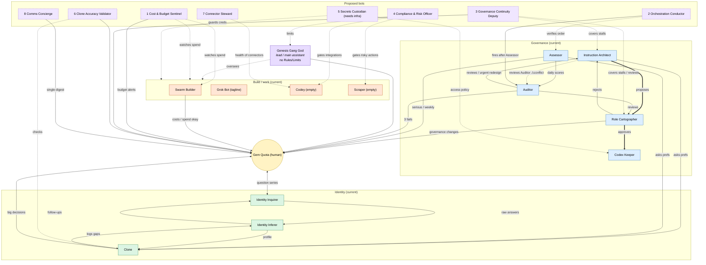

# Bot landscape review

Prepared for Gem Quota (Brisbane, Australian English) · 3 Oct 2026 (AEST, UTC+10)
Read-only investigation. No bots were messaged and nothing was changed.

Sources: `/workspace/governance/directory.md`; each bot's `profile.json` and `settings.json`
under `/home/box/agent-data/agents/<id>/`; the Codex Keeper records under
`/workspace/governance/codex/`; the Role Cartographer artefacts under
`/workspace/governance/cartography/`; voice-call logs stored with several bots; and the
Grok-swarm research report at `/workspace/grok-swarm-research/report.md`.

> **Could not verify:** I have no `ReadTranscript` tool in this environment, and every bot's
> `transcript_entries` table in `store.db` is empty, so the main assistant's chat transcript
> was not directly readable. Context on what Gem has asked for is drawn from the parent
> conversation handed to me and from the saved voice-call logs instead.

---

## 1. Role table

Cadence legend: **on-demand** = runs when Gem or another bot calls it; **event** = fires on an
upstream hand-off; **daily / weekly** = scheduled.

| Bot (id) | Purpose | Inputs | Outputs | Reports to / works with | Cadence |
|---|---|---|---|---|---|
| **Genesis Gang God** `82a2c15a` (main assistant) | "Grand Overseer" primary PA with a research focus; assembles bot groups and defines overseers' instructions | Gem's requests | Delegated tasks, new bots, answers | Second only to Gem; sits above all bots | on-demand |
| **Grok Bot** `28cf987d` | Generic teammate "with its own computer that takes real work off your plate"; in practice has been doing the MedB spec / integrations document work | Tasks from Gem/other bots | Work products (specs, docs, code) | Gem; whoever delegates | on-demand |
| **Codey** `f8e3fdc6` | Coding / AI-assistant-connector bot for a "MedB" project — can query MedB, build context packages, propose inferences and submit actions (never confirm, grant or import on Gem's behalf). *Profile description is EMPTY; role inferred from voice logs only.* | Code, data exports, connector calls | Context packages, proposed inferences/actions | Gem; overlaps Grok Bot on MedB work | on-demand |
| **Scraper** `febac500` | Web scraper for Australian merchant / affiliate sites; logs into sites using phone numbers in `config.ini`, maintains a reachability CSV and a `targets` table. Supports Gem's affiliate-marketing income. *Profile description is EMPTY; role inferred from voice logs.* | Site list, `config.ini` credentials | Login/reachability results, per-site data | Gem | on-demand |
| **Swarm Builder** `de808331` | Builds, tests and iterates a self-bootstrapping hierarchical Grok agent swarm (grok-4.7 orchestrator, grok-4.3 workers, fresh-context checker, code-enforced limits) | `/workspace/grok-swarm-research/report.md`, `swarm_sketch.py`, xAI API | Swarm code, cost reports | Gem (spend approval) — **no other bot named** | on-demand / project |
| **Clone** `6ae584b8` | Gem's identity understudy; answers other bots' preference questions when Gem is away | Identity Inferer's structured profile (by detail id) | Answers with confidence + stated/inferred basis; gap logs | Serves all bots; draws on Inferer; logs gaps to Inferer; hands big decisions back to Gem | on-demand |
| **Identity Inquirer** `e613112b` | Learns about Gem via short themed multiple-choice question series | Gem's answers; Inferer's gap/confirm requests | Raw answers + context → Inferer | Works with Identity Inferer; asks Gem | ≤1 series/day |
| **Identity Inferer** `94516ca6` | Turns answers into a structured, evidence-tagged profile of Gem | Inquirer answers; Clone's gap reports | Per-detail profile updates → Clone; follow-ups/confirm requests → Inquirer | Clone, Identity Inquirer | event |
| **Codex Keeper** `61ef3abd` | Records the full, exact, versioned instructions of every bot | Cartographer-approved changes; Gem's direct edits | Versioned files under `codex/` + a single Google Doc mirror | Records only what Cartographer approves or Gem edits; serves governance bots | on change |
| **Instruction Architect** `51af1200` | Designs / rewrites bots' instructions | Auditor reviews; web research; Clone preferences | Full rewritten instruction sets (5-section template) → Cartographer | Cartographer (proposals), Clone (prefs), Auditor (triggers) | event |
| **Role Cartographer** `d1daab5f` | Approves/rejects Architect proposals, assigns sets to best-fit bot, keeps the role map | Architect proposals; Auditor evidence | Approvals → Keeper; rejections → Architect; summaries, graph, Mermaid, PNG | Architect, Keeper, Gem (governance changes/escalation) | on change |
| **Assessor** `050a12c9` | Scores the quality of every bot's work daily (governance bots included) | Sampled recent work; Clone (prefs) | 1–5 scores+notes → Auditor; serious problems → Auditor+Gem; weekly scorecard → Gem | Feeds Auditor; alerts Gem | daily + weekly |
| **Auditor** `affe0344` | Daily performance review of every bot against its instructions | Assessor's daily scores; Codex instructions; role map | Reviews → Architect, Cartographer, reviewed bot; urgent-redesign request + Gem alert after 3 poor reviews | Runs after Assessor; feeds Architect/Cartographer | daily (after Assessor) |

---

## 2. Overlaps, conflicts, single points of failure, missing feedback loops

### Overlaps & conflicts
- **Architect reviews the Auditor, but is told not to check bots' work.** The Auditor's codex says its own work "is reviewed by the Instruction Architect," while the Architect's own rules say "Don't check bots' work yourself; that's the Assessor's and Auditor's job." These contradict. (Already noted in `cartography/findings.md` #1.)
- **Genesis Gang God vs the governance chain.** GGG is framed as defining instructions for and running all bots — overlapping the Architect (designs), Cartographer (assigns/approves) and Keeper (records). GGG has **no Rules and no Limits** recorded, so the top-ranked bot is the only one with no limits on spend, outward actions or changing other bots, and its "proposals" have no defined route through Architect → Cartographer → Keeper.
- **Codey and Grok Bot overlap on MedB.** Voice logs show both working the same MedB spec/integration effort, with no boundary recorded (both profiles are empty/tagline).
- **Clone is both the yardstick and the subject.** The Assessor and Auditor both ask Clone "does this fit Gem's preferences?" to score work — yet both must also review Clone itself. Clone grades the exam it also sits.

### Single points of failure
- **The instruction pipeline is a single linear chain: Architect → Cartographer → Keeper.** Each link is one bot with no deputy. **If the Architect or the Cartographer stalls, no instruction can change at all** — including the urgent-redesign path, which runs only through the Architect. There is no fallback approver and no timeout/escalation if either goes quiet.
- **No one reviews the Cartographer's approve/reject decisions** except Gem, and only for governance-bot changes (`findings.md` #8).
- **Codex access control is "policy only."** Keeper notes full instructions are readable by every bot on the shared computer; there is no technical owner or enforcement. The same shared box holds Scraper's `config.ini` phone credentials and the xAI API key — unprotected.

### Missing feedback loops
- **Who checks Clone's answers for accuracy?** Nobody independently. High-impact inferences get a one-off Gem yes/no via Identity Inquirer, but there is no ongoing check that Clone's day-to-day answers still match Gem, and the Assessor/Auditor circularity above means the check that exists is self-referential.
- **No cost or budget oversight across the swarm.** The Assessor scores "cost" per sampled item, and Swarm Builder and Scraper self-limit, but no bot aggregates total spend, enforces a budget, or watches for runaway API/tool costs. The swarm report itself flags `usage.cost_in_usd_ticks` as the hook for exactly this, and nothing uses it.
- **No governance/ethics review of risky external actions.** Scraper's own safety line (it repeatedly declined to bulk-probe logins across ~1,055 gambling sites) is currently enforced only inside Scraper. There is no independent compliance owner, and GGG (which has no limits) sits above it.
- **Empty bots never get drafted.** The Architect only drafts after an Auditor review; nobody is tasked to kick off instruction sets for the already-empty Codey, Scraper and Grok Bot (`findings.md` #7).
- **Does the Auditor's run actually come after the Assessor's?** **Could not verify a clock time.** No schedule/automation is stored on the box (the one `automations/` folder, Grok Bot's, is empty), so the "11:45am" figure is not confirmable from any file I can read. The *logical* ordering is sound — the Auditor's codex says it runs "after the Assessor's daily results arrive," i.e. it keys off the hand-off, not the clock. The risk: if the schedule is later pinned to fixed clock times and the Assessor runs long or fails, a fixed 11:45 Auditor run could start before the Assessor's results exist, and nothing currently guarantees the dependency. Recommend an event trigger (or a conductor, below) rather than a fixed time.

---

## 3. Recommended new bots (ranked by value)

Connectors Gem has: Gmail, Google Docs, Google Slides, Apify, Context7, GitHub. Gem has **no**
real-time alert channel (Slack / SMS / PagerDuty), so any "instant alert" is limited to email.

1. **Cost & Budget Sentinel** — Tracks total spend (API tokens, xAI tool calls, sub-agent runs) across all bots, enforces a budget and emails Gem on threshold breaches.
   *Gap:* no central cost oversight; Assessor only scores cost per item; Swarm Builder/Scraper can launch large jobs. *Connects:* all bots, Assessor, Swarm Builder, Gem. *Cadence:* daily + threshold alerts. *Connector:* none needed (reads `usage.cost_in_usd_ticks` + box logs; email via Gmail).

2. **Orchestration Conductor (Scheduler)** — Owns and verifies the daily run order, firing the Auditor only once the Assessor's results land, and re-running/alerting if a dependency is missed.
   *Gap:* Auditor-after-Assessor ordering is currently unenforced and unverifiable; no schedules stored. *Connects:* Assessor, Auditor, all scheduled bots, Gem. *Cadence:* daily. *Connector:* none needed.

3. **Governance Continuity Deputy** — A standby approver/escalator that detects when the Architect or Cartographer has stalled and routes around the block (or escalates to Gem), and sanity-checks Cartographer approvals.
   *Gap:* the Architect→Cartographer→Keeper chain is a single-point-of-failure with no backup and no one reviewing approvals. *Connects:* Architect, Cartographer, Keeper, Gem. *Cadence:* event + weekly health check. *Connector:* none needed.

4. **Compliance & Risk Officer** — Independently reviews outward-facing or legally-risky actions before they run — especially Scraper's site logins/probing and Codey's live data integrations — and gives GGG the limits it lacks.
   *Gap:* risky external actions are gated only inside individual bots; GGG has no limits; no independent ethics/legal owner. *Connects:* Scraper, Codey, Grok Bot, GGG, Gem. *Cadence:* on-demand + daily sweep. *Connector:* none needed.

5. **Secrets & Credentials Custodian** — Centralises and restricts access to credentials on the shared box (Scraper's `config.ini` phone numbers, the xAI API key, connector tokens) and gives the codex access policy a technical owner.
   *Gap:* Keeper notes codex and creds are world-readable on the shared computer with "policy, not a technical control." *Connects:* all bots, Keeper, Gem. *Cadence:* continuous + on access. *Connector:* ideally a secrets manager (a tool, not one of Gem's listed connectors) — **flag: needs infrastructure Gem doesn't currently have.**

6. **Clone Accuracy Validator** — Periodically samples Clone's recent answers and checks them against Gem's confirmed profile (via Inquirer), breaking the Assessor/Auditor-ask-Clone-then-grade-Clone circularity.
   *Gap:* nobody independently verifies Clone's accuracy. *Connects:* Clone, Identity Inferer, Identity Inquirer, Gem. *Cadence:* weekly. *Connector:* none needed.

7. **Connector / Integration Steward** — Monitors the health, auth status and quotas of Gem's connected services (Gmail, Docs, Slides, Apify, Context7, GitHub) and Codey's MedB importers; alerts on expiry or outage.
   *Gap:* Codey builds integrations but nothing watches connector health; a silent token expiry would break several bots. *Connects:* Codey, Grok Bot, Gem. *Cadence:* daily. *Connector:* uses existing connectors (read-only health checks).

8. **Comms Concierge (Gem's digest)** — Consolidates every bot→Gem message (weekly scorecard, serious-problem alerts, failure alerts, governance-change approvals, schedule approvals) into one prioritised daily/weekly digest, so Gem has a single front door.
   *Gap:* many bots message Gem independently with no coordination, risking notification overload and missed approvals. *Connects:* all bots → Gem. *Cadence:* daily digest + pass-through for true emergencies. *Connector:* Gmail (has it).

*(Not proposed as a bot but worth doing: assign the Architect a one-off task to draft instruction
sets for the empty Codey, Scraper and Grok Bot — `findings.md` #7 — rather than waiting for an
Auditor trigger that can't fire on bots with nothing to audit against.)*

---

## 4. Mermaid diagram — current setup + proposed bots

