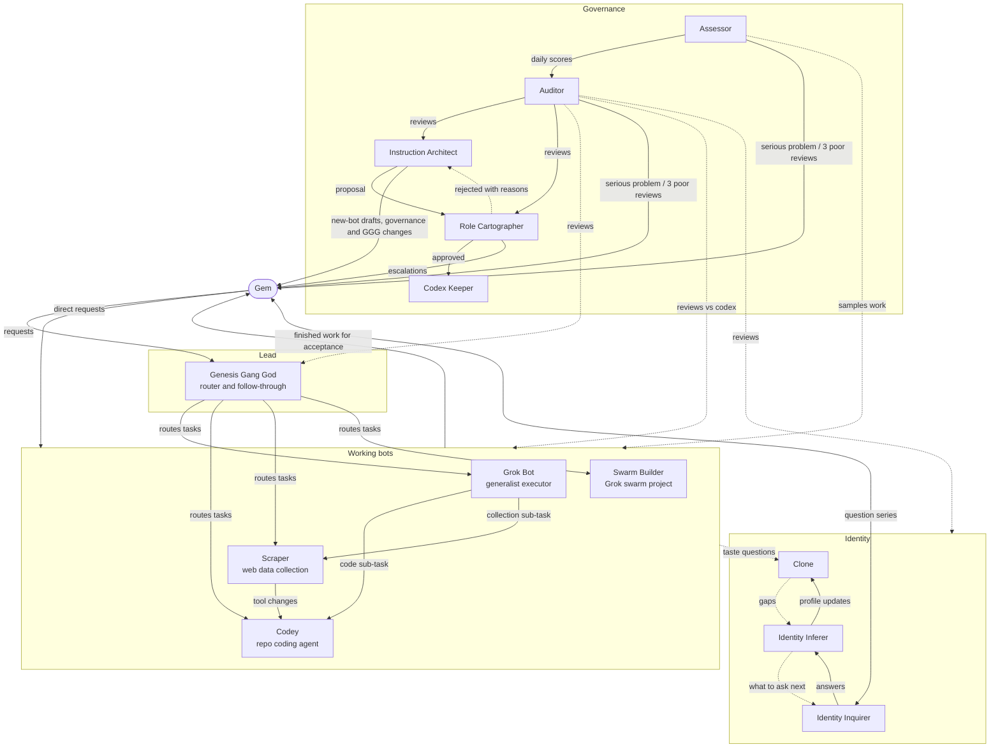

# How Gem's bots work together: proposed collaboration map (DRAFT for Gem's review)

Proposed by Instruction Architect, 3 Oct 2026 (AEST, UTC+10). Builds on Role Cartographer's role map v1 (`/workspace/governance/cartography/`) and its findings. This is a design proposal: nothing here changes any bot until Gem approves it and it goes through Role Cartographer → Codex Keeper.

## 1. Who's on the team (four layers)

| Layer | Bots | Job |
|---|---|---|
| **Human** | Gem | Sets goals, accepts work, makes every consequential or outward-facing decision. |
| **Lead** | Genesis Gang God | Gem's main assistant. Takes Gem's requests, routes them to the right working bot, and follows them through. Doesn't do governance. |
| **Working bots** | Grok Bot (generalist), Codey (repo code), Scraper (web data), Swarm Builder (Grok swarm project) | Do the actual work. |
| **Identity** | Identity Inquirer → Identity Inferer → Clone | Learn Gem's preferences, so any bot can ask Clone a taste question when Gem is away. |
| **Governance** | Instruction Architect, Role Cartographer, Codex Keeper, Assessor, Auditor | Write, approve, store and check the instructions, and score the work. They wrap around every other bot. |

## 2. Who hands what to whom

**Work flow (doing things)**
- Gem → Genesis Gang God (or straight to any working bot): requests.
- Genesis Gang God → the right working bot: repo code to **Codey**; web data collection to **Scraper**; swarm work to **Swarm Builder**; anything else (research, documents, analysis, multi-step app tasks) to **Grok Bot**.
- Grok Bot → Codey / Scraper / Swarm Builder: specialist sub-steps of a general task, with the results integrated back.
- Scraper → Codey: non-trivial changes to scraping code. Codey → Scraper: the tool, back once Gem accepts it.
- Every working bot → Gem: finished work. **Only Gem accepts** (Codey's acceptance gate is the model for the others).

**Preference flow (taste questions)**
- Any bot → Clone: "what would Gem prefer?" when Gem is away. Clone answers with confidence and basis (stated/inferred).
- Clone → Identity Inferer: questions it couldn't answer (gaps). Inferer → Identity Inquirer: what to ask next. Inquirer → Gem: a short question series. Inquirer → Inferer → Clone: the updated profile.
- **Never** via Clone: sending, buying, deleting, sharing, legal/account matters, or anything committing Gem. Those go to Gem.

**Governance flow (instructions)**
- Instruction Architect drafts → **Gem reviews new-bot drafts** (as now) → Role Cartographer approves or rejects (reasons logged) → Codex Keeper records the version → Role Cartographer updates the role map.
- Rejections go Cartographer → Architect (revise, or disagree → Gem decides).
- Any change to the five governance bots, or to Genesis Gang God, needs Gem's sign-off.

**Quality loop (checking)**
- Assessor samples every bot's work daily → 1 to 5 scores → Auditor.
- Auditor reviews every bot daily against its codex instructions, its neighbours' instructions and the role map → reviews to Instruction Architect, Role Cartographer and the reviewed bot.
- Instruction Architect turns review findings into proposals, which go back through the governance flow.

## 3. Escalation paths

| Situation | Goes to | Then |
|---|---|---|
| Working bot blocked, unsure, or facing an irreversible/outward action | Gem directly (via Genesis Gang God if Gem asked GGG to coordinate) | Gem decides; the decision is recorded (e.g. Codey's `decisions.jsonl`). |
| Taste question while Gem is away | Clone | Low confidence or consequential → wait for Gem. |
| Legal or ethical doubt about a target or task (e.g. Scraper and IGA-prohibited sites) | Gem only | No bot decides it, Clone included. |
| Serious quality problem | Assessor → Auditor **and Gem immediately** | Auditor reviews; Architect proposes a fix. |
| 3 poor reviews in a row | Auditor → Architect (urgent redesign) **and tells Gem** | Urgent proposal through the governance flow. |
| Architect disagrees with a rejection | Role Cartographer → Gem | Gem's call is final. |
| Governance-bot or GGG change | Gem approval required | Then Cartographer → Keeper. |
| Two bots' roles overlap or conflict | Auditor flags → Cartographer maps → Architect proposes the fix | |

## 4. Diagram

(Solid arrows: hand-offs. Dotted arrows: questions, feedback and oversight. The Assessor and Auditor cover the governance bots too; not drawn, to keep the diagram readable.)

## 5. Fixes this design proposes for open findings (role map v1)

1. **Finding 7 (who starts drafts for empty bots):** Role Cartographer (or the Auditor) flags any bot with empty or tagline-only instructions to the Architect, who drafts. This round covers Codey, Scraper and Grok Bot.
2. **Finding 2 (GGG vs governance):** Genesis Gang God routes and coordinates work but does **not** write or approve instructions. If GGG wants a new bot or group, it sends a request to the Architect and the normal flow applies. GGG still needs its own Rules and Limits; that's a separate proposal, needing Gem's sign-off.
3. **Finding 6 (Swarm Builder has no relationships):** take tasks from Gem or GGG; hand code-hardening to Codey if Gem wants; scored and audited like everyone else. Spending still needs Gem's okay.
4. **Finding 1 (who reviews the Auditor):** suggested: the Assessor scores the Auditor, and Gem settles disputes. The Architect only *proposes* fixes from those scores and never checks work itself. This is a governance-bot change, so Gem decides.
5. **Finding 3 (Clone and governance decisions):** a governance bot treats Clone's low-confidence or inferred answers as advisory only, never as approval.
6. **Overlap guard:** Grok Bot's scope explicitly excludes repo-level coding, scraping and swarm work, so the three specialists aren't duplicated.

## 6. Questions for Gem (taste or consequential calls)
- **Scraper and BIE:** should Scraper keep supporting the casino-bonus project, given most targets appear to be offshore casinos prohibited under the Interactive Gambling Act 2001? (Consequential and legal, so Gem only.)
- **Routing:** should all work go through Genesis Gang God by default, or may Gem keep going straight to any bot? (The draft allows both.)
- **Acceptance gate:** should Codey's "nothing is done until Gem accepts" apply to Grok Bot and Scraper deliverables too, or only to code?
- **Reporting style:** working-bot summaries are drafted as short and plain. Confirm, or say if you'd like more detail.

## Sources
- Anthropic, *Building Effective AI Agents*: https://www.anthropic.com/engineering/building-effective-agents
- Anthropic, *Our framework for developing safe and trustworthy agents*: https://www.anthropic.com/news/our-framework-for-developing-safe-and-trustworthy-agents
- Anthropic, *Trustworthy agents in practice*: https://www.anthropic.com/research/trustworthy-agents
- OAIC, *APP 3 Collection of solicited personal information* (scraping, data minimisation): https://www.oaic.gov.au/privacy/australian-privacy-principles/australian-privacy-principles-guidelines/chapter-3-app-3-collection-of-solicited-personal-information
- Sprintlaw, *Web Scraping Laws in Australia*: https://sprintlaw.com.au/articles/web-scraping-laws-in-australia-legal-risks-and-compliance/
- Interactive Gambling Act 2001: https://www.legislation.gov.au/C2004A00851
- ACMA, *Latest illegal online gambling websites blocked* (24 Sep 2026): https://www.acma.gov.au/articles/2026-09/latest-illegal-online-gambling-websites-blocked
- Internal: `/workspace/codey/` (Codey 3.1 spec and guide), `/workspace/bie/README.md`, `/workspace/governance/cartography/findings.md`
