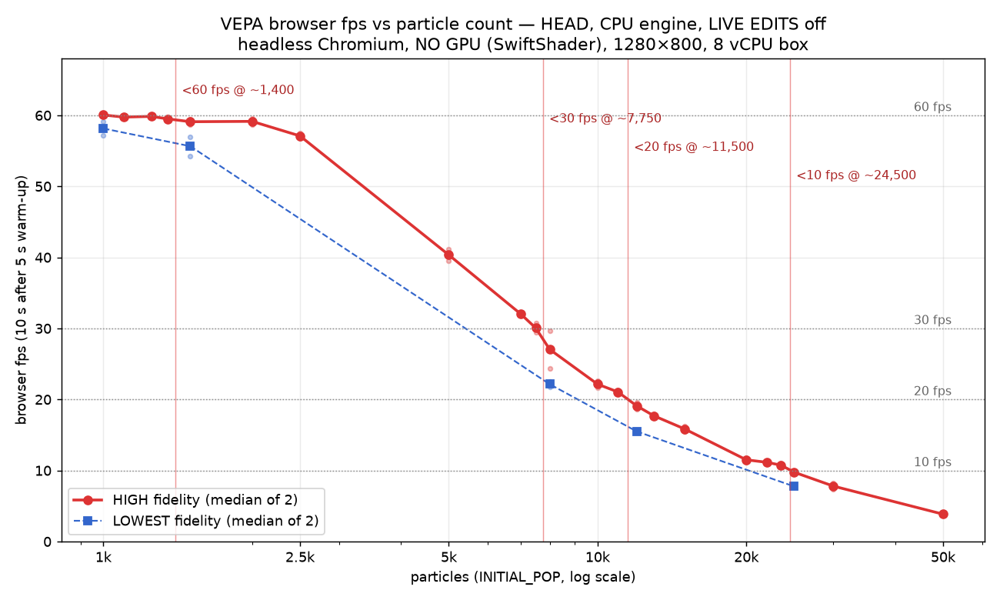

# Browser fps thresholds vs particle count (Task A, 16 Oct 2026)

**Result (HIGH fidelity, the default):**

| Threshold | Particles | Bracket (median fps) | Sim ticks/s there |
|---|---|---|---|
| below **60 fps** | **≈ 1,400** | 1,350 → 59.5 · 1,500 → 59.1 | ≈ 6 |
| below **30 fps** | **≈ 7,750** | 7,500 → 30.1 · 8,000 → 27.1 | ≈ 1.6 |
| below **20 fps** | **≈ 11,500** | 11,000 → 21.1 · 12,000 → 19.1 | ≈ 1.1–1.25 |
| below **10 fps** | **≈ 24,500** | 23,500 → 10.8 · 25,000 → 9.8 | ≈ 0.55–0.7 |

Each bracket is within about 10% (1,350–1,500 is 11%, 7,500–8,000 is 7%, 11,000–12,000 is 9% and 23,500–25,000 is 6%).
The 60 fps knee is soft. From 1,500 to 2,000 particles fps stays at about 59.1–59.2, then falls to 57.1 at 2,500 and 40 at 5,000.

**LOWEST fidelity:** fidelity does affect fps. LOWEST steps the sim 3–4× faster, but it renders 15–20% fewer frames at the same particle count, so every threshold comes earlier:

| Particles | HIGH fps | LOWEST fps | HIGH ticks/s | LOWEST ticks/s |
|---|---|---|---|---|
| 1,000 | 60.1 | 58.2 | 8.6 | 29.8 |
| 1,500 | 59.1 | 55.7 | 6.1 | 24.5 |
| 8,000 | 27.1 | 22.2 | 1.6 | 6.9 |
| 12,000 | 19.1 | 15.5 | 1.05 | 4.4 |
| 25,000 | 9.75 | 7.75 | 0.69 | 1.8 |

This is likely because the main thread handles each completed worker tick (population, intelligence and HUD in `finishPhysicsTick`). More ticks per second leaves less frame budget. LOWEST also breeds more: a 1,000 start reaches about 1,660 particles within the 15 s window, against about 1,150 at HIGH.



## Method

This is the same harness as the 10 Oct `fidelity-bench/browser-raw.csv` (`/workspace/perf/curves/browser.mjs`):

- **Browser:** headless Chromium (Playwright) with `--enable-unsafe-swiftshader`, so there is **NO GPU**: WebGL runs on SwiftShader, a software rasteriser on the CPU. The box has 8 vCPUs. Viewport 1280×800.
- **Build:** a production build of HEAD 60b81a5 (D-043), at `/workspace/perf/build-head`. It was served with COOP/COEP (cross-origin isolated, so the SharedArrayBuffer worker path is active) by `/workspace/perf/serve-coi.py 4190`.
- **Settings:** the launch modal is accepted with default settings: TIDAL BLOOM preset, **HIGH** fidelity, **LIVE EDITS off**. Then `computeEngine = cpu`, `INITIAL_POP = N` and `sim:restart` are sent through the app bus.
- **Population cap (one change from 10 Oct):** the current default preset caps `MAX_POP` at 6,000. The first coarse run at 7,500 therefore plateaued at 6,000, and that row was discarded. For every size ≥ 7,500, `MAX_POP` and `PARTICLE_COUNT` were raised to N before the restart. The `particles_seen` column confirms each run reached N. Below 6,000 the cap is untouched.
- **Measurement:**
  - **fps** is rAF callbacks per second over **10 s**, taken after a **5 s warm-up**. Frame p50/p95 are rAF intervals.
  - **Ticks/s** counts `physics:tick` bus events per second, i.e. completed worker solve round trips. This is the same definition as the 10 Oct `sim_ticks_per_s`.
  - Each size is a fresh page. The result is the **median of 2** runs.
- **Thresholds:**
  - Headless rAF is capped at exactly 60.0, so "below 60" means median < 59.5.
  - "Below 30, 20 and 10" mean a median strictly below that value.
  - Each threshold number is the midpoint of its bracket.
- **Sweep:**
  - Coarse sizes: 1k, 2.5k, 5k, 7.5k, 10k, 15k, 20k, 30k, 50k.
  - Bisection points: 1.1k, 1.25k, 1.35k, 1.5k, 2k, 7k, 8k, 11k, 12k, 13k, 22k, 23.5k, 25k.
  - LOWEST was run at 1k, 1.5k, 8k, 12k and 25k. LOWEST used `fidelityPreset('LOWEST')` speed keys, sent as `world:paramChanged`.
- **Timing:** measured 16 Oct 2026, 3:22–3:46 PM AEST. Nothing else heavy ran during the runs.

**Compared with 10 Oct (same method):**

| Particles | 10 Oct HIGH fps | Now (HEAD) |
|---|---|---|
| 2,500 | 60.0 | 57.1 |
| 10,000 | 25.3 | 22.2 |
| 50,000 | 5.7 | 3.85 |

HEAD is about 5–30% slower in the browser. These are noisy single-box numbers, but the direction is consistent across all three sizes.

## Files

- `SUMMARY.txt`: the four numbers.
- `fps-raw.csv`: every run (level, size, rep, particles_seen, fps, frame p50/p95, sim ticks/s, engine, respawn ms).
- `fps-median.csv`: medians per level and size.
- `fps-vs-particles.png`: the chart.
- `fps.mjs` and `chart.py`: the harness and chart script (copies of `/workspace/perf/fps/`).

To rerun:

```
python3 /workspace/perf/serve-coi.py 4190 /workspace/perf/build-head &
node fps.mjs HIGH 1000,2500,5000 2 out.csv
```

Run `fps.mjs` with the repo's Node 22 and Playwright.
