# Multi-Agent / Agent Swarm Structures Catalog

_Generated 2026-10-02 - 101 structures in 15 categories._

> key_sources were verified to exist (arXiv API title lookup, Crossref DOI lookup, or HTTP 200 check) on generation date. Descriptive fields (strengths, weaknesses, fit ratings, etc.) are editorial synthesis informed by the sources, not quotations. research_fit and scraping_fit are 1-5 editorial ratings for LLM research and web-scraping swarms; complexity_rating is 1 (simple) to 5 (complex).

## Categories

- **Centralized orchestration** (12)
- **Classical MAS architectures & organizations** (6)
- **Classical swarm intelligence** (6)
- **Conversational teams & role-play** (8)
- **Critique & refinement loops** (5)
- **Debate & deliberation** (6)
- **Decentralized & peer-to-peer** (8)
- **Evolutionary & self-optimizing** (12)
- **Market & negotiation** (4)
- **Parallel & ensemble** (4)
- **Pipeline & workflow** (9)
- **Research & web-scraping reference systems** (10)
- **Routing & handoff** (3)
- **Search-based reasoning** (3)
- **Shared-state & stigmergic coordination** (5)


<!-- META_MAP_START -->
## Meta map

All 101 structures positioned in a common design space so similar structures sit near each other. Interactive version: the **Meta map** tab in `swarm_structures.html`. Coordinates: `meta_map.json`, the `meta_x/meta_y` (semantic) and `meta_axes_x/meta_axes_y` (axes) fields in `swarm_structures.json`, and the `meta_map*` tables in `swarm_structures.sqlite`.

### 1. Design-space axes (interpretable)

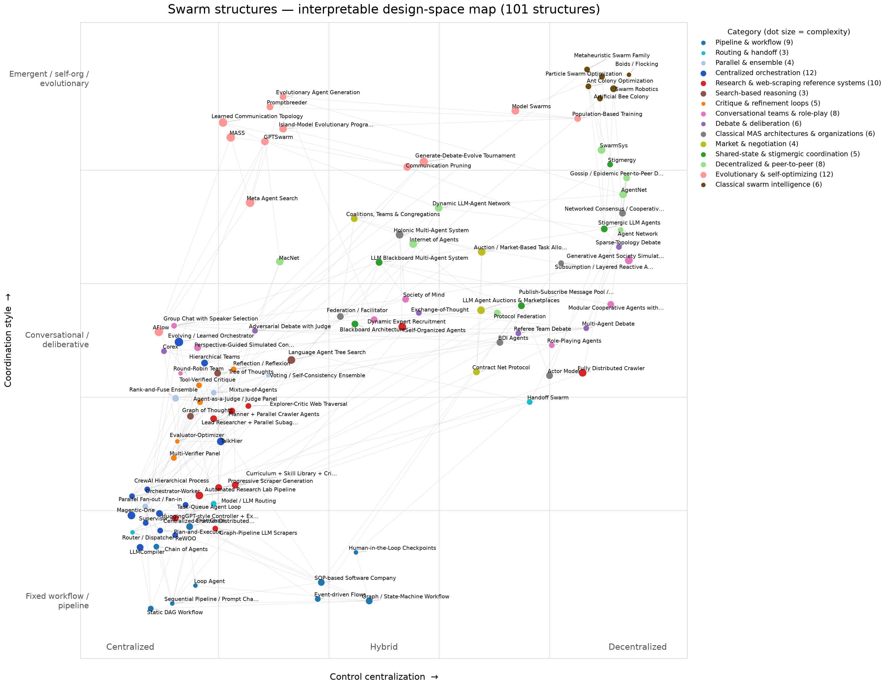

- **X: Control: centralized → decentralized.** 0.7 × rule score parsed from control_flow (centralized≈0.08, hierarchical≈0.28, hybrid≈0.5, decentralized≈0.92, averaged over matched terms) + 0.3 × rank-normalised embedding projection onto the anchor axis 'single central orchestrator' → 'autonomous peers, no controller'.
- **Y: Coordination: fixed workflow → conversational/deliberative → emergent/evolutionary.** 0.55 × category prior (e.g. Pipeline 0.05, Conversational 0.55, Evolutionary 0.9, Classical swarm 0.95) + 0.45 × rank-normalised soft-assignment of the structure's embedding to three anchor descriptions (fixed workflow=0, conversational=0.5, emergent/evolutionary=1).
- Dot size = complexity_rating; colour = category.

Occupancy of the design space (rows top→bottom = emergent → fixed workflow; columns left→right = centralized → decentralized):

| coordination \ control | centralized | mostly centr. | hybrid | mostly decentr. | decentralized |
|---|---|---|---|---|---|
| emergent/evolutionary | 0 | 6 | 2 | 1 | 9 |
| adaptive/market-like | 0 | 2 | 5 | 1 | 8 |
| conversational/deliberative | 10 | 5 | 6 | 6 | 5 |
| structured/adaptive | 11 | 4 | 0 | 1 | 0 |
| fixed workflow | 15 | 2 | 2 | 0 | 0 |

### 2. Semantic embedding map

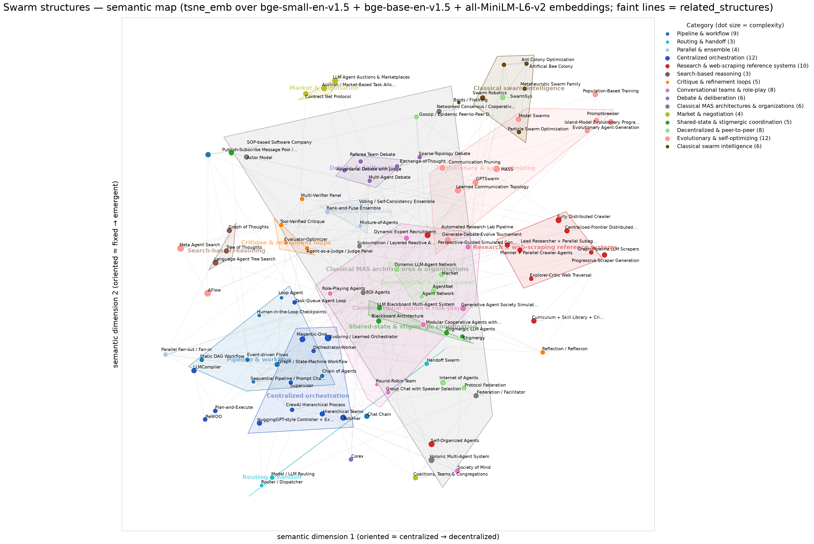

Layout `tsne_emb` (chosen over `umap_emb`, `pca_emb`, `umap_tfidf`, `tsne_tfidf` by trustworthiness + category purity) of bge-small-en-v1.5 + bge-base-en-v1.5 + all-MiniLM-L6-v2 embeddings of each entry's description, topology, control flow, communication, coordination, memory, roles and characteristics. The category label is **not** in the text, so category regions show how well the hand-made categories agree with how the structures are actually described. Faint lines = `related_structures` links.

| layout | trustworthiness (k=7) | category 5-NN purity |
|---|---|---|
| umap_emb | 0.849 | 0.358 |
| tsne_emb | 0.843 | 0.386 |
| pca_emb | 0.73 | 0.162 |
| umap_tfidf | 0.72 | 0.226 |
| tsne_tfidf | 0.737 | 0.255 |
| axes | 0.685 | 0.319 |

Most similar cross-category pairs that are *not* linked in `related_structures`:

- GPTSwarm (agents as optimizable graphs) ↔ Graph / State-Machine Workflow (LangGraph-style) (cosine 0.744)
- Swarm Robotics (swarm engineering) ↔ SwarmSys (explorer / worker / validator swarm) (cosine 0.738)
- SwarmSys (explorer / worker / validator swarm) ↔ Model Swarms (PSO over LLM experts) (cosine 0.73)
- Networked Consensus / Cooperative Control ↔ Boids / Flocking (cosine 0.718)
- Task-Queue Agent Loop (BabyAGI-style) ↔ Loop Agent (iterate until condition) (cosine 0.706)
- Modular Cooperative Agents with Communication Module (CoELA) ↔ AgentNet (decentralized evolving DAG of agents) (cosine 0.695)
- Agent Network (many-to-many, any agent routes) ↔ Graph / State-Machine Workflow (LangGraph-style) (cosine 0.693)
- Dynamic LLM-Agent Network (DyLAN) ↔ LLM Blackboard Multi-Agent System (cosine 0.691)
- Modular Cooperative Agents with Communication Module (CoELA) ↔ Stigmergic LLM Agents (pressure fields, shared artifacts) (cosine 0.691)
- Networked Consensus / Cooperative Control ↔ Agent Network (many-to-many, any agent routes) (cosine 0.69)

### 3. Category-level meta diagram

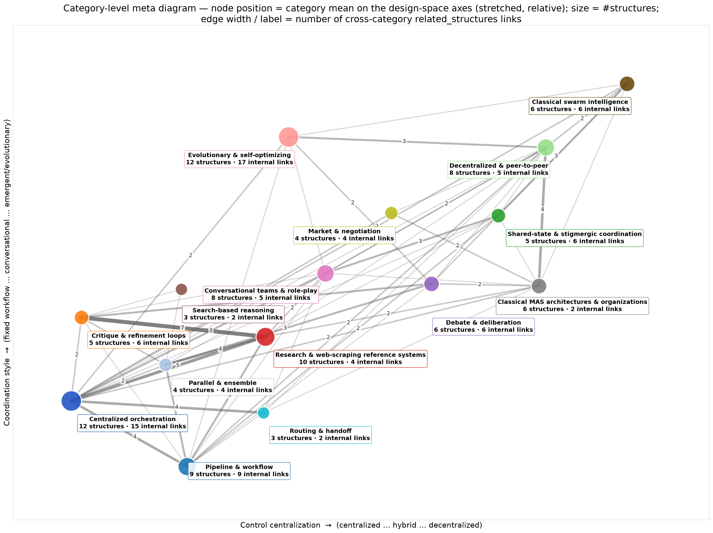

Edge label = number of cross-category `related_structures` links (also in `meta_map_categories.mmd`).

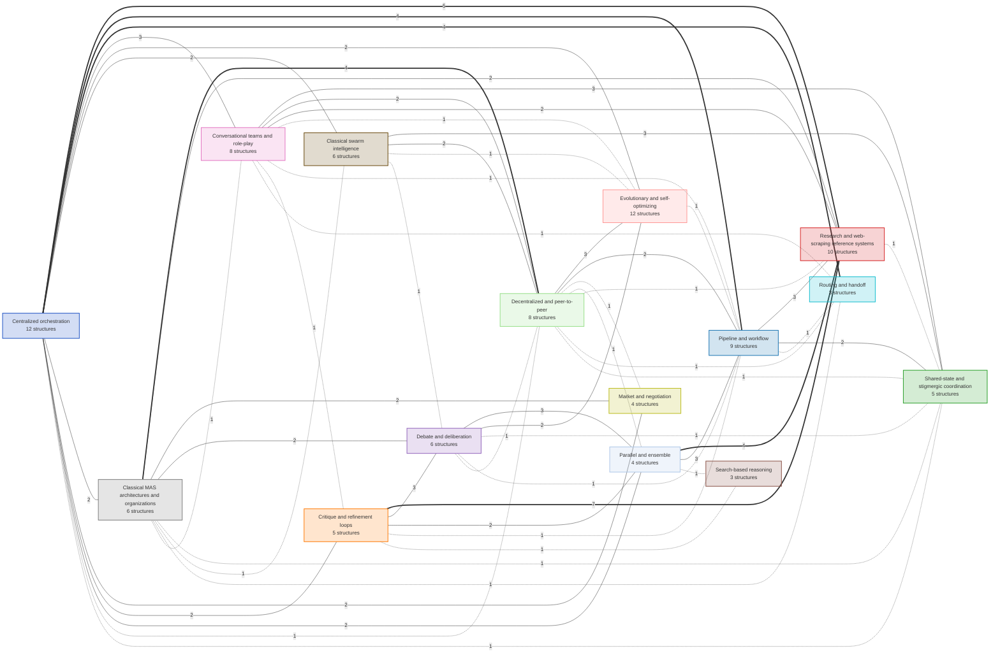

<!-- META_MAP_END -->

## Summary comparison table

| # | Structure | Category | Control | Topology (short) | Complexity | Research fit | Scraping fit |
|---|---|---|---|---|---|---|---|
| 1 | [CrewAI Hierarchical Process (manager-delegated crew)](#crewai_hierarchical) | Centralized orchestration | Centralized | Star: manager over role agents; manager uses delegation tools. | 2 | 4 | 3 |
| 2 | [Evolving / Learned Orchestrator (Puppeteer)](#evolving_orchestration_puppeteer) | Centralized orchestration | Centralized (learned policy) | Star with learned sequencing; emergent compact/cyclic subgraphs. | 5 | 3 | 2 |
| 3 | [Hierarchical Teams (supervisor of supervisors)](#hierarchical_teams) | Centralized orchestration | Centralized (per subtree), hierarchical overall | Tree (2+ levels). Communication follows parent-child edges only. | 3 | 4 | 4 |
| 4 | [HuggingGPT-style Controller + Expert Models](#hugginggpt_controller) | Centralized orchestration | Centralized | Star: controller LLM over many specialised non-LLM or LLM experts. | 3 | 3 | 4 |
| 5 | [LLMCompiler (parallel task DAG)](#llmcompiler_dag) | Centralized orchestration | Centralized | DAG of tasks generated at runtime; planner -> scheduler -> parallel... | 3 | 4 | 5 |
| 6 | [Magentic-One (Orchestrator with task & progress ledgers)](#magentic_one_ledger) | Centralized orchestration | Centralized | Star around Orchestrator; specialists include a browser agent. | 4 | 5 | 4 |
| 7 | [Orchestrator-Worker (Lead agent + subagents)](#orchestrator_worker) | Centralized orchestration | Centralized | Star: one orchestrator hub, N worker spokes; workers do not talk to... | 2 | 5 | 5 |
| 8 | [Plan-and-Execute](#plan_and_execute) | Centralized orchestration | Centralized | Pipeline with feedback: Planner -> Executor(s) -> Replanner -> (Exe... | 2 | 4 | 4 |
| 9 | [ReWOO (Reasoning WithOut Observation)](#rewoo) | Centralized orchestration | Centralized | Three-stage pipeline: Planner -> Worker(s) -> Solver. | 2 | 3 | 4 |
| 10 | [Supervisor (LLM-routed worker graph)](#supervisor_router) | Centralized orchestration | Centralized | Star with a loop: supervisor <-> each worker; workers return to sup... | 2 | 4 | 3 |
| 11 | [TalkHier (structured hierarchical talk)](#talkhier) | Centralized orchestration | Centralized/hierarchical | Tree: main supervisor -> generator and evaluation teams with their ... | 4 | 4 | 2 |
| 12 | [Task-Queue Agent Loop (BabyAGI-style)](#task_queue_babyagi) | Centralized orchestration | Centralized (shared queue) | Ring/loop around a shared task queue and vector memory. | 2 | 3 | 4 |
| 13 | [Actor Model (message-passing runtime)](#actor_model) | Classical MAS architectures & organizations | Decentralized | Arbitrary dynamic graph of addresses. | 3 | 3 | 5 |
| 14 | [BDI Agents (Belief-Desire-Intention)](#bdi_agents) | Classical MAS architectures & organizations | Per-agent deliberative | Single-agent architecture; multi-agent via messaging. | 3 | 3 | 2 |
| 15 | [Networked Consensus / Cooperative Control](#consensus_networks) | Classical MAS architectures & organizations | Decentralized | Arbitrary connected graph. | 3 | 2 | 1 |
| 16 | [Federation / Facilitator (broker-mediated)](#federation_facilitator) | Classical MAS architectures & organizations | Hybrid | Agents grouped under intermediaries; intermediaries interconnect. | 3 | 3 | 3 |
| 17 | [Holonic Multi-Agent System (holarchy)](#holonic) | Classical MAS architectures & organizations | Hybrid (autonomy within, cooperation across) | Recursive nested groups (holarchy). | 4 | 4 | 3 |
| 18 | [Subsumption / Layered Reactive Architecture](#subsumption_layered) | Classical MAS architectures & organizations | Decentralized within agent (layered priority) | Stack of layers with suppression/inhibition links. | 2 | 2 | 4 |
| 19 | [Ant Colony Optimization (Ant System / ACS)](#ant_colony_optimization) | Classical swarm intelligence | Decentralized | No direct links; shared pheromone matrix (stigmergy). | 2 | 3 | 4 |
| 20 | [Artificial Bee Colony (employed / onlooker / scout)](#artificial_bee_colony) | Classical swarm intelligence | Decentralized | Hive-centred broadcast of source quality. | 2 | 4 | 5 |
| 21 | [Boids / Flocking](#boids_flocking) | Classical swarm intelligence | Decentralized | Local neighbourhood (radius-based) dynamic graph. | 1 | 2 | 3 |
| 22 | [Metaheuristic Swarm Family (Firefly, Grey Wolf, Bacterial Foraging)](#firefly_gwo_family) | Classical swarm intelligence | Decentralized (with emergent leaders in GWO) | Attraction graph (firefly), leader hierarchy (GWO), local chemotaxi... | 2 | 2 | 2 |
| 23 | [Particle Swarm Optimization](#particle_swarm_optimization) | Classical swarm intelligence | Decentralized | Global (star/gbest) or local (ring/lbest, von Neumann) neighbourhoo... | 2 | 2 | 2 |
| 24 | [Swarm Robotics (swarm engineering)](#swarm_robotics) | Classical swarm intelligence | Decentralized | Local communication graph. | 3 | 2 | 3 |
| 25 | [Dynamic Expert Recruitment (AgentVerse)](#agentverse_dynamic_team) | Conversational teams & role-play | Hybrid | Dynamic group; horizontal (democratic) or vertical (solver + review... | 3 | 4 | 2 |
| 26 | [Modular Cooperative Agents with Communication Module (CoELA)](#cooperative_embodied_coela) | Conversational teams & role-play | Decentralized | Peer agents (decentralized), each modular. | 3 | 2 | 2 |
| 27 | [Generative Agent Society Simulation](#generative_agents_sim) | Conversational teams & role-play | Decentralized | Spatial/social graph in shared environment; agents meet and convers... | 4 | 2 | 1 |
| 28 | [Group Chat with Speaker Selection (AutoGen)](#group_chat_selector) | Conversational teams & role-play | Centralized (speaker selector) | Bus/broadcast with a manager selecting speakers. | 2 | 3 | 2 |
| 29 | [Perspective-Guided Simulated Conversations (STORM / Co-STORM)](#perspective_conversations_storm) | Conversational teams & role-play | Centralized (pipeline with parallel dialogues) | Many parallel writer<->expert dialogues feeding an outline/writer; ... | 3 | 5 | 3 |
| 30 | [Role-Playing Agents (CAMEL)](#role_play_camel) | Conversational teams & role-play | Decentralized (pair) | Dyad (plus task specifier). | 2 | 2 | 1 |
| 31 | [Round-Robin Team](#round_robin_chat) | Conversational teams & role-play | Centralized (fixed schedule) | Ring over a shared bus. | 1 | 2 | 1 |
| 32 | [Society of Mind (NLSOM / nested inner team)](#society_of_mind) | Conversational teams & role-play | Hybrid | Inner team encapsulated as a single agent; society structure varies... | 3 | 3 | 2 |
| 33 | [Evaluator-Optimizer (Generator-Critic loop)](#evaluator_optimizer) | Critique & refinement loops | Centralized (loop) | Two-node cycle. | 1 | 5 | 4 |
| 34 | [Agent-as-a-Judge / Judge Panel](#llm_judge_panel) | Critique & refinement loops | Centralized | Evaluated system -> judge agent(s). | 2 | 4 | 3 |
| 35 | [Multi-Verifier Panel (MAV)](#multi_agent_verification) | Critique & refinement loops | Centralized | Candidates x verifiers bipartite. | 2 | 4 | 4 |
| 36 | [Reflection / Reflexion (verbal self-improvement)](#reflection_self_critique) | Critique & refinement loops | Centralized | Actor-evaluator-reflector cycle with episodic memory. | 2 | 3 | 4 |
| 37 | [Tool-Verified Critique (CRITIC / Chain-of-Verification)](#tool_verified_critique) | Critique & refinement loops | Centralized | Draft -> verifier(s) with tools -> reviser. | 2 | 5 | 4 |
| 38 | [Referee Team Debate (ChatEval)](#chateval_referee_debate) | Debate & deliberation | Decentralized peers with fixed protocol | Group of referees; sequential or simultaneous rounds. | 2 | 3 | 1 |
| 39 | [Corex (Discuss / Review / Retrieve modes)](#corex_collab_modes) | Debate & deliberation | Centralized per mode | Teams + judge (Discuss); chain of reviewers (Review); candidates + ... | 2 | 3 | 1 |
| 40 | [Exchange-of-Thought (cross-model communication)](#exchange_of_thought) | Debate & deliberation | Varies by paradigm | Bus (Memory), Star (Report), Ring (Relay), Tree/peer (Debate). | 2 | 3 | 1 |
| 41 | [Adversarial Debate with Judge (MAD)](#mad_judge_debate) | Debate & deliberation | Centralized (judge) | Two debaters + judge (triangle). | 2 | 4 | 1 |
| 42 | [Multi-Agent Debate (society of minds, rounds)](#multi_agent_debate) | Debate & deliberation | Decentralized (symmetric peers), with fixed rounds | Fully connected (all-to-all) per round. | 2 | 4 | 1 |
| 43 | [Sparse-Topology Debate](#sparse_debate_topology) | Debate & deliberation | Decentralized | Sparse graph (ring, star, random). | 2 | 3 | 1 |
| 44 | [Protocol Federation (A2A + MCP)](#a2a_federation) | Decentralized & peer-to-peer | Decentralized/hybrid | Federated network of opaque agents; client-remote agent pairs. | 3 | 3 | 4 |
| 45 | [AgentNet (decentralized evolving DAG of agents)](#agentnet_decentralized) | Decentralized & peer-to-peer | Decentralized | Dynamic DAG among peers. | 4 | 3 | 3 |
| 46 | [Dynamic LLM-Agent Network (DyLAN)](#dylan_dynamic_network) | Decentralized & peer-to-peer | Hybrid | Layered temporal network; edges between consecutive layers. | 4 | 3 | 2 |
| 47 | [Gossip / Epidemic Peer-to-Peer Dissemination](#gossip_p2p) | Decentralized & peer-to-peer | Decentralized | Random dynamic peer links. | 3 | 2 | 4 |
| 48 | [Internet of Agents (heterogeneous agent network)](#internet_of_agents) | Decentralized & peer-to-peer | Hybrid | Client-server registry with dynamic team formation (nested groups). | 4 | 3 | 3 |
| 49 | [MacNet (DAG-organised large-scale collaboration)](#macnet_dag) | Decentralized & peer-to-peer | Centralized (topological order) | DAG (chain, star, tree, mesh, small-world, random). | 4 | 3 | 1 |
| 50 | [Agent Network (many-to-many, any agent routes)](#network_all_to_all) | Decentralized & peer-to-peer | Decentralized | Complete graph. | 2 | 2 | 1 |
| 51 | [SwarmSys (explorer / worker / validator swarm)](#swarmsys) | Decentralized & peer-to-peer | Decentralized | Decentralized population; dynamic matching between agents and events. | 4 | 4 | 4 |
| 52 | [Meta Agent Search (ADAS)](#adas_meta_agent) | Evolutionary & self-optimizing | Centralized | Meta agent + archive + evaluated candidate systems. | 5 | 3 | 2 |
| 53 | [AFlow (MCTS over agentic workflows)](#aflow_workflow_search) | Evolutionary & self-optimizing | Centralized (optimizer) | Searched workflow graph. | 5 | 3 | 3 |
| 54 | [Communication Pruning (AgentPrune)](#agentprune_sparsification) | Evolutionary & self-optimizing | Same as base | Pruned version of base topology. | 4 | 3 | 3 |
| 55 | [Generate-Debate-Evolve Tournament (AI co-scientist)](#ai_coscientist_tournament) | Evolutionary & self-optimizing | Hybrid (supervisor + async workers) | Supervisor + asynchronous task queue of specialist agents. | 5 | 5 | 1 |
| 56 | [Evolutionary Agent Generation (EvoAgent)](#evoagent_evolutionary) | Evolutionary & self-optimizing | Centralized (evolution loop) | Population; outputs aggregated. | 3 | 3 | 2 |
| 57 | [Learned Communication Topology (G-Designer)](#g_designer_topology) | Evolutionary & self-optimizing | Centralized (designer) | Generated sparse graph per task. | 5 | 2 | 2 |
| 58 | [GPTSwarm (agents as optimizable graphs)](#gptswarm_optimizable_graph) | Evolutionary & self-optimizing | Centralized (graph executor) | Learned graph of agent graphs. | 4 | 3 | 3 |
| 59 | [Island-Model Evolutionary Program Search (FunSearch / AlphaEvolve)](#island_evolution_funsearch) | Evolutionary & self-optimizing | Centralized (database/controller), massively parallel | Population database with islands + many parallel LLM samplers + eva... | 4 | 2 | 3 |
| 60 | [MASS (joint prompt + topology optimisation)](#mass_optimizer) | Evolutionary & self-optimizing | Centralized optimizer | Searched over building blocks (aggregate, reflect, debate, tool use). | 5 | 3 | 2 |
| 61 | [Model Swarms (PSO over LLM experts)](#model_swarms_pso) | Evolutionary & self-optimizing | Decentralized particles with global info | Particle swarm (global best broadcast). | 4 | 2 | 2 |
| 62 | [Population-Based Training (PBT)](#population_based_training) | Evolutionary & self-optimizing | Decentralized/asynchronous | Population with periodic peer comparison. | 3 | 2 | 3 |
| 63 | [Promptbreeder (self-referential prompt evolution)](#promptbreeder) | Evolutionary & self-optimizing | Centralized (evolution loop) | Population. | 3 | 2 | 3 |
| 64 | [Auction / Market-Based Task Allocation](#auction_market_allocation) | Market & negotiation | Decentralized or hybrid | Auctioneer-bidder star or fully decentralized peer consensus. | 4 | 3 | 4 |
| 65 | [Coalitions, Teams & Congregations (organizational paradigms)](#coalitions_congregations) | Market & negotiation | Varies | Varies: subgroups formed dynamically within a larger population. | 3 | 3 | 3 |
| 66 | [Contract Net Protocol](#contract_net) | Market & negotiation | Decentralized allocation (any agent can be manager) | Dynamic star per task; recursive sub-contracting forms dynamic hier... | 3 | 3 | 4 |
| 67 | [LLM Agent Auctions & Marketplaces](#llm_auction_marketplace) | Market & negotiation | Decentralized/hybrid | Marketplace hub with requester and provider agents. | 4 | 3 | 3 |
| 68 | [Rank-and-Fuse Ensemble (LLM-Blender)](#llm_blender_rank_fuse) | Parallel & ensemble | Centralized | Parallel generators -> ranker -> fuser. | 3 | 3 | 3 |
| 69 | [Mixture-of-Agents (layered proposers + aggregator)](#mixture_of_agents) | Parallel & ensemble | Centralized (fixed layers) | Layered fully-connected feed-forward network of agents. | 2 | 4 | 1 |
| 70 | [Parallel Fan-out / Fan-in (Map-Reduce, Sectioning)](#parallel_fanout_mapreduce) | Parallel & ensemble | Centralized | Fan-out star then fan-in to reducer. | 2 | 5 | 5 |
| 71 | [Voting / Self-Consistency Ensemble](#voting_ensemble) | Parallel & ensemble | Centralized (aggregator) | Parallel independent agents -> voter. | 1 | 4 | 4 |
| 72 | [Chain of Agents (long-context relay)](#chain_of_agents) | Pipeline & workflow | Centralized (fixed order) | Linear relay of workers ending at a manager. | 2 | 4 | 3 |
| 73 | [Chat Chain (ChatDev)](#chat_chain_chatdev) | Pipeline & workflow | Centralized (phase chain) | Chain of phases, each phase a pair of agents. | 3 | 2 | 3 |
| 74 | [Event-driven Flows (CrewAI Flows)](#crewai_flows) | Pipeline & workflow | Hybrid | Event graph; crews embedded as steps. | 2 | 4 | 4 |
| 75 | [Static DAG Workflow (parallel dependencies)](#dag_workflow) | Pipeline & workflow | Centralized (scheduler) | DAG. | 2 | 3 | 5 |
| 76 | [Graph / State-Machine Workflow (LangGraph-style)](#graph_state_machine) | Pipeline & workflow | Hybrid (deterministic edges + LLM-chosen conditional edges) | Arbitrary directed graph (cycles allowed) defined by developer. | 3 | 5 | 5 |
| 77 | [Human-in-the-Loop Checkpoints (user proxy)](#human_in_the_loop) | Pipeline & workflow | Hybrid | Human node inserted into any topology. | 1 | 4 | 4 |
| 78 | [Loop Agent (iterate until condition)](#loop_agent) | Pipeline & workflow | Centralized | Cycle over a fixed sub-sequence. | 1 | 3 | 4 |
| 79 | [Sequential Pipeline / Prompt Chaining (assembly line)](#sequential_pipeline) | Pipeline & workflow | Centralized (predetermined by code) | Linear chain A -> B -> C. | 1 | 3 | 5 |
| 80 | [SOP-based Software Company (MetaGPT)](#sop_assembly_line_metagpt) | Pipeline & workflow | Hybrid (SOP order + subscription-triggered actions) | Role pipeline over a shared message pool (pub/sub). | 3 | 4 | 3 |
| 81 | [Automated Research Lab Pipeline (AI Scientist / Agent Laboratory)](#ai_scientist_pipeline) | Research & web-scraping reference systems | Centralized | Staged pipeline with role agents per stage and review loops. | 4 | 4 | 2 |
| 82 | [Lead Researcher + Parallel Subagents + Citation Agent (Anthropic Research)](#anthropic_research_system) | Research & web-scraping reference systems | Centralized | Orchestrator-worker star + post-processing citation stage + externa... | 3 | 5 | 4 |
| 83 | [Progressive Scraper Generation (AutoScraper)](#autoscraper_progressive) | Research & web-scraping reference systems | Centralized | Generator agent + synthesis over seed pages (single agent with phas... | 3 | 2 | 5 |
| 84 | [Centralized-Frontier Distributed Crawler (Mercator-style)](#distributed_crawler_frontier) | Research & web-scraping reference systems | Centralized | Hub (frontier) with many worker threads/processes; pipeline of proc... | 3 | 3 | 5 |
| 85 | [Planner + Parallel Crawler Agents (GPT Researcher)](#gpt_researcher) | Research & web-scraping reference systems | Centralized | Planner -> parallel crawler/summariser agents -> publisher. | 3 | 5 | 4 |
| 86 | [Graph-Pipeline LLM Scrapers (ScrapeGraphAI)](#scrapegraph_pipelines) | Research & web-scraping reference systems | Centralized | Directed node graph per scrape; fan-out for multi-URL graphs. | 2 | 3 | 4 |
| 87 | [Self-Organized Agents (self-multiplying hierarchy)](#self_organized_agents) | Research & web-scraping reference systems | Hierarchical, self-organising | Dynamically growing tree. | 4 | 3 | 4 |
| 88 | [Curriculum + Skill Library + Critic (Voyager)](#skill_library_voyager) | Research & web-scraping reference systems | Centralized | Cycle of curriculum -> coder -> critic -> library. | 3 | 3 | 5 |
| 89 | [Fully Distributed Crawler (UbiCrawler, consistent hashing)](#ubicrawler_decentralized) | Research & web-scraping reference systems | Decentralized | Peer ring (consistent hashing). | 4 | 2 | 5 |
| 90 | [Explorer-Critic Web Traversal (WebWalker)](#webwalker_explorer_critic) | Research & web-scraping reference systems | Centralized pair | Two-agent loop. | 2 | 4 | 4 |
| 91 | [Handoff Swarm (OpenAI Swarm / Agents SDK handoffs)](#handoff_swarm) | Routing & handoff | Decentralized (local handoff decisions) | Directed graph of allowed handoffs (often triage hub + specialists,... | 2 | 3 | 2 |
| 92 | [Model / LLM Routing (cost-quality router)](#model_routing) | Routing & handoff | Centralized | Router in front of a pool of models; in MAS variants the router als... | 2 | 3 | 5 |
| 93 | [Router / Dispatcher](#router_dispatcher) | Routing & handoff | Centralized (single decision) | One-to-one-of-N fan-out (tree depth 1); no return to router. | 1 | 3 | 5 |
| 94 | [Graph of Thoughts](#graph_of_thoughts) | Search-based reasoning | Centralized | Directed graph allowing merges (fan-in). | 3 | 3 | 2 |
| 95 | [Language Agent Tree Search (LATS)](#lats_mcts) | Search-based reasoning | Centralized | Search tree of trajectories. | 4 | 3 | 3 |
| 96 | [Tree of Thoughts (multi-branch deliberate search)](#tree_of_thoughts) | Search-based reasoning | Centralized (search controller) | Tree of states; proposer and evaluator roles. | 3 | 3 | 2 |
| 97 | [Blackboard Architecture (classical, Hearsay-II)](#blackboard_classic) | Shared-state & stigmergic coordination | Hybrid (opportunistic, scheduler-focused) | Hub data structure; knowledge sources never talk directly. | 3 | 4 | 3 |
| 98 | [LLM Blackboard Multi-Agent System](#blackboard_llm) | Shared-state & stigmergic coordination | Hybrid | Hub data store with LLM agents around it. | 3 | 5 | 4 |
| 99 | [Publish-Subscribe Message Pool / Event Bus](#pubsub_message_pool) | Shared-state & stigmergic coordination | Decentralized (event-driven) | Bus with topic subscriptions. | 3 | 4 | 5 |
| 100 | [Stigmergy (indirect coordination via environment)](#stigmergy_classic) | Shared-state & stigmergic coordination | Decentralized | No agent-agent links; all via environment. | 2 | 3 | 4 |
| 101 | [Stigmergic LLM Agents (pressure fields, shared artifacts)](#stigmergy_llm) | Shared-state & stigmergic coordination | Decentralized | Agents around shared artifact; no direct links. | 3 | 3 | 4 |

## Top picks for research / web-scraping swarms (research_fit + scraping_fit >= 8)

- **Orchestrator-Worker (Lead agent + subagents)** (R5/S5): Excellent default for research swarms: lead agent plans, subagents each search/scrape a slice, lead synthesises and a citation pass attributes claims.
- **Parallel Fan-out / Fan-in (Map-Reduce, Sectioning)** (R5/S5): The workhorse for web scraping swarms; combine with rate limiting, per-domain concurrency caps and a schema-validated reducer.
- **Graph / State-Machine Workflow (LangGraph-style)** (R5/S5): Recommended chassis for production swarms: encode crawl/extract/verify loops explicitly; resume after failures.
- **LLMCompiler (parallel task DAG)** (R4/S5): Very good for scraping many URLs with partial dependencies (list page -> N detail pages).
- **Magentic-One (Orchestrator with task & progress ledgers)** (R5/S4): Excellent template for agentic browsing/scraping tasks requiring interaction (forms, pagination, JS sites).
- **Artificial Bee Colony (employed / onlooker / scout)** (R4/S5): Strong analogy for research swarms: most workers mine high-yield sources, onlookers follow yield signals, scouts search for new sources; abandon sources after N fruitless tries.
- **Evaluator-Optimizer (Generator-Critic loop)** (R5/S4): High value: a verifier agent that re-reads the source page to check each extracted field/claim.
- **Tool-Verified Critique (CRITIC / Chain-of-Verification)** (R5/S4): Core of trustworthy research swarms: every claim checked against fetched sources.
- **Lead Researcher + Parallel Subagents + Citation Agent (Anthropic Research)** (R5/S4): The best-documented blueprint for an LLM research swarm; add a scraping tool layer and a source-quality policy.
- **Planner + Parallel Crawler Agents (GPT Researcher)** (R5/S4): Directly on target: reference implementation of a scraping-backed research swarm.
- **LLM Blackboard Multi-Agent System** (R5/S4): Strong fit: scrapers post findings to a board; analysts self-select items to verify/synthesise.
- **Publish-Subscribe Message Pool / Event Bus** (R4/S5): Great backbone for large scraping swarms: crawlers publish pages; extractors, classifiers and indexers subscribe.
- **Hierarchical Teams (supervisor of supervisors)** (R4/S4): Good when a crawl has distinct domains (e.g. per-site scraping teams under a research director).
- **Plan-and-Execute** (R4/S4): Good for structured scraping jobs and literature reviews with known phases.
- **Actor Model (message-passing runtime)** (R3/S5): Good substrate for large scraping fleets (each crawler/extractor an actor with a mailbox).
- **Perspective-Guided Simulated Conversations (STORM / Co-STORM)** (R5/S3): Excellent template for research swarms: perspective agents ask questions, expert agents search/scrape and answer with citations.
- **Multi-Verifier Panel (MAV)** (R4/S4): Good QA layer for high-value extracted datasets.
- **SwarmSys (explorer / worker / validator swarm)** (R4/S4): The explorer/worker/validator split maps well onto discover-URLs / scrape / verify roles.
- **Voting / Self-Consistency Ensemble** (R4/S4): Use cheap N-way voting on uncertain extracted fields; escalate disagreement to a stronger model.
- **Event-driven Flows (CrewAI Flows)** (R4/S4): Good wrapper: deterministic scraper steps trigger LLM crews only when needed.
- **Static DAG Workflow (parallel dependencies)** (R3/S5): Good for recurring scraping jobs (e.g. daily: 5 sources in parallel -> merge -> dedupe -> report).
- **Human-in-the-Loop Checkpoints (user proxy)** (R4/S4): Recommended for approving crawl scopes, ToS-sensitive sites and final outputs.
- **Sequential Pipeline / Prompt Chaining (assembly line)** (R3/S5): Backbone of most production scraping: deterministic per-item pipelines, parallelised across items.
- **Centralized-Frontier Distributed Crawler (Mercator-style)** (R3/S5): The right skeleton for scraping swarms: keep crawling deterministic; use LLM agents only for prioritisation, extraction and QA.
- **Curriculum + Skill Library + Critic (Voyager)** (R3/S5): Very relevant: store verified per-site extraction routines and reuse them across swarm runs.
- **Explorer-Critic Web Traversal (WebWalker)** (R4/S4): Strong for targeted research on specific websites (docs, government, company sites).
- **Model / LLM Routing (cost-quality router)** (R3/S5): Very valuable for scraping swarms: cheap models for extraction, strong models for planning/synthesis.
- **Router / Dispatcher** (R3/S5): Excellent at the front of a scraping swarm: route each URL by domain/page-type to a specialised extractor.

---

# Centralized orchestration

<a id="crewai_hierarchical"></a>
## CrewAI Hierarchical Process (manager-delegated crew)

`id: crewai_hierarchical` · complexity 2/5 · research fit 4/5 · scraping fit 3/5

A CrewAI crew where an auto-created or custom manager agent plans, delegates tasks to role-defined agents (role/goal/backstory) and validates outcomes.

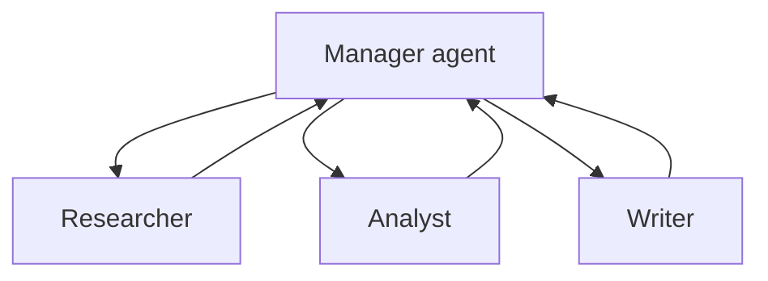

**Aliases:**
- Process.hierarchical
- manager_llm crew
- crew manager

**Topology:** Star: manager over role agents; manager uses delegation tools.

**Control flow:** Centralized

**Communication pattern:** Manager issues delegate/ask-coworker tool calls; agents return task outputs.

**Coordination mechanism:** Manager allocates tasks by capability, reviews outputs, decides completion; optional planning step.

**Typical roles:**
- Manager (no tools)
- Role agents e.g. Researcher, Analyst, Writer

**Memory model:** Crew memory (short-term, long-term, entity) optional; task outputs passed as context.

**Characteristics:**
- Role/goal/backstory persona prompts
- Manager should not have tools
- Default is sequential, hierarchical opt-in

**Strengths:**
- Very fast to prototype
- Readable role definitions
- Built-in validation step

**Weaknesses:**
- Manager delegation can be unpredictable
- Less fine-grained control than graph frameworks

**Failure modes:**
- Manager over-delegates or loops on validation
- Persona prompts drift from tasks

**Scalability:** Small-to-medium crews (2-10 agents).

**Cost / latency:** Medium-high; manager reasoning on every delegation.

**Best use cases:**
- Research-and-report crews
- Content generation from scraped data

**Research & scraping fit:** Convenient for small research crews; for bulk scraping prefer deterministic flows.

**Poor fit:**
- Strict, auditable pipelines
- High-volume crawls

**Variants:**
- manager_llm auto manager
- custom manager_agent
- planning=True

**Frameworks / implementations:**
- CrewAI

**Related:** [Hierarchical Teams (supervisor of supervisors)](#hierarchical_teams), [Supervisor (LLM-routed worker graph)](#supervisor_router), [Sequential Pipeline / Prompt Chaining (assembly line)](#sequential_pipeline), [Event-driven Flows (CrewAI Flows)](#crewai_flows)

**Key sources:**
- [CrewAI Processes (sequential / hierarchical)](https://docs.crewai.com/edge/en/concepts/processes)
- [CrewAI Hierarchical Process guide](https://docs.crewai.com/edge/en/learn/hierarchical-process)
- [CrewAI Custom Manager Agent](https://docs.crewai.com/edge/en/learn/custom-manager-agent)
- [CrewAI Crews concept](https://docs.crewai.com/edge/en/concepts/crews)
- [crewAIInc/crewAI (GitHub)](https://github.com/crewAIInc/crewAI)

<a id="evolving_orchestration_puppeteer"></a>
## Evolving / Learned Orchestrator (Puppeteer)

`id: evolving_orchestration_puppeteer` · complexity 5/5 · research fit 3/5 · scraping fit 2/5

A centralized orchestrator ("puppeteer") trained with reinforcement learning dynamically sequences which agent ("puppet") acts next, learning compact, often cyclic, efficient orchestration over time.

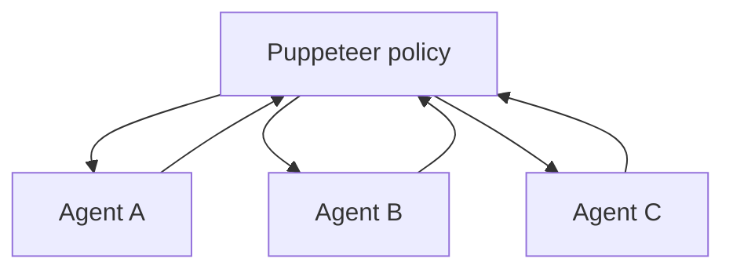

**Aliases:**
- puppeteer-puppets
- RL-trained orchestrator
- dynamic sequencing

**Topology:** Star with learned sequencing; emergent compact/cyclic subgraphs.

**Control flow:** Centralized (learned policy)

**Communication pattern:** Orchestrator activates one agent at a time with evolving state.

**Coordination mechanism:** RL policy optimising quality and cost.

**Typical roles:**
- Puppeteer policy
- Puppet agents (reasoning styles, tools)

**Memory model:** Shared task state.

**Characteristics:**
- Topology emerges from training
- Cost-aware

**Strengths:**
- Prunes useless agents
- Adapts to task distribution

**Weaknesses:**
- Needs training data/reward
- Less interpretable

**Failure modes:**
- Reward hacking
- Poor transfer to new task types

**Scalability:** Policy scales to many candidate agents.

**Cost / latency:** Training cost upfront; cheaper inference.

**Best use cases:**
- Mature production swarms with logged tasks and measurable quality

**Research & scraping fit:** Later-stage optimisation once you have evals for your research swarm.

**Poor fit:**
- Early prototypes without evals

**Variants:**
- Puppeteer
- MasRouter (learned routing)

**Frameworks / implementations:**
- Paper reference implementation

**Related:** [Supervisor (LLM-routed worker graph)](#supervisor_router), [Model / LLM Routing (cost-quality router)](#model_routing), [GPTSwarm (agents as optimizable graphs)](#gptswarm_optimizable_graph)

**Key sources:**
- [Yufan Dang et al. (2025) Multi-Agent Collaboration via Evolving Orchestration](https://arxiv.org/abs/2505.19591)

<a id="hierarchical_teams"></a>
## Hierarchical Teams (supervisor of supervisors)

`id: hierarchical_teams` · complexity 3/5 · research fit 4/5 · scraping fit 4/5

Generalises the supervisor pattern into a tree: a top-level manager delegates to team leads, each of which supervises its own workers.

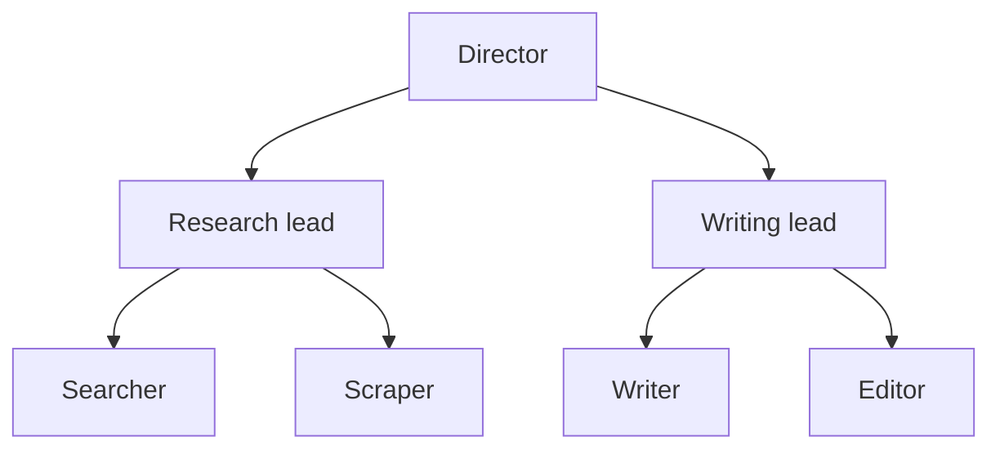

**Aliases:**
- multi-level hierarchy
- tree of managers
- nested teams
- hierarchical swarm

**Topology:** Tree (2+ levels). Communication follows parent-child edges only.

**Control flow:** Centralized (per subtree), hierarchical overall

**Communication pattern:** Top-down task assignment, bottom-up reporting; teams are subgraphs.

**Coordination mechanism:** Recursive decomposition; each mid-level supervisor owns a sub-goal and returns a summary.

**Typical roles:**
- Top-level director
- Team supervisors (e.g. research team, writing team)
- Leaf workers

**Memory model:** Scoped state per team (subgraph state / checkpoint namespace); summaries pass upward.

**Characteristics:**
- Information hiding between teams
- Span-of-control limits per manager
- Composable subgraphs

**Strengths:**
- Scales beyond single-supervisor limits
- Teams reusable as modules
- Parallel teams

**Weaknesses:**
- More hops = more latency and information loss
- Harder to debug across levels
- Over-engineering for small tasks

**Failure modes:**
- Telephone-game distortion across levels
- Mid-level managers duplicate each other
- Budget blow-up from deep recursion

**Scalability:** High: number of agents grows with branching factor^depth.

**Cost / latency:** High tokens; latency grows with depth but parallel subtrees help.

**Best use cases:**
- Large research projects split into topic teams (search team, scrape team, analysis team, writing team)
- Enterprise workflows mirroring org charts

**Research & scraping fit:** Good when a crawl has distinct domains (e.g. per-site scraping teams under a research director).

**Poor fit:**
- Small tasks
- Latency-sensitive chat

**Variants:**
- LangGraph hierarchical agent teams
- CrewAI hierarchical process
- TalkHier
- Swarms HierarchicalSwarm
- Nested agents-as-tools

**Frameworks / implementations:**
- LangGraph Hierarchical Agent Teams
- langgraph-supervisor multi-level
- CrewAI Process.hierarchical
- Google ADK hierarchical task decomposition

**Related:** [Supervisor (LLM-routed worker graph)](#supervisor_router), [Orchestrator-Worker (Lead agent + subagents)](#orchestrator_worker), [TalkHier (structured hierarchical talk)](#talkhier), [Holonic Multi-Agent System (holarchy)](#holonic)

**Key sources:**
- [LangGraph multi-agent concepts (network, supervisor, hierarchical, custom)](https://langchain-ai.github.io/langgraph/concepts/multi_agent/)
- [LangGraph tutorial: Hierarchical Agent Teams](https://langchain-ai.github.io/langgraph/tutorials/multi_agent/hierarchical_agent_teams/)
- [langgraph-supervisor-py (GitHub)](https://github.com/langchain-ai/langgraph-supervisor-py)
- [CrewAI Hierarchical Process guide](https://docs.crewai.com/edge/en/learn/hierarchical-process)
- [Swarms docs: HierarchicalSwarm](https://docs.swarms.world/api/hierarchical-swarm)
- [Google ADK Multi-agent systems (coordinator, generator-critic, hierarchical patterns)](https://google.github.io/adk-docs/agents/multi-agents/)

<a id="hugginggpt_controller"></a>
## HuggingGPT-style Controller + Expert Models

`id: hugginggpt_controller` · complexity 3/5 · research fit 3/5 · scraping fit 4/5

An LLM controller performs task planning, selects expert models (from a model hub) per subtask, executes them and generates the response.

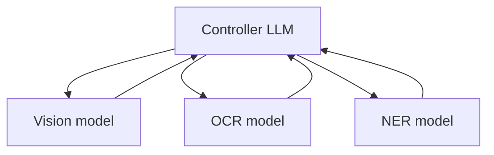

**Aliases:**
- LLM as controller
- tool/model orchestration
- JARVIS

**Topology:** Star: controller LLM over many specialised non-LLM or LLM experts.

**Control flow:** Centralized

**Communication pattern:** Structured task specs (JSON) to experts; results back to controller.

**Coordination mechanism:** Four stages: planning, model selection (by description), execution, response generation.

**Typical roles:**
- Controller LLM
- Expert models/tools

**Memory model:** Task list with dependencies and resource references.

**Characteristics:**
- Experts selected by textual descriptions
- Heterogeneous modalities

**Strengths:**
- Leverages specialised models cheaply
- Modular

**Weaknesses:**
- Dependent on quality of model descriptions
- Planning errors

**Failure modes:**
- Wrong expert chosen
- Format mismatches between experts

**Scalability:** Large expert pools possible with retrieval over descriptions.

**Cost / latency:** Moderate; expert calls can be cheap.

**Best use cases:**
- Pipelines mixing OCR, vision, NER, translation on scraped content

**Research & scraping fit:** Useful when scraped data needs specialised processors (PDF OCR, image captioning, NER).

**Poor fit:**
- Pure text reasoning tasks

**Variants:**
- HuggingGPT/JARVIS
- MCP tool-server orchestration

**Frameworks / implementations:**
- Microsoft JARVIS (HuggingGPT)
- MCP-based agents

**Related:** [Orchestrator-Worker (Lead agent + subagents)](#orchestrator_worker), [Router / Dispatcher](#router_dispatcher)

**Key sources:**
- [Yongliang Shen et al. (2023) HuggingGPT: Solving AI Tasks with ChatGPT and its Friends in Hugging Face](https://arxiv.org/abs/2303.17580)
- [Model Context Protocol](https://modelcontextprotocol.io/)

<a id="llmcompiler_dag"></a>
## LLMCompiler (parallel task DAG)

`id: llmcompiler_dag` · complexity 3/5 · research fit 4/5 · scraping fit 5/5

A planner emits a DAG of tool/agent tasks with dependencies; a task-fetching unit dispatches ready tasks in parallel; a joiner decides to answer or replan.

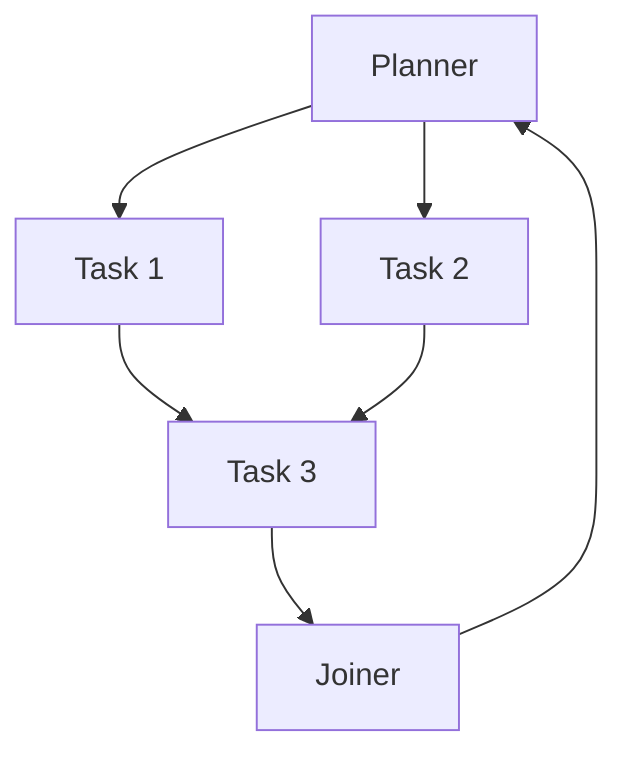

**Aliases:**
- task DAG planner
- parallel function calling

**Topology:** DAG of tasks generated at runtime; planner -> scheduler -> parallel executors -> joiner.

**Control flow:** Centralized

**Communication pattern:** Dependency-resolved dispatch; streamed plan.

**Coordination mechanism:** Dependency graph scheduling (like a compiler).

**Typical roles:**
- Planner
- Task fetching unit / scheduler
- Executors
- Joiner

**Memory model:** Task results keyed by task id.

**Characteristics:**
- Max parallelism given dependencies
- Streaming planning

**Strengths:**
- Lower latency and cost than sequential ReAct
- Good for many independent lookups

**Weaknesses:**
- Planner must get dependencies right

**Failure modes:**
- Missing dependency -> task runs with empty input
- Over-parallelism hits rate limits

**Scalability:** High for independent subtasks.

**Cost / latency:** Low latency, moderate cost.

**Best use cases:**
- Fetching many pages/entities in parallel then combining
- Multi-source fact gathering

**Research & scraping fit:** Very good for scraping many URLs with partial dependencies (list page -> N detail pages).

**Poor fit:**
- Tasks with long chains of strict dependencies

**Variants:**
- LLMCompiler
- Strands Workflow DAG

**Frameworks / implementations:**
- LangGraph LLMCompiler tutorial
- SqueezeAILab LLMCompiler

**Related:** [ReWOO (Reasoning WithOut Observation)](#rewoo), [Plan-and-Execute](#plan_and_execute), [Parallel Fan-out / Fan-in (Map-Reduce, Sectioning)](#parallel_fanout_mapreduce), [Static DAG Workflow (parallel dependencies)](#dag_workflow)

**Key sources:**
- [Sehoon Kim et al. (2023) An LLM Compiler for Parallel Function Calling](https://arxiv.org/abs/2312.04511)
- [LangChain blog: Plan-and-Execute agents (Plan-and-execute, ReWOO, LLMCompiler)](https://blog.langchain.dev/planning-agents/)

<a id="magentic_one_ledger"></a>
## Magentic-One (Orchestrator with task & progress ledgers)

`id: magentic_one_ledger` · complexity 4/5 · research fit 5/5 · scraping fit 4/5

A generalist orchestrator keeps an outer-loop Task Ledger (facts, guesses, plan) and inner-loop Progress Ledger, directing WebSurfer, FileSurfer, Coder and ComputerTerminal agents and replanning when stuck.

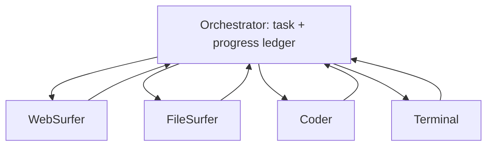

**Aliases:**
- Magentic orchestration
- ledger-based orchestrator

**Topology:** Star around Orchestrator; specialists include a browser agent.

**Control flow:** Centralized

**Communication pattern:** Orchestrator selects next agent and instruction each step; agents reply.

**Coordination mechanism:** Two nested loops: task ledger planning and progress ledger self-reflection (is task done? are we looping? who next?).

**Typical roles:**
- Orchestrator
- WebSurfer (browser)
- FileSurfer
- Coder
- ComputerTerminal

**Memory model:** Explicit ledgers maintained by orchestrator.

**Characteristics:**
- Stall detection and replanning
- Modular agents plug in/out

**Strengths:**
- Robust to dead ends via stall counter
- Strong on web tasks (GAIA, WebArena)

**Weaknesses:**
- Many LLM calls; slow
- Browser agents are brittle

**Failure modes:**
- Loops between agents
- Risky web actions without human approval

**Scalability:** Small fixed team; replicate for throughput.

**Cost / latency:** High cost and latency per task.

**Best use cases:**
- Complex web navigation and research requiring browsing, downloading, coding

**Research & scraping fit:** Excellent template for agentic browsing/scraping tasks requiring interaction (forms, pagination, JS sites).

**Poor fit:**
- Bulk static scraping (use crawlers)
- Cost-sensitive workloads

**Variants:**
- Magentic-One
- Semantic Kernel Magentic orchestration
- MagenticOneGroupChat

**Frameworks / implementations:**
- AutoGen MagenticOneGroupChat
- Semantic Kernel MagenticOrchestration

**Related:** [Orchestrator-Worker (Lead agent + subagents)](#orchestrator_worker), [Supervisor (LLM-routed worker graph)](#supervisor_router), [Reflection / Reflexion (verbal self-improvement)](#reflection_self_critique)

**Key sources:**
- [Adam Fourney et al. (2024) Magentic-One: A Generalist Multi-Agent System for Solving Complex Tasks](https://arxiv.org/abs/2411.04468)
- [AutoGen Magentic-One docs](https://microsoft.github.io/autogen/stable/user-guide/agentchat-user-guide/magentic-one.html)
- [Semantic Kernel Agent Orchestration (concurrent, sequential, handoff, group chat, magentic)](https://learn.microsoft.com/en-us/semantic-kernel/frameworks/agent/agent-orchestration/)

<a id="orchestrator_worker"></a>
## Orchestrator-Worker (Lead agent + subagents)

`id: orchestrator_worker` · complexity 2/5 · research fit 5/5 · scraping fit 5/5

A central LLM decomposes a task at runtime, spawns or calls specialised worker agents (often in parallel, each with its own context window) and synthesises their condensed results.

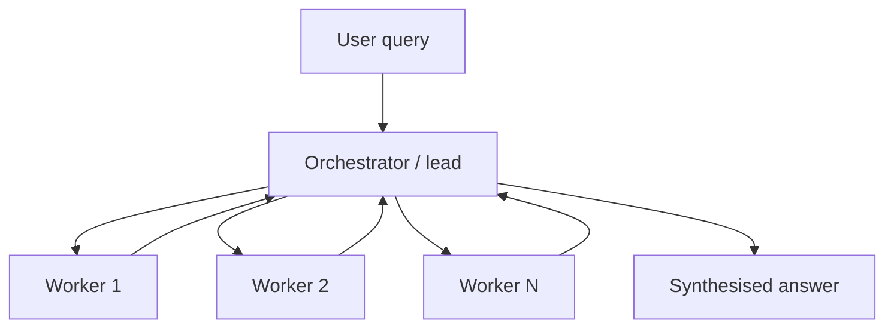

**Aliases:**
- orchestrator-workers
- lead agent / subagents
- manager-worker
- agents-as-tools
- subagents pattern

**Topology:** Star: one orchestrator hub, N worker spokes; workers do not talk to each other.

**Control flow:** Centralized

**Communication pattern:** Request/response between hub and spokes (tool calls or spawned sub-runs); workers return condensed summaries.

**Coordination mechanism:** Dynamic task decomposition by the orchestrator; explicit task briefs (objective, output format, tools, boundaries); orchestrator decides when to stop.

**Typical roles:**
- Orchestrator/lead
- Worker/subagent (searcher, analyst, coder)
- Optional synthesiser or citation agent

**Memory model:** Orchestrator holds global plan (often persisted to external memory); each worker has an isolated, short-lived context; only distilled results flow back.

**Characteristics:**
- Subtasks not known in advance
- Context isolation per worker
- Parallelism at the worker level
- Single owner of final answer

**Strengths:**
- Breadth-first exploration in parallel
- Keeps orchestrator context clean
- Easy to reason about and trace
- Effort can scale with query complexity

**Weaknesses:**
- Orchestrator is a bottleneck and single point of failure
- High token usage (Anthropic reports ~15x a chat for multi-agent)
- Workers cannot coordinate directly, so duplicated work is possible

**Failure modes:**
- Vague delegation causes overlapping or off-scope subagents
- Spawning too many subagents for simple queries
- Lossy summaries drop key evidence
- Orchestrator stops too early or loops forever

**Scalability:** Good to ~10-20 parallel workers per orchestrator; beyond that, add hierarchy.

**Cost / latency:** High tokens, low wall-clock when workers run in parallel; latency bounded by slowest worker plus synthesis.

**Best use cases:**
- Open-ended web research and deep research reports
- Parallel scraping of many sites/sources with a central aggregator
- Coding tasks touching many files

**Research & scraping fit:** Excellent default for research swarms: lead agent plans, subagents each search/scrape a slice, lead synthesises and a citation pass attributes claims.

**Poor fit:**
- Tasks needing tight shared context between all agents
- Simple fixed pipelines (use prompt chaining)
- Low-budget, latency-insensitive single lookups

**Variants:**
- Agents-as-tools (manager keeps ownership)
- Spawned subagents with separate context windows
- Lead + CitationAgent post-pass
- Dynamic effort scaling (1 agent for facts, 10+ for complex research)

**Frameworks / implementations:**
- Anthropic Claude Research
- Claude Code subagents
- OpenAI Agents SDK Agent.as_tool()
- LangChain subagents pattern
- Strands agents-as-tools
- smolagents managed agents

**Related:** [Supervisor (LLM-routed worker graph)](#supervisor_router), [Hierarchical Teams (supervisor of supervisors)](#hierarchical_teams), [Parallel Fan-out / Fan-in (Map-Reduce, Sectioning)](#parallel_fanout_mapreduce), [Lead Researcher + Parallel Subagents + Citation Agent (Anthropic Research)](#anthropic_research_system), [Plan-and-Execute](#plan_and_execute)

**Key sources:**
- [Building effective agents (Anthropic, Dec 2024)](https://www.anthropic.com/engineering/building-effective-agents)
- [How we built our multi-agent research system (Anthropic, Jun 2025)](https://www.anthropic.com/engineering/multi-agent-research-system)
- [OpenAI Agents SDK: Agent orchestration](https://openai.github.io/openai-agents-python/multi_agent/)
- [Migrate from langgraph-supervisor to subagents pattern](https://docs.langchain.com/oss/python/migrate/langgraph-supervisor)
- [Claude Code subagents docs (Anthropic)](https://docs.anthropic.com/en/docs/claude-code/sub-agents)
- [smolagents: orchestrate a multi-agent system (managed agents)](https://huggingface.co/docs/smolagents/examples/multiagents)
- [Strands Agents multi-agent patterns](https://strandsagents.com/docs/user-guide/sdk/multi-agent/multi-agent-patterns/)

<a id="plan_and_execute"></a>
## Plan-and-Execute

`id: plan_and_execute` · complexity 2/5 · research fit 4/5 · scraping fit 4/5

A planner LLM writes a multi-step plan up front; executor agent(s) carry out steps with tools; a replanner revises the plan from results.

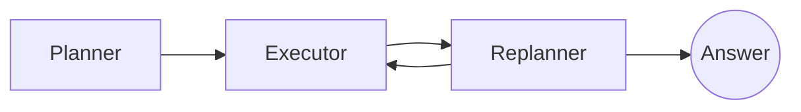

**Aliases:**
- planner-executor
- plan-and-solve agent
- planner/replanner

**Topology:** Pipeline with feedback: Planner -> Executor(s) -> Replanner -> (Executor | Finish).

**Control flow:** Centralized

**Communication pattern:** Plan object passed down; step results passed back to replanner.

**Coordination mechanism:** Explicit plan as shared artifact; replanning loop.

**Typical roles:**
- Planner
- Executor (tool-using)
- Replanner / solver

**Memory model:** Plan + past steps list in shared state.

**Characteristics:**
- Separates long-horizon reasoning from tool execution
- Executor can be a smaller model

**Strengths:**
- Fewer calls to the expensive model
- Forces explicit thinking about the whole task
- Plan is auditable

**Weaknesses:**
- Static plans go stale when web results surprise
- Sequential by default

**Failure modes:**
- Plan too coarse or hallucinated steps
- Replanner rubber-stamps failures

**Scalability:** Single-thread unless steps are parallelised (see LLMCompiler).

**Cost / latency:** Lower cost than ReAct on long tasks; latency still sequential.

**Best use cases:**
- Multi-step research questions with predictable structure
- Scrape jobs with known site sequence (login -> list -> detail pages)

**Research & scraping fit:** Good for structured scraping jobs and literature reviews with known phases.

**Poor fit:**
- Highly exploratory tasks where the next step depends heavily on surprises

**Variants:**
- Plan-and-Solve prompting
- ReWOO
- LLMCompiler
- BabyAGI task list

**Frameworks / implementations:**
- LangGraph plan-and-execute tutorial
- CrewAI planning=True

**Related:** [ReWOO (Reasoning WithOut Observation)](#rewoo), [LLMCompiler (parallel task DAG)](#llmcompiler_dag), [Orchestrator-Worker (Lead agent + subagents)](#orchestrator_worker), [Task-Queue Agent Loop (BabyAGI-style)](#task_queue_babyagi)

**Key sources:**
- [LangChain blog: Plan-and-Execute agents (Plan-and-execute, ReWOO, LLMCompiler)](https://blog.langchain.dev/planning-agents/)
- [Lei Wang et al. (2023) Plan-and-Solve Prompting: Improving Zero-Shot Chain-of-Thought Reasoning by Large Language Models](https://arxiv.org/abs/2305.04091)

<a id="rewoo"></a>
## ReWOO (Reasoning WithOut Observation)

`id: rewoo` · complexity 2/5 · research fit 3/5 · scraping fit 4/5

Planner writes the full plan with evidence placeholders (#E1, #E2) up front; workers execute tools filling placeholders; a solver composes the answer. No LLM call between tool steps.

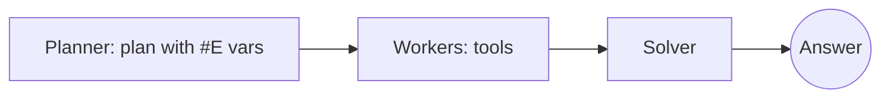

**Aliases:**
- planner-worker-solver
- decoupled reasoning

**Topology:** Three-stage pipeline: Planner -> Worker(s) -> Solver.

**Control flow:** Centralized

**Communication pattern:** Variable substitution of tool outputs into plan.

**Coordination mechanism:** Pre-declared dependency variables.

**Typical roles:**
- Planner
- Worker (tool executor)
- Solver

**Memory model:** Plan with evidence variables.

**Characteristics:**
- Decouples reasoning from observations
- Token-efficient

**Strengths:**
- Large token savings vs ReAct
- Workers can run tools without LLM

**Weaknesses:**
- Cannot adapt mid-way to observations
- Planner errors propagate

**Failure modes:**
- Placeholder chain breaks when a tool returns unexpected format

**Scalability:** Good; tool calls can be parallel if independent.

**Cost / latency:** Low token cost, low latency.

**Best use cases:**
- Predictable lookup chains (search X, fetch page, extract Y)
- Cheap high-volume enrichment

**Research & scraping fit:** Strong for cheap, repetitive enrichment scrapes where the steps are known.

**Poor fit:**
- Exploratory browsing
- Sites requiring adaptive navigation

**Variants:**
- ReWOO
- LLMCompiler (adds parallel DAG)

**Frameworks / implementations:**
- LangGraph ReWOO tutorial

**Related:** [Plan-and-Execute](#plan_and_execute), [LLMCompiler (parallel task DAG)](#llmcompiler_dag)

**Key sources:**
- [Binfeng Xu et al. (2023) ReWOO: Decoupling Reasoning from Observations for Efficient Augmented Language Models](https://arxiv.org/abs/2305.18323)
- [LangChain blog: Plan-and-Execute agents (Plan-and-execute, ReWOO, LLMCompiler)](https://blog.langchain.dev/planning-agents/)

<a id="supervisor_router"></a>
## Supervisor (LLM-routed worker graph)

`id: supervisor_router` · complexity 2/5 · research fit 4/5 · scraping fit 3/5

A supervisor LLM node repeatedly picks which specialist agent acts next (or FINISH), receiving each agent's output back before choosing again.

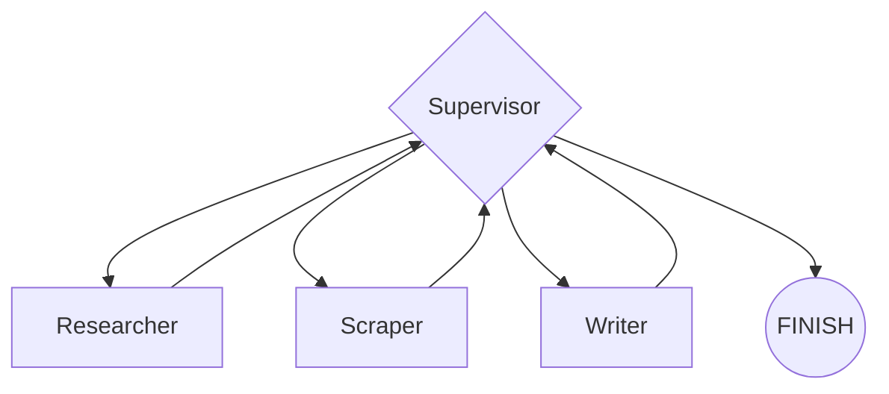

**Aliases:**
- supervisor architecture
- agent supervisor
- group manager

**Topology:** Star with a loop: supervisor <-> each worker; workers return to supervisor after each step.

**Control flow:** Centralized

**Communication pattern:** Turn-based routing; handoff tools or Command routing; shared or partially shared message history.

**Coordination mechanism:** Supervisor selects next worker from descriptions + state; can call several in parallel or map-reduce.

**Typical roles:**
- Supervisor
- Specialist workers (researcher, coder, writer)

**Memory model:** Shared graph state (message list) usually visible to supervisor; output_mode controls whether full worker history or last message is added.

**Characteristics:**
- Sequential multi-step loop
- Explicit FINISH decision
- Workers can be whole sub-agents

**Strengths:**
- Simple mental model
- Easy to add/remove specialists
- Natural checkpointing in graph frameworks

**Weaknesses:**
- Extra LLM call per routing step
- Supervisor context grows with worker outputs
- Translation loss when supervisor paraphrases worker results

**Failure modes:**
- Ping-pong between two workers
- Supervisor never emits FINISH
- Wrong specialist chosen due to vague descriptions

**Scalability:** Moderate: routing accuracy degrades as worker count grows (tool selection overload); nest into hierarchy for >~10 workers.

**Cost / latency:** Medium-high; one supervisor call per hop adds latency.

**Best use cases:**
- Research assistant with search, scrape, analysis and writing specialists
- Mixed tool domains needing different prompts

**Research & scraping fit:** Good for interactive research where next step depends on last result (search -> scrape -> analyse -> search again).

**Poor fit:**
- Embarrassingly parallel bulk scraping (fan-out is cheaper)
- Hard real-time

**Variants:**
- Tool-calling supervisor (workers as tools)
- Command-based routing in LangGraph
- Parallel tool-call supervisor

**Frameworks / implementations:**
- LangGraph supervisor / langgraph-supervisor
- CrewAI hierarchical manager
- Swarms HierarchicalSwarm

**Related:** [Orchestrator-Worker (Lead agent + subagents)](#orchestrator_worker), [Hierarchical Teams (supervisor of supervisors)](#hierarchical_teams), [Router / Dispatcher](#router_dispatcher), [Group Chat with Speaker Selection (AutoGen)](#group_chat_selector)

**Key sources:**
- [LangGraph multi-agent concepts (network, supervisor, hierarchical, custom)](https://langchain-ai.github.io/langgraph/concepts/multi_agent/)
- [LangGraph.js multi_agent.md concept doc](https://github.com/langchain-ai/langgraphjs/blob/86389fa3/docs/docs/concepts/multi_agent.md)
- [langgraph-supervisor-py (GitHub)](https://github.com/langchain-ai/langgraph-supervisor-py)
- [Migrate from langgraph-supervisor to subagents pattern](https://docs.langchain.com/oss/python/migrate/langgraph-supervisor)

<a id="talkhier"></a>
## TalkHier (structured hierarchical talk)

`id: talkhier` · complexity 4/5 · research fit 4/5 · scraping fit 2/5

Hierarchical multi-agent framework with a structured communication protocol (message, background, intermediate output) and hierarchical refinement where evaluator teams feed summarised feedback to a supervisor.

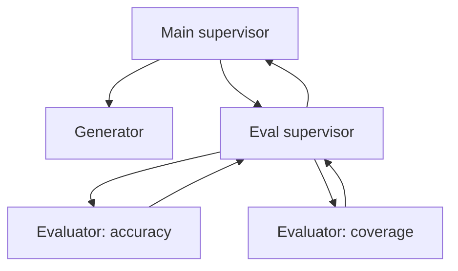

**Aliases:**
- Talk Structurally, Act Hierarchically

**Topology:** Tree: main supervisor -> generator and evaluation teams with their own supervisors.

**Control flow:** Centralized/hierarchical

**Communication pattern:** Structured messages with explicit context fields.

**Coordination mechanism:** Hierarchical refinement: evaluators score, evaluation supervisor aggregates, main supervisor revises.

**Typical roles:**
- Main supervisor
- Generator
- Evaluator supervisor
- Evaluators

**Memory model:** Per-agent memory plus structured message context.

**Characteristics:**
- Communication schema reduces ambiguity
- Separates generation from evaluation hierarchically

**Strengths:**
- Reduced miscommunication
- Balanced multi-criteria feedback

**Weaknesses:**
- Heavier prompting overhead

**Failure modes:**
- Evaluator disagreement unresolved
- Overhead without gains on simple tasks

**Scalability:** Moderate.

**Cost / latency:** High.

**Best use cases:**
- Research reports needing multi-criteria review (accuracy, coverage, style)

**Research & scraping fit:** Good for high-stakes research outputs; overkill for scraping.

**Poor fit:**
- Bulk extraction

**Variants:**
- TalkHier

**Frameworks / implementations:**
- TalkHier reference implementation (paper)

**Related:** [Hierarchical Teams (supervisor of supervisors)](#hierarchical_teams), [Evaluator-Optimizer (Generator-Critic loop)](#evaluator_optimizer)

**Key sources:**
- [Zhao Wang et al. (2025) Talk Structurally, Act Hierarchically: A Collaborative Framework for LLM Multi-Agent Systems](https://arxiv.org/abs/2502.11098)

<a id="task_queue_babyagi"></a>
## Task-Queue Agent Loop (BabyAGI-style)

`id: task_queue_babyagi` · complexity 2/5 · research fit 3/5 · scraping fit 4/5

Three cooperating roles run in a loop over a shared task list: an execution agent completes the top task, a creation agent adds new tasks from results, a prioritisation agent reorders the queue.

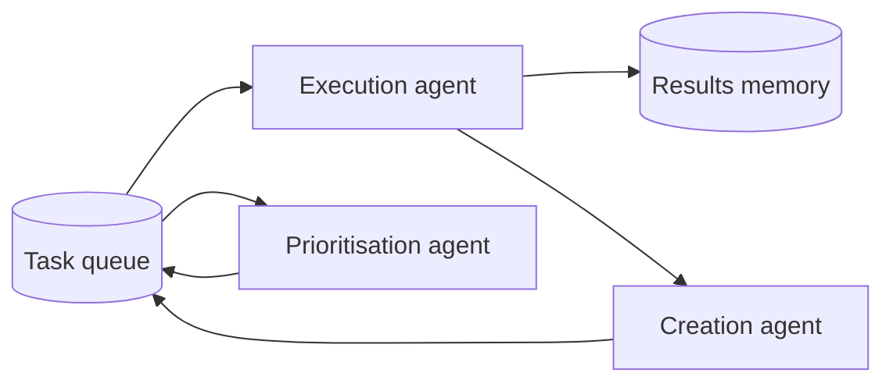

**Aliases:**
- task creation / prioritization / execution loop
- autonomous task list
- job-queue agents

**Topology:** Ring/loop around a shared task queue and vector memory.

**Control flow:** Centralized (shared queue)

**Communication pattern:** Agents read/write a shared queue and results store.

**Coordination mechanism:** Priority queue + objective; memory retrieval for context.

**Typical roles:**
- Execution agent
- Task creation agent
- Prioritisation agent

**Memory model:** Vector store of task results + task queue.

**Characteristics:**
- Open-ended autonomous loop
- Objective-driven

**Strengths:**
- Simple and generalisable
- Naturally extends to worker pools pulling from a queue

**Weaknesses:**
- Unbounded task growth
- Drifts from objective

**Failure modes:**
- Infinite task generation
- Duplicate tasks
- Goal drift

**Scalability:** Queue can feed many parallel workers (worker pool); needs dedup.

**Cost / latency:** Unbounded unless capped.

**Best use cases:**
- Crawl frontier management
- Long-running background research with budget caps

**Research & scraping fit:** The queue+workers idea maps directly onto a crawl frontier; add dedup, budgets and stop criteria.

**Poor fit:**
- Tasks needing guaranteed termination without guardrails

**Variants:**
- BabyAGI
- AutoGPT-style loops
- Worker pool with work stealing

**Frameworks / implementations:**
- BabyAGI
- AutoGPT

**Related:** [Plan-and-Execute](#plan_and_execute), [Centralized-Frontier Distributed Crawler (Mercator-style)](#distributed_crawler_frontier), [LLM Blackboard Multi-Agent System](#blackboard_llm)

**Key sources:**
- [yoheinakajima/babyagi (GitHub)](https://github.com/yoheinakajima/babyagi)
- [Significant-Gravitas/AutoGPT (GitHub)](https://github.com/Significant-Gravitas/AutoGPT)
- [Blumofe & Leiserson (1999) Scheduling multithreaded computations by work stealing. J. ACM](https://doi.org/10.1145/324133.324234)


---

# Classical MAS architectures & organizations

<a id="actor_model"></a>
## Actor Model (message-passing runtime)

`id: actor_model` · complexity 3/5 · research fit 3/5 · scraping fit 5/5

Computation by independent actors with private state that communicate only via asynchronous messages, can create new actors and decide how to handle the next message.

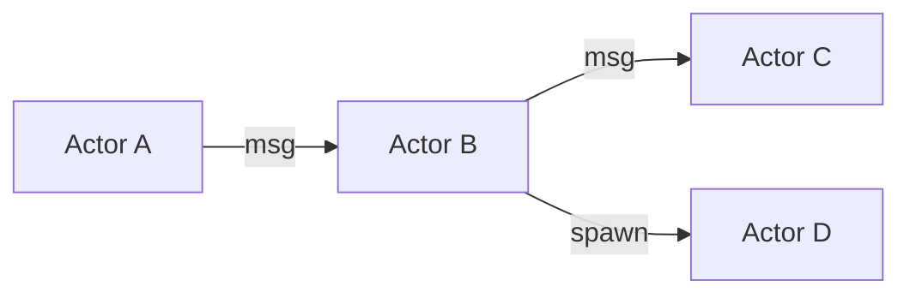

**Aliases:**
- actors
- mailbox concurrency
- agent runtime

**Topology:** Arbitrary dynamic graph of addresses.

**Control flow:** Decentralized

**Communication pattern:** Asynchronous message passing to mailboxes.

**Coordination mechanism:** Messages; supervision trees (in Erlang/Akka-like systems).

**Typical roles:**
- Actors
- Supervisors

**Memory model:** Private per-actor state.

**Characteristics:**
- No shared memory
- Location transparency

**Strengths:**
- Natural for distributed agent runtimes; fault isolation

**Weaknesses:**
- Global reasoning harder

**Failure modes:**
- Mailbox overflow; deadlocks via request cycles

**Scalability:** Very high (distributed).

**Cost / latency:** Low overhead.

**Best use cases:**
- Runtime substrate for large swarms (AutoGen Core is actor-style)

**Research & scraping fit:** Good substrate for large scraping fleets (each crawler/extractor an actor with a mailbox).

**Poor fit:**
- —

**Variants:**
- Erlang/OTP
- Akka
- AutoGen Core runtime
- Ray actors

**Frameworks / implementations:**
- AutoGen Core
- Ray
- Akka

**Related:** [Publish-Subscribe Message Pool / Event Bus](#pubsub_message_pool), [Gossip / Epidemic Peer-to-Peer Dissemination](#gossip_p2p)

**Key sources:**
- [Hewitt, Bishop, Steiger (1973) A Universal Modular ACTOR Formalism for AI. IJCAI](https://www.ijcai.org/Proceedings/73/Papers/027B.pdf)
- [Wikipedia: Actor model](https://en.wikipedia.org/wiki/Actor_model)
- [AutoGen Core: Topic and Subscription (pub/sub)](https://microsoft.github.io/autogen/stable/user-guide/core-user-guide/core-concepts/topic-and-subscription.html)

<a id="bdi_agents"></a>
## BDI Agents (Belief-Desire-Intention)

`id: bdi_agents` · complexity 3/5 · research fit 3/5 · scraping fit 2/5

Agent architecture with beliefs (state), desires (goals) and intentions (committed plans); a deliberation cycle generates options, filters them, commits to intentions and executes hierarchical plans.

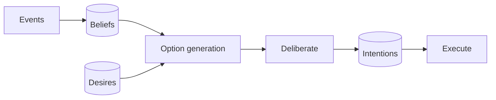

**Aliases:**
- BDI
- PRS
- dMARS
- AgentSpeak/Jason

**Topology:** Single-agent architecture; multi-agent via messaging.

**Control flow:** Per-agent deliberative

**Communication pattern:** Agent communication languages (e.g. FIPA ACL / KQML) in MAS settings.

**Coordination mechanism:** Plan libraries; intention commitment and reconsideration.

**Typical roles:**
- BDI agent

**Memory model:** Belief base + goal stack + intention stack.

**Characteristics:**
- Commitment to plans; reactive to events

**Strengths:**
- Principled goal management; interpretable

**Weaknesses:**
- Hand-written plan libraries

**Failure modes:**
- Over/under-commitment to intentions

**Scalability:** Moderate.

**Cost / latency:** Cheap (symbolic).

**Best use cases:**
- Structuring LLM agents with explicit belief/goal/intent state

**Research & scraping fit:** Useful to structure a research agent's state: beliefs (facts found), desires (open questions), intentions (current search plan).

**Poor fit:**
- —

**Variants:**
- PRS
- dMARS
- AgentSpeak/Jason
- JACK

**Frameworks / implementations:**
- Jason, JACK, PRS

**Related:** [Plan-and-Execute](#plan_and_execute), [Subsumption / Layered Reactive Architecture](#subsumption_layered)

**Key sources:**
- [Rao & Georgeff (1995) BDI Agents: From Theory to Practice. ICMAS-95](https://cdn.aaai.org/ICMAS/1995/ICMAS95-042.pdf)
- [Wikipedia: Belief-desire-intention software model](https://en.wikipedia.org/wiki/Belief%E2%80%93desire%E2%80%93intention_software_model)

<a id="consensus_networks"></a>
## Networked Consensus / Cooperative Control

`id: consensus_networks` · complexity 3/5 · research fit 2/5 · scraping fit 1/5

Agents on a communication graph iteratively update their state toward neighbours' states, reaching agreement; convergence depends on graph connectivity (algebraic connectivity).

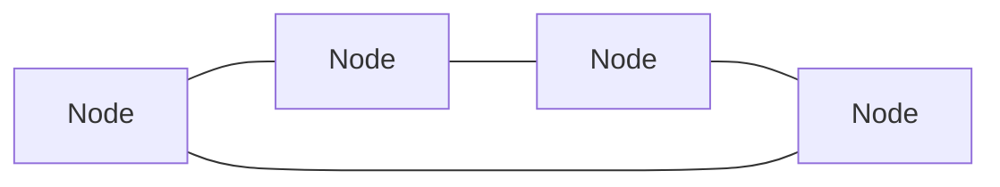

**Aliases:**
- distributed consensus
- average consensus
- flocking control

**Topology:** Arbitrary connected graph.

**Control flow:** Decentralized

**Communication pattern:** Neighbour exchange each step.

**Coordination mechanism:** Consensus protocols (weighted averaging).

**Typical roles:**
- Peer nodes

**Memory model:** Local state.

**Characteristics:**
- Graph theory guarantees

**Strengths:**
- Provable convergence

**Weaknesses:**
- Assumes numeric states

**Failure modes:**
- Disconnected graphs; adversarial nodes

**Scalability:** High.

**Cost / latency:** Low.

**Best use cases:**
- Theory for LLM debate convergence and topology choice

**Research & scraping fit:** Theory lens for designing debate/consensus among LLM verifiers.

**Poor fit:**
- —

**Variants:**
- Average consensus
- Leader-follower consensus
- Byzantine-resilient consensus

**Frameworks / implementations:**
- Control systems

**Related:** [Multi-Agent Debate (society of minds, rounds)](#multi_agent_debate), [Sparse-Topology Debate](#sparse_debate_topology), [Gossip / Epidemic Peer-to-Peer Dissemination](#gossip_p2p)

**Key sources:**
- [Olfati-Saber, Fax, Murray (2007) Consensus and Cooperation in Networked Multi-Agent Systems. Proc. IEEE](https://doi.org/10.1109/JPROC.2006.887293)

<a id="federation_facilitator"></a>
## Federation / Facilitator (broker-mediated)

`id: federation_facilitator` · complexity 3/5 · research fit 3/5 · scraping fit 3/5

Agents join groups that delegate external communication to an intermediary (facilitator, broker, matchmaker) which routes requests by capability.

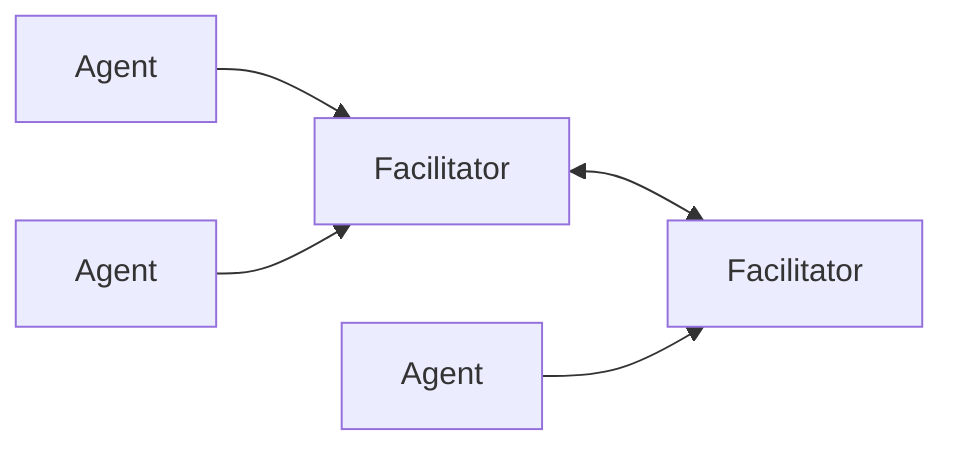

**Aliases:**
- federated MAS
- broker
- matchmaker
- facilitator

**Topology:** Agents grouped under intermediaries; intermediaries interconnect.

**Control flow:** Hybrid

**Communication pattern:** Via intermediaries.

**Coordination mechanism:** Capability advertisement and matchmaking.

**Typical roles:**
- Facilitator/broker
- Member agents

**Memory model:** Capability registry.

**Characteristics:**
- Agents need not know each other

**Strengths:**
- Interoperability; discovery

**Weaknesses:**
- Intermediary bottleneck

**Failure modes:**
- Facilitator failure isolates group

**Scalability:** Good.

**Cost / latency:** Extra hop.

**Best use cases:**
- Tool/agent registries

**Research & scraping fit:** Equivalent to a capability registry in front of scraping services.

**Poor fit:**
- Small closed teams

**Variants:**
- Broker
- Matchmaker
- Facilitator

**Frameworks / implementations:**
- Classical MAS

**Related:** [Protocol Federation (A2A + MCP)](#a2a_federation), [Internet of Agents (heterogeneous agent network)](#internet_of_agents), [Router / Dispatcher](#router_dispatcher)

**Key sources:**
- [Horling & Lesser (2004) A survey of multi-agent organizational paradigms. Knowledge Engineering Review](https://doi.org/10.1017/S0269888905000317)

<a id="holonic"></a>
## Holonic Multi-Agent System (holarchy)

`id: holonic` · complexity 4/5 · research fit 4/5 · scraping fit 3/5

Agents are holons: simultaneously wholes (composed of sub-holons) and parts of larger holons; a head holon represents the group externally; structure is recursive and self-similar, often dynamic.

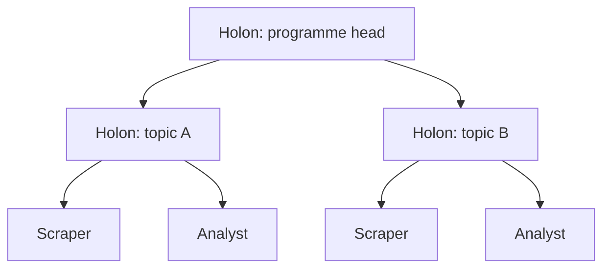

**Aliases:**
- holarchy
- holons
- holonic manufacturing
- recursive agent organisations

**Topology:** Recursive nested groups (holarchy).

**Control flow:** Hybrid (autonomy within, cooperation across)

**Communication pattern:** Through heads between levels; free within holon.

**Coordination mechanism:** Holon heads, commitments, dynamic holon formation.

**Typical roles:**
- Head holon
- Body holons
- Sub-holons

**Memory model:** Per-holon shared knowledge.

**Characteristics:**
- Self-similarity; partial autonomy

**Strengths:**
- Combines hierarchy's structure with heterarchy's flexibility

**Weaknesses:**
- Complex to engineer

**Failure modes:**
- Unclear authority boundaries

**Scalability:** High.

**Cost / latency:** Medium.

**Best use cases:**
- Large, evolving swarms where teams form/dissolve

**Research & scraping fit:** Good conceptual frame for big research programmes: each topic holon contains scraping, analysis and QA sub-holons and presents one interface upward.

**Poor fit:**
- Small tasks

**Variants:**
- LLM-enhanced holonic SoS
- Holonic Learning
- Holonic manufacturing

**Frameworks / implementations:**
- Research prototypes

**Related:** [Hierarchical Teams (supervisor of supervisors)](#hierarchical_teams), [Society of Mind (NLSOM / nested inner team)](#society_of_mind), [Coalitions, Teams & Congregations (organizational paradigms)](#coalitions_congregations)

**Key sources:**
- [Wikipedia: Holon (philosophy) (Koestler)](https://en.wikipedia.org/wiki/Holon_(philosophy))
- [Muhammad Ashfaq et al. (2025) LLM-Ehnanced Holonic Architecture for Ad-Hoc Scalable SoS](https://arxiv.org/abs/2501.07992)
- [Ahmad Esmaeili et al. (2023) Holonic Learning: A Flexible Agent-based Distributed Machine Learning Framework](https://arxiv.org/abs/2401.10839)
- [Horling & Lesser (2004) A survey of multi-agent organizational paradigms. Knowledge Engineering Review](https://doi.org/10.1017/S0269888905000317)

<a id="subsumption_layered"></a>
## Subsumption / Layered Reactive Architecture

`id: subsumption_layered` · complexity 2/5 · research fit 2/5 · scraping fit 4/5

Control is decomposed into layers of task-achieving behaviours; higher layers can suppress/inhibit lower ones; no central world model.

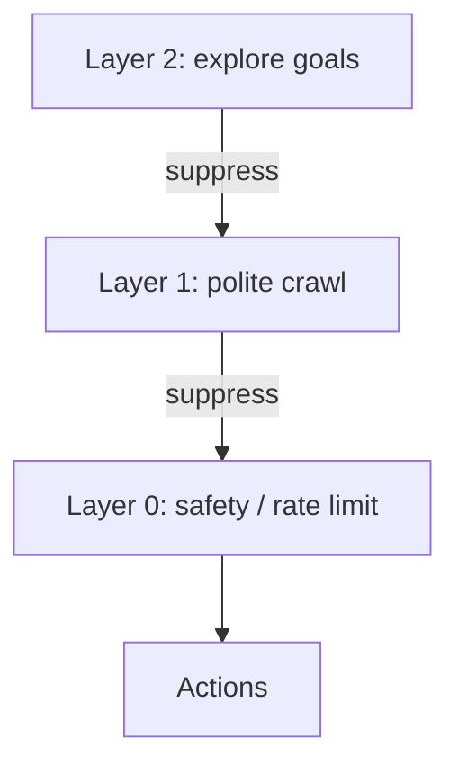

**Aliases:**
- subsumption architecture
- behaviour-based control
- layered control

**Topology:** Stack of layers with suppression/inhibition links.

**Control flow:** Decentralized within agent (layered priority)

**Communication pattern:** Signals between layers.

**Coordination mechanism:** Priority-based suppression.

**Typical roles:**
- Behaviour modules (avoid, wander, explore)

**Memory model:** Minimal; world as its own model.

**Characteristics:**
- Reactive, robust

**Strengths:**
- Fast, robust behaviour; incremental build-up

**Weaknesses:**
- Hard for long-horizon goals

**Failure modes:**
- Layer conflicts

**Scalability:** Per agent.

**Cost / latency:** Very cheap.

**Best use cases:**
- Safety/guardrail layering over LLM agents

**Research & scraping fit:** Pattern for scraper guardrails: low layers (robots.txt, rate limits, ban detection) override higher goal-seeking layers.

**Poor fit:**
- Deliberative research synthesis

**Variants:**
- Subsumption
- Three-layer architectures

**Frameworks / implementations:**
- Brooks robots

**Related:** [BDI Agents (Belief-Desire-Intention)](#bdi_agents), [Holonic Multi-Agent System (holarchy)](#holonic)

**Key sources:**
- [Brooks (1986) A robust layered control system for a mobile robot. IEEE J. Robotics & Automation](https://doi.org/10.1109/JRA.1986.1087032)
- [Wikipedia: Subsumption architecture](https://en.wikipedia.org/wiki/Subsumption_architecture)


---

# Classical swarm intelligence

<a id="ant_colony_optimization"></a>
## Ant Colony Optimization (Ant System / ACS)

`id: ant_colony_optimization` · complexity 2/5 · research fit 3/5 · scraping fit 4/5

Artificial ants build solutions probabilistically, biased by pheromone trails on solution components; good solutions deposit more pheromone; evaporation forgets poor paths.

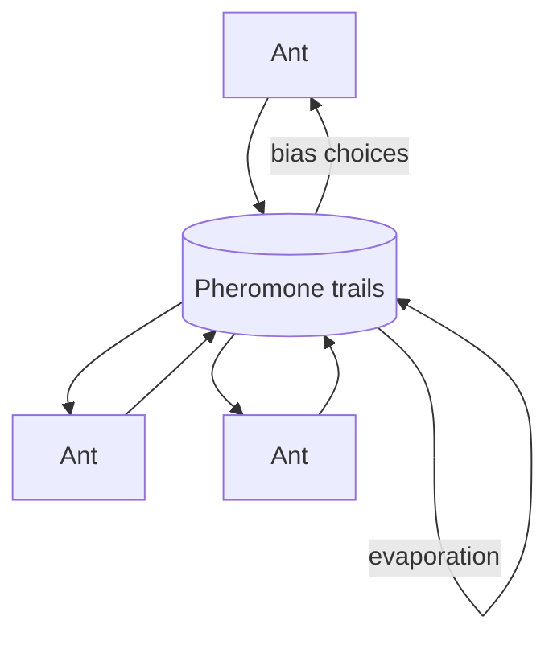

**Aliases:**
- ACO
- Ant System
- Ant Colony System
- MAX-MIN Ant System

**Topology:** No direct links; shared pheromone matrix (stigmergy).

**Control flow:** Decentralized

**Communication pattern:** Indirect via pheromone deposits.

**Coordination mechanism:** Positive feedback + evaporation + heuristic desirability.

**Typical roles:**
- Ants (homogeneous)
- Optional daemon actions (global update)

**Memory model:** Pheromone matrix in environment; ants have short tabu lists.

**Characteristics:**
- Stigmergic
- Constructive search

**Strengths:**
- Good for combinatorial path problems
- Robust, parallel

**Weaknesses:**
- Parameter-sensitive
- Slow convergence

**Failure modes:**
- Stagnation on a suboptimal trail

**Scalability:** High.

**Cost / latency:** Cheap agents, many iterations.

**Best use cases:**
- Routing/path problems; crawl path prioritisation

**Research & scraping fit:** Inspiration: score link paths by yield (relevant pages found) and reinforce productive navigation paths across crawler workers, with decay.

**Poor fit:**
- Continuous optimisation (PSO better)

**Variants:**
- Ant System
- Ant Colony System
- MAX-MIN Ant System
- Elitist AS

**Frameworks / implementations:**
- TSP solvers; network routing (AntNet)

**Related:** [Stigmergy (indirect coordination via environment)](#stigmergy_classic), [Stigmergic LLM Agents (pressure fields, shared artifacts)](#stigmergy_llm), [SwarmSys (explorer / worker / validator swarm)](#swarmsys), [Particle Swarm Optimization](#particle_swarm_optimization)

**Key sources:**
- [Dorigo, Maniezzo, Colorni (1996) Ant system: optimization by a colony of cooperating agents. IEEE TSMC-B](https://doi.org/10.1109/3477.484436)
- [Dorigo & Gambardella (1997) Ant colony system. IEEE Trans. Evol. Comp.](https://doi.org/10.1109/4235.585892)
- [Wikipedia: Ant colony optimization algorithms](https://en.wikipedia.org/wiki/Ant_colony_optimization_algorithms)

<a id="artificial_bee_colony"></a>
## Artificial Bee Colony (employed / onlooker / scout)

`id: artificial_bee_colony` · complexity 2/5 · research fit 4/5 · scraping fit 5/5

Employed bees exploit known food sources, onlooker bees choose sources probabilistically by quality (waggle-dance analogue), scouts abandon exhausted sources and explore randomly.

```mermaid
flowchart TD
    H((Hive / dance floor))
    E[Employed bees]-->|report quality|H
    H-->|recruit|O[Onlookers]
    S[Scouts]-->|new sources|H
    O-->FS[(Food sources)]
    E-->FS
```

**Aliases:**
- ABC
- bee algorithm
- honeybee foraging

**Topology:** Hive-centred broadcast of source quality.

**Control flow:** Decentralized

**Communication pattern:** Quality advertisement at hive.

**Coordination mechanism:** Fitness-proportional recruitment; abandonment limit triggers scouting.

**Typical roles:**
- Employed bees
- Onlookers
- Scouts

**Memory model:** Food source positions + trial counters.

**Characteristics:**
- Explicit explore/exploit role split

**Strengths:**
- Balances exploration/exploitation via roles

**Weaknesses:**
- Slow on some problems

**Failure modes:**
- Too few scouts -> stagnation

**Scalability:** High.

**Cost / latency:** Cheap.

**Best use cases:**
- Allocating effort between known productive sources and new sources

**Research & scraping fit:** Strong analogy for research swarms: most workers mine high-yield sources, onlookers follow yield signals, scouts search for new sources; abandon sources after N fruitless tries.

**Poor fit:**
- —

**Variants:**
- ABC
- Bees algorithm

**Frameworks / implementations:**
- Optimisation libraries

**Related:** [Ant Colony Optimization (Ant System / ACS)](#ant_colony_optimization), [SwarmSys (explorer / worker / validator swarm)](#swarmsys), [Orchestrator-Worker (Lead agent + subagents)](#orchestrator_worker)

**Key sources:**
- [Karaboga & Basturk (2007) Artificial bee colony (ABC) algorithm. J. Global Optimization](https://doi.org/10.1007/s10898-007-9149-x)
- [Wikipedia: Artificial bee colony algorithm](https://en.wikipedia.org/wiki/Artificial_bee_colony_algorithm)

<a id="boids_flocking"></a>
## Boids / Flocking

`id: boids_flocking` · complexity 1/5 · research fit 2/5 · scraping fit 3/5

Each agent follows three local rules over nearby neighbours: separation, alignment and cohesion; global flocking emerges.

```mermaid
flowchart LR
    B1[Boid]-.-B2[Boid]
    B2-.-B3[Boid]
    B1-.-B3
    B3-.-B4[Boid]
```

**Aliases:**
- flocking
- herding
- schooling

**Topology:** Local neighbourhood (radius-based) dynamic graph.

**Control flow:** Decentralized

**Communication pattern:** Local sensing of neighbours.

**Coordination mechanism:** Local steering rules.

**Typical roles:**
- Homogeneous boids

**Memory model:** None (reactive).

**Characteristics:**
- Emergence from local rules

**Strengths:**
- Scalable; no leader

**Weaknesses:**
- Not goal-directed by default

**Failure modes:**
- Fragmentation; collisions with poor parameters

**Scalability:** Very high.

**Cost / latency:** Cheap.

**Best use cases:**
- Spatial coordination; analogy for keeping agents apart (separation) on work

**Research & scraping fit:** Separation rule analogue: keep scrapers from hitting the same domain/topic (politeness, dedup), alignment: share strategy.

**Poor fit:**
- Symbolic tasks

**Variants:**
- Boids
- Vicsek model

**Frameworks / implementations:**
- Graphics/robotics simulations

**Related:** [Particle Swarm Optimization](#particle_swarm_optimization), [Swarm Robotics (swarm engineering)](#swarm_robotics)

**Key sources:**
- [Reynolds (1987) Flocks, herds and schools: A distributed behavioral model. SIGGRAPH](https://doi.org/10.1145/37402.37406)
- [Wikipedia: Boids](https://en.wikipedia.org/wiki/Boids)

<a id="firefly_gwo_family"></a>
## Metaheuristic Swarm Family (Firefly, Grey Wolf, Bacterial Foraging)

`id: firefly_gwo_family` · complexity 2/5 · research fit 2/5 · scraping fit 2/5

Firefly: agents move toward brighter (better) peers with distance-attenuated attraction; Grey Wolf: alpha/beta/delta leaders guide omega wolves (a social hierarchy); Bacterial Foraging: chemotaxis, swarming, reproduction and elimination-dispersal.

```mermaid
flowchart TD
    AL[Alpha]-->OM[Omega wolves]
    BE[Beta]-->OM
    DE[Delta]-->OM
```

**Aliases:**
- firefly algorithm
- grey wolf optimizer
- BFOA
- nature-inspired metaheuristics

**Topology:** Attraction graph (firefly), leader hierarchy (GWO), local chemotaxis (BFO).

**Control flow:** Decentralized (with emergent leaders in GWO)

**Communication pattern:** Fitness signals / attraction.

**Coordination mechanism:** Attraction to fitter agents; leader-following; reproduction/elimination.

**Typical roles:**
- Fireflies
- Alpha/beta/delta/omega wolves
- Bacteria

**Memory model:** Positions.

**Characteristics:**
- Different social structures for search

**Strengths:**
- Multimodal search (firefly subgroups)

**Weaknesses:**
- Many are variants with debated novelty

**Failure modes:**
- Premature convergence

**Scalability:** High.

**Cost / latency:** Cheap.

**Best use cases:**
- Inspiration for leader-follower and attraction-based agent allocation

**Research & scraping fit:** GWO suggests a 3-leader steering committee rather than a single lead; firefly suggests local subgroups exploring multiple promising topics.

**Poor fit:**
- Direct LLM use

**Variants:**
- Firefly
- Grey Wolf Optimizer
- Bacterial Foraging Optimization

**Frameworks / implementations:**
- Metaheuristic libraries

**Related:** [Particle Swarm Optimization](#particle_swarm_optimization), [Artificial Bee Colony (employed / onlooker / scout)](#artificial_bee_colony), [Hierarchical Teams (supervisor of supervisors)](#hierarchical_teams)

**Key sources:**
- [Yang (2009) Firefly Algorithms for Multimodal Optimization. LNCS](https://doi.org/10.1007/978-3-642-04944-6_14)
- [Mirjalili, Mirjalili, Lewis (2014) Grey Wolf Optimizer. Adv. Eng. Software](https://doi.org/10.1016/j.advengsoft.2013.12.007)
- [Passino (2002) Biomimicry of bacterial foraging for distributed optimization and control. IEEE Control Systems](https://doi.org/10.1109/MCS.2002.1004010)

<a id="particle_swarm_optimization"></a>
## Particle Swarm Optimization

`id: particle_swarm_optimization` · complexity 2/5 · research fit 2/5 · scraping fit 2/5

Particles move through a search space with velocities pulled toward their own best position and the best position found by their neighbourhood (global or local topology).

```mermaid
flowchart LR
    P1[Particle]-->NB((Neighbourhood best))
    P2[Particle]-->NB
    P3[Particle]-->NB
    NB-->P1
    NB-->P2
    NB-->P3
```

**Aliases:**
- PSO
- gbest/lbest PSO

**Topology:** Global (star/gbest) or local (ring/lbest, von Neumann) neighbourhoods.

**Control flow:** Decentralized

**Communication pattern:** Neighbourhood best sharing.

**Coordination mechanism:** Velocity update with inertia, cognitive and social terms.

**Typical roles:**
- Particles

**Memory model:** Personal best + neighbourhood best.

**Characteristics:**
- Neighbourhood topology controls exploration vs exploitation

**Strengths:**
- Simple and effective for continuous problems

**Weaknesses:**
- Premature convergence in gbest

**Failure modes:**
- Swarm collapse on local optimum

**Scalability:** High.

**Cost / latency:** Cheap.

**Best use cases:**
- Continuous parameter tuning; neighbourhood-topology lessons for agent comms

**Research & scraping fit:** Lesson for LLM swarms: local (ring) sharing preserves diversity longer than global broadcast.

**Poor fit:**
- Discrete language tasks directly

**Variants:**
- gbest
- lbest ring
- von Neumann
- constriction PSO

**Frameworks / implementations:**
- pyswarms etc.

**Related:** [Model Swarms (PSO over LLM experts)](#model_swarms_pso), [Sparse-Topology Debate](#sparse_debate_topology), [Boids / Flocking](#boids_flocking)

**Key sources:**
- [Kennedy & Eberhart (1995) Particle swarm optimization. Proc. ICNN](https://doi.org/10.1109/ICNN.1995.488968)
- [Wikipedia: Particle swarm optimization](https://en.wikipedia.org/wiki/Particle_swarm_optimization)

<a id="swarm_robotics"></a>
## Swarm Robotics (swarm engineering)

`id: swarm_robotics` · complexity 3/5 · research fit 2/5 · scraping fit 3/5

Large numbers of simple robots with local sensing/communication achieve collective behaviours (aggregation, foraging, task allocation); engineering methods cover design and analysis.

```mermaid
flowchart LR
    R1[Robot]-.-R2[Robot]
    R2-.-R3[Robot]
    R3-.-R4[Robot]
    R4-.-R1
```

**Aliases:**
- robot swarms
- collective robotics

**Topology:** Local communication graph.

**Control flow:** Decentralized

**Communication pattern:** Local, often range-limited.

**Coordination mechanism:** Behaviour-based rules, probabilistic finite state machines, automatic design.

**Typical roles:**
- Homogeneous robots

**Memory model:** Local.

**Characteristics:**
- Robustness, flexibility, scalability as design goals

**Strengths:**
- Fault tolerance

**Weaknesses:**
- Hard to predict macro from micro

**Failure modes:**
- Emergent undesirable behaviour

**Scalability:** Very high.

**Cost / latency:** Cheap units.

**Best use cases:**
- Design principles for large homogeneous LLM worker swarms

**Research & scraping fit:** Design principles: homogeneous workers + local rules + probabilistic task switching for elastic crawl fleets.

**Poor fit:**
- —

**Variants:**
- Aggregation
- Foraging
- Task allocation
- Collective decision-making

**Frameworks / implementations:**
- Kilobots, ARGoS simulator

**Related:** [Boids / Flocking](#boids_flocking), [Stigmergy (indirect coordination via environment)](#stigmergy_classic), [Networked Consensus / Cooperative Control](#consensus_networks)

**Key sources:**
- [Brambilla et al. (2013) Swarm robotics: a review from the swarm engineering perspective. Swarm Intelligence](https://doi.org/10.1007/s11721-012-0075-2)


---

# Conversational teams & role-play

<a id="agentverse_dynamic_team"></a>
## Dynamic Expert Recruitment (AgentVerse)

`id: agentverse_dynamic_team` · complexity 3/5 · research fit 4/5 · scraping fit 2/5

A recruiter agent composes a team of expert roles for the task; the group decides (horizontal or vertical structure), executes, evaluates and adjusts membership over iterations.

```mermaid
flowchart LR
    R[Recruiter]-->D[Decision-making group]
    D-->X[Execution]
    X-->E[Evaluation]
    E-->R
```

**Aliases:**
- AgentVerse
- expert recruitment
- recruit-decide-execute-evaluate

**Topology:** Dynamic group; horizontal (democratic) or vertical (solver + reviewers).

**Control flow:** Hybrid

**Communication pattern:** Group discussion then execution.

**Coordination mechanism:** Four stages: expert recruitment, collaborative decision-making, action execution, evaluation (feedback to recruitment).

**Typical roles:**
- Recruiter
- Experts
- Solver
- Reviewers
- Evaluator

**Memory model:** Shared group context per round.

**Characteristics:**
- Team composition adapts to task
- Studies emergent behaviours (volunteer, conformity, destructive)

**Strengths:**
- Right-sized teams
- Adapts across iterations

**Weaknesses:**
- Recruitment quality critical

**Failure modes:**
- Destructive or conformity behaviours noted in paper

**Scalability:** Small-medium.

**Cost / latency:** High.

**Best use cases:**
- Research questions needing ad-hoc domain experts

**Research & scraping fit:** Good for assembling per-question expert panels in research (e.g. legal + financial analyst).

**Poor fit:**
- Repetitive extraction

**Variants:**
- Horizontal communication
- Vertical communication

**Frameworks / implementations:**
- OpenBMB/AgentVerse

**Related:** [Dynamic LLM-Agent Network (DyLAN)](#dylan_dynamic_network), [Group Chat with Speaker Selection (AutoGen)](#group_chat_selector), [Evolutionary Agent Generation (EvoAgent)](#evoagent_evolutionary)

**Key sources:**
- [Weize Chen et al. (2023) AgentVerse: Facilitating Multi-Agent Collaboration and Exploring Emergent Behaviors](https://arxiv.org/abs/2308.10848)
- [OpenBMB/AgentVerse (GitHub)](https://github.com/OpenBMB/AgentVerse)

<a id="cooperative_embodied_coela"></a>
## Modular Cooperative Agents with Communication Module (CoELA)

`id: cooperative_embodied_coela` · complexity 3/5 · research fit 2/5 · scraping fit 2/5

Each agent has perception, memory, communication, planning and execution modules; agents decide what and when to communicate under costly communication, cooperating on embodied tasks.

```mermaid
flowchart LR
    A[Agent A: modules]<-.costly msg.->B[Agent B: modules]
```

**Aliases:**
- CoELA
- perception-memory-communication-planning-execution modules

**Topology:** Peer agents (decentralized), each modular.

**Control flow:** Decentralized

**Communication pattern:** Selective natural-language messages (communication has cost).

**Coordination mechanism:** LLM decides if communication is worth it.

**Typical roles:**
- Peer cooperative agents

**Memory model:** Semantic, episodic, procedural memory per agent.

**Characteristics:**
- Cost-aware communication

**Strengths:**
- Efficient cooperation

**Weaknesses:**
- Embodied focus

**Failure modes:**
- Over/under-communication

**Scalability:** Small teams.

**Cost / latency:** Medium.

**Best use cases:**
- Peer agents sharing only important findings

**Research & scraping fit:** Lesson: let peer scrapers message only when they find something others need.

**Poor fit:**
- —

**Variants:**
- CoELA

**Frameworks / implementations:**
- Paper code

**Related:** [Agent Network (many-to-many, any agent routes)](#network_all_to_all), [LLM Blackboard Multi-Agent System](#blackboard_llm)

**Key sources:**
- [Hongxin Zhang et al. (2023) Building Cooperative Embodied Agents Modularly with Large Language Models](https://arxiv.org/abs/2307.02485)

<a id="generative_agents_sim"></a>
## Generative Agent Society Simulation

`id: generative_agents_sim` · complexity 4/5 · research fit 2/5 · scraping fit 1/5

Many persona agents with memory streams, reflection and planning live in a shared environment and interact, producing emergent social behaviour.

```mermaid
flowchart LR
    A[Agent A]<-->B[Agent B]
    B<-->C[Agent C]
    A-->ENV[(Shared world)]
    B-->ENV
    C-->ENV
```

**Aliases:**
- Smallville
- generative agents
- persona simulation
- TinyTroupe

**Topology:** Spatial/social graph in shared environment; agents meet and converse locally.

**Control flow:** Decentralized

**Communication pattern:** Local pairwise dialogue + environment observation.

**Coordination mechanism:** Emergent; memory retrieval (recency, importance, relevance), reflection, planning.

**Typical roles:**
- Persona agents
- Environment

**Memory model:** Per-agent memory stream with reflections.

**Characteristics:**
- Believable behaviour
- Information diffusion emerges

**Strengths:**
- Studies social dynamics; user/market simulation

**Weaknesses:**
- Expensive; not task-oriented

**Failure modes:**
- Memory retrieval errors; embellishment

**Scalability:** Tens of agents in original work; costly to scale.

**Cost / latency:** Very high.

**Best use cases:**
- Simulating users/markets for survey-style research

**Research & scraping fit:** Only for simulation-based research (synthetic focus groups); not for scraping.

**Poor fit:**
- Goal-directed retrieval

**Variants:**
- Generative Agents
- TinyTroupe persona simulation

**Frameworks / implementations:**
- joonspk-research/generative_agents
- microsoft/TinyTroupe

**Related:** [Society of Mind (NLSOM / nested inner team)](#society_of_mind), [Stigmergic LLM Agents (pressure fields, shared artifacts)](#stigmergy_llm)

**Key sources:**
- [Joon Sung Park et al. (2023) Generative Agents: Interactive Simulacra of Human Behavior](https://arxiv.org/abs/2304.03442)
- [joonspk-research/generative_agents (GitHub)](https://github.com/joonspk-research/generative_agents)
- [microsoft/TinyTroupe (GitHub)](https://github.com/microsoft/TinyTroupe)

<a id="group_chat_selector"></a>
## Group Chat with Speaker Selection (AutoGen)

`id: group_chat_selector` · complexity 2/5 · research fit 3/5 · scraping fit 2/5

All participants share one broadcast conversation; a manager (LLM or custom function) picks the next speaker each turn based on context and agent descriptions.

```mermaid
flowchart TD
    M{Group chat manager}-.selects.->A[Planner]
    M-.->B[Searcher]
    M-.->C[Analyst]
    A-->T[(Shared transcript)]
    B-->T
    C-->T
    T-->M
```

**Aliases:**
- SelectorGroupChat
- GroupChatManager
- LLM-selected speaker
- group chat orchestration

**Topology:** Bus/broadcast with a manager selecting speakers.

**Control flow:** Centralized (speaker selector)

**Communication pattern:** Broadcast: every message visible to all participants.

**Coordination mechanism:** LLM speaker selection with optional selector_func / candidate_func; termination conditions (e.g. APPROVED keyword, max messages).

**Typical roles:**
- Group chat manager
- Planner
- Web searcher
- Analyst
- Critic
- User proxy

**Memory model:** Single shared transcript.

**Characteristics:**
- Only one agent active at a time
- Flexible emergent turn-taking

**Strengths:**
- Easy to add agents
- Rich collaboration and critique
- Custom selection rules for determinism

**Weaknesses:**
- Shared transcript grows quickly
- Sequential, no parallelism
- Selector errors

**Failure modes:**
- Same agent dominates
- Chatter without progress
- Termination never triggered

**Scalability:** Small teams (3-8).

**Cost / latency:** High; whole transcript in each call.

**Best use cases:**
- Collaborative analysis with planner + searcher + analyst
- Prototyping team dynamics

**Research & scraping fit:** OK for small research teams; for scraping, transcripts bloat with page content - keep scraped data out of the chat (store references).

**Poor fit:**
- High-volume pipelines
- Strict ordering

**Variants:**
- SelectorGroupChat
- RoundRobinGroupChat
- Semantic Kernel GroupChatOrchestration
- Custom selector_func state machine

**Frameworks / implementations:**
- AutoGen AgentChat
- AutoGen Core group chat
- Semantic Kernel
- AgentScope

**Related:** [Round-Robin Team](#round_robin_chat), [Handoff Swarm (OpenAI Swarm / Agents SDK handoffs)](#handoff_swarm), [Supervisor (LLM-routed worker graph)](#supervisor_router), [LLM Blackboard Multi-Agent System](#blackboard_llm)

**Key sources:**
- [AutoGen SelectorGroupChat docs](https://microsoft.github.io/autogen/stable/user-guide/agentchat-user-guide/selector-group-chat.html)
- [AutoGen Core design pattern: Group Chat](https://microsoft.github.io/autogen/0.7.3/user-guide/core-user-guide/design-patterns/group-chat.html)
- [Qingyun Wu et al. (2023) AutoGen: Enabling Next-Gen LLM Applications via Multi-Agent Conversation](https://arxiv.org/abs/2308.08155)
- [Semantic Kernel Agent Orchestration (concurrent, sequential, handoff, group chat, magentic)](https://learn.microsoft.com/en-us/semantic-kernel/frameworks/agent/agent-orchestration/)

<a id="perspective_conversations_storm"></a>
## Perspective-Guided Simulated Conversations (STORM / Co-STORM)

`id: perspective_conversations_storm` · complexity 3/5 · research fit 5/5 · scraping fit 3/5

For a topic, STORM discovers diverse perspectives, simulates conversations between a perspective-specific writer and a search-grounded topic expert, curates an outline, then writes a cited article; Co-STORM adds a moderator and multiple experts with a human in a roundtable and a dynamic mind map.

```mermaid
flowchart TD
    P[Perspective discovery]-->W1[Writer persp. 1]
    P-->W2[Writer persp. 2]
    W1<-->E1[Expert + search]
    W2<-->E2[Expert + search]
    E1-->O[Outline]
    E2-->O
    O-->A[Cited article]
```

**Aliases:**
- STORM
- Co-STORM
- writer-expert conversations
- roundtable with moderator

**Topology:** Many parallel writer<->expert dialogues feeding an outline/writer; Co-STORM: roundtable with moderator.

**Control flow:** Centralized (pipeline with parallel dialogues)

**Communication pattern:** Question-asking dialogues grounded in retrieved web sources.

**Coordination mechanism:** Perspective discovery; outline generation; mind-map (Co-STORM) as shared knowledge structure.

**Typical roles:**
- Perspective writers
- Topic expert (search-grounded)
- Outline writer
- Article writer
- Moderator (Co-STORM)

**Memory model:** Collected references + outline / mind map.

**Characteristics:**
- Question-asking drives search
- Built for Wikipedia-like long-form research

**Strengths:**
- Broad coverage via diverse perspectives
- Citations from retrieved sources

**Weaknesses:**
- Source bias transfers to output
- Long runtime

**Failure modes:**
- Off-topic perspectives
- Unreliable sources cited

**Scalability:** Parallel conversations scale.

**Cost / latency:** Medium-high.

**Best use cases:**
- Long-form research reports and literature overviews

**Research & scraping fit:** Excellent template for research swarms: perspective agents ask questions, expert agents search/scrape and answer with citations.

**Poor fit:**
- Structured data extraction

**Variants:**
- STORM
- Co-STORM

**Frameworks / implementations:**
- stanford-oval/storm (knowledge-storm)

**Related:** [Lead Researcher + Parallel Subagents + Citation Agent (Anthropic Research)](#anthropic_research_system), [Planner + Parallel Crawler Agents (GPT Researcher)](#gpt_researcher), [Orchestrator-Worker (Lead agent + subagents)](#orchestrator_worker)

**Key sources:**
- [Yijia Shao et al. (2024) Assisting in Writing Wikipedia-like Articles From Scratch with Large Language Models](https://arxiv.org/abs/2402.14207)
- [Yucheng Jiang et al. (2024) Into the Unknown Unknowns: Engaged Human Learning through Participation in Language Model Agent Conversations](https://arxiv.org/abs/2408.15232)
- [stanford-oval/storm (GitHub)](https://github.com/stanford-oval/storm)

<a id="role_play_camel"></a>
## Role-Playing Agents (CAMEL)

`id: role_play_camel` · complexity 2/5 · research fit 2/5 · scraping fit 1/5

Two agents (AI user/instructor and AI assistant) are assigned roles via inception prompting and cooperate autonomously on a task specified by a task-specifier agent.

```mermaid
flowchart LR
    TS[Task specifier]-->U[AI user]
    U<-->A[AI assistant]
```

**Aliases:**
- CAMEL
- inception prompting
- AI user + AI assistant

**Topology:** Dyad (plus task specifier).

**Control flow:** Decentralized (pair)

**Communication pattern:** Alternating instruction-solution dialogue.

**Coordination mechanism:** Inception prompts fix roles and prevent role flipping.

**Typical roles:**
- Task specifier
- AI user (instructor)
- AI assistant

**Memory model:** Dialogue history.

**Characteristics:**
- Autonomous cooperation with minimal human input

**Strengths:**
- Generates rich dialogue data
- Simple

**Weaknesses:**
- Role flipping, repetition, infinite loops noted in paper

**Failure modes:**
- Role flipping
- Assistant repeats instructions
- Flake replies

**Scalability:** Pairs; extend via workforce modules.

**Cost / latency:** Medium.

**Best use cases:**
- Synthetic data generation
- Exploratory brainstorming between domain roles

**Research & scraping fit:** Limited; useful for brainstorming search strategies or generating test queries.

**Poor fit:**
- Production pipelines

**Variants:**
- CAMEL role-playing
- CAMEL Workforce
- OWL

**Frameworks / implementations:**
- camel-ai/camel

**Related:** [Chat Chain (ChatDev)](#chat_chain_chatdev), [Group Chat with Speaker Selection (AutoGen)](#group_chat_selector)

**Key sources:**
- [Guohao Li et al. (2023) CAMEL: Communicative Agents for "Mind" Exploration of Large Language Model Society](https://arxiv.org/abs/2303.17760)
- [camel-ai/camel (GitHub)](https://github.com/camel-ai/camel)

<a id="round_robin_chat"></a>
## Round-Robin Team

`id: round_robin_chat` · complexity 1/5 · research fit 2/5 · scraping fit 1/5

Agents take turns in fixed cyclic order, broadcasting to a shared context until a termination condition.

```mermaid
flowchart LR
    A[Writer]-->B[Critic]-->C[Editor]-->A
```

**Aliases:**
- RoundRobinGroupChat
- fixed turn order chat

**Topology:** Ring over a shared bus.

**Control flow:** Centralized (fixed schedule)

**Communication pattern:** Broadcast, fixed order.

**Coordination mechanism:** Turn order + termination condition.

**Typical roles:**
- Writer
- Critic
- any

**Memory model:** Shared transcript.

**Characteristics:**
- Deterministic

**Strengths:**
- Predictable; cheap selection

**Weaknesses:**
- Wastes turns when an agent has nothing to add

**Failure modes:**
- Infinite loops without termination

**Scalability:** Small.

**Cost / latency:** Medium.

**Best use cases:**
- Writer-critic pairs; simple reflection

**Research & scraping fit:** Simple draft-review loops for research write-ups.

**Poor fit:**
- Large teams

**Variants:**
- RoundRobinGroupChat

**Frameworks / implementations:**
- AutoGen AgentChat

**Related:** [Group Chat with Speaker Selection (AutoGen)](#group_chat_selector), [Evaluator-Optimizer (Generator-Critic loop)](#evaluator_optimizer)

**Key sources:**
- [AutoGen AgentChat Teams tutorial (RoundRobinGroupChat etc.)](https://microsoft.github.io/autogen/stable/user-guide/agentchat-user-guide/tutorial/teams.html)

<a id="society_of_mind"></a>
## Society of Mind (NLSOM / nested inner team)

`id: society_of_mind` · complexity 3/5 · research fit 3/5 · scraping fit 2/5

A "society" of many agents (LLMs and other neural modules) solves problems via natural-language "mindstorms"; can be organised as monarchy (leader) or democracy; AutoGen wraps an inner team as one agent.

```mermaid
flowchart TD
    O[Outer agent = society]-->L[Leader]
    L-->M1[Member 1]
    L-->M2[Member 2]
    M1<-->M2
```

**Aliases:**
- natural-language society of mind
- NLSOM
- SocietyOfMindAgent
- mindstorms

**Topology:** Inner team encapsulated as a single agent; society structure varies (monarchical vs democratic).

**Control flow:** Hybrid

**Communication pattern:** Natural-language mindstorm discussion.

**Coordination mechanism:** Social structure (leader vs voting) and economy-of-mind credit ideas.

**Typical roles:**
- Leader/king (monarchy)
- Members
- Inner-team summariser

**Memory model:** Inner team transcript summarised outward.

**Characteristics:**
- Inspired by Minsky (1986)
- Encapsulation of complexity

**Strengths:**
- Composable: teams appear as single agents
- Diverse modules

**Weaknesses:**
- Opaque inner reasoning

**Failure modes:**
- Inner team chatter wastes budget

**Scalability:** Up to large societies (paper used up to 129 members).

**Cost / latency:** High.

**Best use cases:**
- Composing research sub-teams as single callable agents

**Research & scraping fit:** Useful encapsulation for nesting a full research team inside a larger swarm.

**Poor fit:**
- Transparent audited workflows

**Variants:**
- Monarchical NLSOM
- Democratic NLSOM
- AutoGen SocietyOfMindAgent

**Frameworks / implementations:**
- AutoGen SocietyOfMindAgent

**Related:** [Hierarchical Teams (supervisor of supervisors)](#hierarchical_teams), [Holonic Multi-Agent System (holarchy)](#holonic), [Group Chat with Speaker Selection (AutoGen)](#group_chat_selector)

**Key sources:**
- [Mingchen Zhuge et al. (2023) Mindstorms in Natural Language-Based Societies of Mind](https://arxiv.org/abs/2305.17066)
- [AutoGen autogen_agentchat.agents API reference (incl. SocietyOfMindAgent)](https://microsoft.github.io/autogen/stable/reference/python/autogen_agentchat.agents.html)
- [Wikipedia: Society of Mind (Minsky, 1986)](https://en.wikipedia.org/wiki/Society_of_Mind)


---

# Critique & refinement loops

<a id="evaluator_optimizer"></a>
## Evaluator-Optimizer (Generator-Critic loop)

`id: evaluator_optimizer` · complexity 1/5 · research fit 5/5 · scraping fit 4/5

One agent generates; a separate evaluator agent critiques against criteria and returns feedback; loop until accepted or capped.

```mermaid
flowchart LR
    G[Generator]-->|draft|E[Evaluator]
    E-->|feedback|G
    E-->|accept|O((Output))
```

**Aliases:**
- generator-verifier
- generator-critic
- writer-reviewer
- actor-critic (LLM sense)

**Topology:** Two-node cycle.

**Control flow:** Centralized (loop)

**Communication pattern:** Draft -> critique -> revision.

**Coordination mechanism:** Explicit evaluation criteria; acceptance threshold; max iterations.

**Typical roles:**
- Generator
- Evaluator/critic

**Memory model:** Draft history and feedback in shared context.

**Characteristics:**
- Separation of producing and judging
- Works when criteria are clear

**Strengths:**
- Measurable quality gains with clear criteria
- Simple

**Weaknesses:**
- Critic shares generator blind spots if same model
- Cost per iteration

**Failure modes:**
- Sycophantic critic approves everything
- Endless nitpicking loop
- Over-editing degrades content

**Scalability:** Per-task; parallelise across tasks.

**Cost / latency:** 2-3x single pass per iteration.

**Best use cases:**
- Checking extracted records against schema and source page
- Report drafts checked for citation coverage

**Research & scraping fit:** High value: a verifier agent that re-reads the source page to check each extracted field/claim.

**Poor fit:**
- No clear evaluation criteria

**Variants:**
- Anthropic evaluator-optimizer
- ADK generator-critic
- AutoGen reflection pattern
- Writer + editor (APPROVED keyword)

**Frameworks / implementations:**
- Anthropic workflow
- Google ADK
- AutoGen Core reflection

**Related:** [Reflection / Reflexion (verbal self-improvement)](#reflection_self_critique), [Tool-Verified Critique (CRITIC / Chain-of-Verification)](#tool_verified_critique), [Loop Agent (iterate until condition)](#loop_agent), [Agent-as-a-Judge / Judge Panel](#llm_judge_panel)

**Key sources:**
- [Building effective agents (Anthropic, Dec 2024)](https://www.anthropic.com/engineering/building-effective-agents)
- [Google ADK Multi-agent systems (coordinator, generator-critic, hierarchical patterns)](https://google.github.io/adk-docs/agents/multi-agents/)
- [AutoGen Core design pattern: Reflection](https://microsoft.github.io/autogen/stable/user-guide/core-user-guide/design-patterns/reflection.html)
- [AutoGen Core design pattern: Group Chat](https://microsoft.github.io/autogen/0.7.3/user-guide/core-user-guide/design-patterns/group-chat.html)

<a id="llm_judge_panel"></a>
## Agent-as-a-Judge / Judge Panel

`id: llm_judge_panel` · complexity 2/5 · research fit 4/5 · scraping fit 3/5

Agentic evaluators (with tools to inspect artifacts and intermediate steps) judge another agent system's outputs and trajectories.

```mermaid
flowchart LR
    S[Agent system]-->T[(Trajectory + artifacts)]
    T-->J[Judge agent]
    J-->SC[Scores + feedback]
```

**Aliases:**
- LLM-as-judge
- agent-as-a-judge
- evaluation agents

**Topology:** Evaluated system -> judge agent(s).

**Control flow:** Centralized

**Communication pattern:** Judge reads artifacts, logs and outputs.

**Coordination mechanism:** Rubrics; requirement checking.

**Typical roles:**
- Judge agent
- System under test

**Memory model:** Access to trajectory/workspace.

**Characteristics:**
- Evaluates process, not just final answer

**Strengths:**
- Cheaper than human eval
- Intermediate feedback

**Weaknesses:**
- Judge bias

**Failure modes:**
- Judge fooled by confident outputs

**Scalability:** High.

**Cost / latency:** Medium.

**Best use cases:**
- Evaluating research reports for citation accuracy and source quality (Anthropic uses LLM-as-judge rubric)

**Research & scraping fit:** Essential for evaluating/iterating your research swarm offline.

**Poor fit:**
- Ground-truth-available tasks (use exact checks)

**Variants:**
- Agent-as-a-Judge
- LLM-as-judge rubric
- ChatEval multi-judge debate

**Frameworks / implementations:**
- Agent-as-a-Judge (DevAI)

**Related:** [Evaluator-Optimizer (Generator-Critic loop)](#evaluator_optimizer), [Referee Team Debate (ChatEval)](#chateval_referee_debate), [Multi-Verifier Panel (MAV)](#multi_agent_verification)

**Key sources:**
- [Mingchen Zhuge et al. (2024) Agent-as-a-Judge: Evaluate Agents with Agents](https://arxiv.org/abs/2410.10934)
- [How we built our multi-agent research system (Anthropic, Jun 2025)](https://www.anthropic.com/engineering/multi-agent-research-system)

<a id="multi_agent_verification"></a>
## Multi-Verifier Panel (MAV)

`id: multi_agent_verification` · complexity 2/5 · research fit 4/5 · scraping fit 4/5

Generate candidates, then many off-the-shelf LLM "aspect verifiers" each check one aspect and vote approve/reject; choose candidate with most approvals.

```mermaid
flowchart LR
    C1[Candidate 1]-->V1[Verifier: format]
    C1-->V2[Verifier: grounding]
    C2[Candidate 2]-->V1
    C2-->V2
    V1-->S{Select}
    V2-->S
```

**Aliases:**
- multiple verifiers
- aspect verifiers
- BoN-MAV

**Topology:** Candidates x verifiers bipartite.

**Control flow:** Centralized

**Communication pattern:** Binary approvals aggregated.

**Coordination mechanism:** Scaling number of verifiers as test-time compute.

**Typical roles:**
- Generator
- Aspect verifiers
- Aggregator

**Memory model:** None.

**Characteristics:**
- Verifiers not trained

**Strengths:**
- Scales with verifier count
- Weak verifiers can improve strong generators

**Weaknesses:**
- Cost

**Failure modes:**
- Correlated verifier bias

**Scalability:** Parallel.

**Cost / latency:** High cost, low latency if parallel.

**Best use cases:**
- Selecting the best extraction/answer among candidates with multiple checks (format, source match, completeness)

**Research & scraping fit:** Good QA layer for high-value extracted datasets.

**Poor fit:**
- Low-budget

**Variants:**
- BoN-MAV

**Frameworks / implementations:**
- Paper implementation

**Related:** [Voting / Self-Consistency Ensemble](#voting_ensemble), [Tool-Verified Critique (CRITIC / Chain-of-Verification)](#tool_verified_critique), [Agent-as-a-Judge / Judge Panel](#llm_judge_panel)

**Key sources:**
- [Shalev Lifshitz et al. (2025) Multi-Agent Verification: Scaling Test-Time Compute with Multiple Verifiers](https://arxiv.org/abs/2502.20379)

<a id="reflection_self_critique"></a>
## Reflection / Reflexion (verbal self-improvement)

`id: reflection_self_critique` · complexity 2/5 · research fit 3/5 · scraping fit 4/5

An actor attempts the task, an evaluator scores it, a self-reflection step writes verbal lessons into memory used on the next attempt (Reflexion); or the same model iteratively critiques and refines (Self-Refine).

```mermaid
flowchart LR
    A[Actor]-->EV[Evaluator]
    EV-->RF[Self-reflection]
    RF-->M[(Reflection memory)]
    M-->A
```

**Aliases:**
- Reflexion
- self-reflection
- Self-Refine
- episodic reflective memory

**Topology:** Actor-evaluator-reflector cycle with episodic memory.

**Control flow:** Centralized

**Communication pattern:** Feedback text stored in memory.

**Coordination mechanism:** Trial-and-error with verbal reinforcement.

**Typical roles:**
- Actor
- Evaluator
- Self-reflection model

**Memory model:** Episodic memory of reflections across trials.

**Characteristics:**
- No weight updates
- Learns across attempts

**Strengths:**
- Improves on retries (e.g. code, decision tasks)
- Cheap learning

**Weaknesses:**
- Self-evaluation unreliable without external signal

**Failure modes:**
- Reinforcing wrong lessons
- Hallucinated self-feedback

**Scalability:** Per agent.

**Cost / latency:** Multiplies attempts.

**Best use cases:**
- Scrapers that fail on a site and retry with lessons (selectors, waits)
- Search strategy refinement

**Research & scraping fit:** Useful for self-healing scrapers: store per-domain lessons ("needs scroll", "uses API endpoint X").

**Poor fit:**
- One-shot tasks without feedback signal

**Variants:**
- Reflexion
- Self-Refine
- AutoGen reflection pattern

**Frameworks / implementations:**
- Reflexion repo
- LangGraph reflection tutorials

**Related:** [Evaluator-Optimizer (Generator-Critic loop)](#evaluator_optimizer), [Tool-Verified Critique (CRITIC / Chain-of-Verification)](#tool_verified_critique), [Curriculum + Skill Library + Critic (Voyager)](#skill_library_voyager)

**Key sources:**
- [Noah Shinn et al. (2023) Reflexion: Language Agents with Verbal Reinforcement Learning](https://arxiv.org/abs/2303.11366)
- [Aman Madaan et al. (2023) Self-Refine: Iterative Refinement with Self-Feedback](https://arxiv.org/abs/2303.17651)
- [AutoGen Core design pattern: Reflection](https://microsoft.github.io/autogen/stable/user-guide/core-user-guide/design-patterns/reflection.html)

<a id="tool_verified_critique"></a>
## Tool-Verified Critique (CRITIC / Chain-of-Verification)

`id: tool_verified_critique` · complexity 2/5 · research fit 5/5 · scraping fit 4/5

Draft answer is checked by generating verification questions and answering them independently or with external tools (search, code), then revising.

```mermaid
flowchart LR
    D[Draft]-->Q[Verification questions]
    Q-->V1[Verifier+search]
    Q-->V2[Verifier+code]
    V1-->R[Revise]
    V2-->R
```

**Aliases:**
- CRITIC
- CoVe
- fact-check agent
- verify-then-revise

**Topology:** Draft -> verifier(s) with tools -> reviser.

**Control flow:** Centralized

**Communication pattern:** Verification questions and evidence returned.

**Coordination mechanism:** Independent verification to avoid copying draft errors.

**Typical roles:**
- Drafter
- Verifier (tool-using)
- Reviser

**Memory model:** Draft + verification Q/A pairs.

**Characteristics:**
- Grounds critique in external evidence

**Strengths:**
- Reduces hallucination
- Fits citation checking

**Weaknesses:**
- Extra tool calls

**Failure modes:**
- Verifier searches confirm errors via low-quality sources

**Scalability:** Verification questions parallelisable.

**Cost / latency:** Medium.

**Best use cases:**
- Fact-checking research claims
- Verifying scraped values against a second source

**Research & scraping fit:** Core of trustworthy research swarms: every claim checked against fetched sources.

**Poor fit:**
- Subjective tasks

**Variants:**
- CRITIC
- Chain-of-Verification
- CitationAgent (Anthropic)

**Frameworks / implementations:**
- Paper implementations; Anthropic CitationAgent

**Related:** [Evaluator-Optimizer (Generator-Critic loop)](#evaluator_optimizer), [Multi-Verifier Panel (MAV)](#multi_agent_verification), [Lead Researcher + Parallel Subagents + Citation Agent (Anthropic Research)](#anthropic_research_system)

**Key sources:**
- [Zhibin Gou et al. (2023) CRITIC: Large Language Models Can Self-Correct with Tool-Interactive Critiquing](https://arxiv.org/abs/2305.11738)
- [Shehzaad Dhuliawala et al. (2023) Chain-of-Verification Reduces Hallucination in Large Language Models](https://arxiv.org/abs/2309.11495)
- [How we built our multi-agent research system (Anthropic, Jun 2025)](https://www.anthropic.com/engineering/multi-agent-research-system)


---

# Debate & deliberation

<a id="chateval_referee_debate"></a>
## Referee Team Debate (ChatEval)

`id: chateval_referee_debate` · complexity 2/5 · research fit 3/5 · scraping fit 1/5

A team of referee agents with diverse personas debates to evaluate the quality of generated text, using one-by-one, simultaneous-talk, or simultaneous-talk-with-summarizer communication strategies.

```mermaid
flowchart LR
    R1[Referee: critic]<-->R2[Referee: expert]
    R2<-->R3[Referee: public]
    R1-->S[Summariser / score]
    R2-->S
    R3-->S
```

**Aliases:**
- ChatEval
- multi-referee evaluation

**Topology:** Group of referees; sequential or simultaneous rounds.

**Control flow:** Decentralized peers with fixed protocol

**Communication pattern:** Group discussion with configurable turn strategy.

**Coordination mechanism:** Diverse role prompts; majority/average scoring.

**Typical roles:**
- Referees with personas (critic, psychologist, public...)
- Summariser

**Memory model:** Shared discussion.

**Characteristics:**
- Persona diversity matters per paper

**Strengths:**
- Closer to human judgement than single judge

**Weaknesses:**
- Cost

**Failure modes:**
- Identical personas give no gain

**Scalability:** Small.

**Cost / latency:** High.

**Best use cases:**
- Evaluating research summaries

**Research & scraping fit:** Evaluation layer for research outputs.

**Poor fit:**
- Generation

**Variants:**
- One-by-one
- Simultaneous-talk
- Simultaneous-talk-with-summarizer

**Frameworks / implementations:**
- ChatEval repo

**Related:** [Agent-as-a-Judge / Judge Panel](#llm_judge_panel), [Multi-Agent Debate (society of minds, rounds)](#multi_agent_debate)

**Key sources:**
- [Chi-Min Chan et al. (2023) ChatEval: Towards Better LLM-based Evaluators through Multi-Agent Debate](https://arxiv.org/abs/2308.07201)

<a id="corex_collab_modes"></a>
## Corex (Discuss / Review / Retrieve modes)

`id: corex_collab_modes` · complexity 2/5 · research fit 3/5 · scraping fit 1/5

Suite of collaboration strategies: Discuss (teams debate, judge decides), Review (one writes, others review code/chain iteratively), Retrieve (retriever picks the most faithful candidate chain).

```mermaid
flowchart LR
    T1[Team 1]-->J{Judge}
    T2[Team 2]-->J
    W[Writer]-->RV[Reviewer]-->W
```

**Aliases:**
- Corex
- multi-model collaboration modes

**Topology:** Teams + judge (Discuss); chain of reviewers (Review); candidates + retriever (Retrieve).

**Control flow:** Centralized per mode

**Communication pattern:** Mode-dependent.

**Coordination mechanism:** Mode selection per task.

**Typical roles:**
- Debaters
- Judge
- Reviewers
- Retriever

**Memory model:** Transcript.

**Characteristics:**
- Shows different modes suit different reasoning tasks

**Strengths:**
- Flexible; cost-aware choices

**Weaknesses:**
- Mode must be chosen

**Failure modes:**
- Wrong mode for task

**Scalability:** Small.

**Cost / latency:** Medium.

**Best use cases:**
- Analysis tasks mixing code and reasoning

**Research & scraping fit:** Reference for designing analysis-stage collaboration.

**Poor fit:**
- Bulk scraping

**Variants:**
- Discuss
- Review
- Retrieve

**Frameworks / implementations:**
- Corex repo

**Related:** [Multi-Agent Debate (society of minds, rounds)](#multi_agent_debate), [Evaluator-Optimizer (Generator-Critic loop)](#evaluator_optimizer), [Voting / Self-Consistency Ensemble](#voting_ensemble)

**Key sources:**
- [Qiushi Sun et al. (2023) Corex: Pushing the Boundaries of Complex Reasoning through Multi-Model Collaboration](https://arxiv.org/abs/2310.00280)

<a id="exchange_of_thought"></a>
## Exchange-of-Thought (cross-model communication)

`id: exchange_of_thought` · complexity 2/5 · research fit 3/5 · scraping fit 1/5

Models exchange rationales via one of four network paradigms (Memory, Report, Relay, Debate) with confidence evaluation to filter unreliable reasoning.

```mermaid
flowchart LR
    A[Model A]-->B[Model B]
    B-->C[Model C]
    C-->A
```

**Aliases:**
- EoT
- Memory/Report/Relay/Debate paradigms

**Topology:** Bus (Memory), Star (Report), Ring (Relay), Tree/peer (Debate).

**Control flow:** Varies by paradigm

**Communication pattern:** Rationale sharing.

**Coordination mechanism:** Confidence-weighted adoption of others' reasoning; termination on consistency.

**Typical roles:**
- Peer models

**Memory model:** Shared or relayed rationales.

**Characteristics:**
- Explicitly compares network topologies

**Strengths:**
- Shows topology choice matters
- Confidence filtering

**Weaknesses:**
- Reasoning-task focused

**Failure modes:**
- Confident wrong rationales spread

**Scalability:** Small groups.

**Cost / latency:** Medium-high.

**Best use cases:**
- Choosing a communication topology for reasoning-heavy analysis

**Research & scraping fit:** Design reference for analysis teams.

**Poor fit:**
- Data collection

**Variants:**
- Memory
- Report
- Relay
- Debate

**Frameworks / implementations:**
- Paper implementation

**Related:** [Multi-Agent Debate (society of minds, rounds)](#multi_agent_debate), [LLM Blackboard Multi-Agent System](#blackboard_llm), [Sequential Pipeline / Prompt Chaining (assembly line)](#sequential_pipeline)

**Key sources:**
- [Zhangyue Yin et al. (2023) Exchange-of-Thought: Enhancing Large Language Model Capabilities through Cross-Model Communication](https://arxiv.org/abs/2312.01823)

<a id="mad_judge_debate"></a>
## Adversarial Debate with Judge (MAD)

`id: mad_judge_debate` · complexity 2/5 · research fit 4/5 · scraping fit 1/5

Two (or more) agents argue opposing positions; a judge agent manages rounds and decides; designed to encourage divergent thinking and avoid self-reflection degeneration.

```mermaid
flowchart LR
    A[Affirmative]-->J{Judge}
    N[Negative]-->J
    A<-->N
```

**Aliases:**
- MAD
- affirmative vs negative
- tit-for-tat debate
- AI safety via debate

**Topology:** Two debaters + judge (triangle).

**Control flow:** Centralized (judge)

**Communication pattern:** Alternating arguments; judge reads all.

**Coordination mechanism:** Adversarial roles; judge termination.

**Typical roles:**
- Affirmative debater
- Negative debater
- Judge/moderator

**Memory model:** Debate transcript.

**Characteristics:**
- Forced disagreement surfaces alternatives

**Strengths:**
- Counters degeneration-of-thought
- Explicit pros/cons

**Weaknesses:**
- Debaters may argue persuasively for wrong side

**Failure modes:**
- Judge biased to longer/eloquent arguments

**Scalability:** Small.

**Cost / latency:** Medium-high.

**Best use cases:**
- Evaluating claims, competing hypotheses, source credibility disputes

**Research & scraping fit:** Good for weighing competing interpretations in analysis stages.

**Poor fit:**
- Data collection

**Variants:**
- MAD (Liang et al.)
- AI safety via debate (Irving et al.)

**Frameworks / implementations:**
- MAD repo

**Related:** [Multi-Agent Debate (society of minds, rounds)](#multi_agent_debate), [Referee Team Debate (ChatEval)](#chateval_referee_debate), [Evaluator-Optimizer (Generator-Critic loop)](#evaluator_optimizer)

**Key sources:**
- [Tian Liang et al. (2023) Encouraging Divergent Thinking in Large Language Models through Multi-Agent Debate](https://arxiv.org/abs/2305.19118)
- [Geoffrey Irving et al. (2018) AI safety via debate](https://arxiv.org/abs/1805.00899)

<a id="multi_agent_debate"></a>
## Multi-Agent Debate (society of minds, rounds)

`id: multi_agent_debate` · complexity 2/5 · research fit 4/5 · scraping fit 1/5

Several agents answer independently, then over multiple rounds read each other's answers and update, converging toward a consensus answer.

```mermaid
flowchart LR
    A[Agent A]<-->B[Agent B]
    B<-->C[Agent C]
    A<-->C
    A-->F{Consensus}
    B-->F
    C-->F
```

**Aliases:**
- multiagent debate
- LLM debate
- round-based debate

**Topology:** Fully connected (all-to-all) per round.

**Control flow:** Decentralized (symmetric peers), with fixed rounds

**Communication pattern:** Broadcast of answers each round.

**Coordination mechanism:** Iterative mutual critique; consensus/majority at end.

**Typical roles:**
- Debater peers
- Optional aggregator

**Memory model:** Shared transcript of previous rounds.

**Characteristics:**
- Improves factuality and reasoning per paper
- Rounds and agent count as knobs

**Strengths:**
- Catches individual hallucinations
- Model-agnostic

**Weaknesses:**
- Cost O(agents x rounds) with growing contexts
- Conformity pressure

**Failure modes:**
- Herding to a confident wrong answer
- Degeneration of thought

**Scalability:** Poor beyond a few agents with full connectivity (use sparse topologies).

**Cost / latency:** High.

**Best use cases:**
- Resolving contradictory sources in research
- Fact questions with uncertainty

**Research & scraping fit:** Use selectively when sources conflict; too expensive as default.

**Poor fit:**
- Extraction at scale

**Variants:**
- Du et al. debate
- Sparse-topology debate
- AutoGen debate pattern
- Exchange-of-Thought

**Frameworks / implementations:**
- AutoGen Core multi-agent debate

**Related:** [Adversarial Debate with Judge (MAD)](#mad_judge_debate), [Sparse-Topology Debate](#sparse_debate_topology), [Voting / Self-Consistency Ensemble](#voting_ensemble), [Exchange-of-Thought (cross-model communication)](#exchange_of_thought)

**Key sources:**
- [Yilun Du et al. (2023) Improving Factuality and Reasoning in Language Models through Multiagent Debate](https://arxiv.org/abs/2305.14325)
- [AutoGen Core design pattern: Multi-Agent Debate](https://microsoft.github.io/autogen/stable/user-guide/core-user-guide/design-patterns/multi-agent-debate.html)

<a id="sparse_debate_topology"></a>
## Sparse-Topology Debate

`id: sparse_debate_topology` · complexity 2/5 · research fit 3/5 · scraping fit 1/5

Debate where each agent sees only neighbours' answers (e.g. ring or sparse graph) instead of all peers, cutting cost while maintaining or improving accuracy.

```mermaid
flowchart LR
    A[A]<-->B[B]
    B<-->C[C]
    C<-->D[D]
    D<-->A
```

**Aliases:**
- neighbour-only debate
- sparse communication MAD

**Topology:** Sparse graph (ring, star, random).

**Control flow:** Decentralized

**Communication pattern:** Neighbour-only broadcast per round.

**Coordination mechanism:** Graph-limited information diffusion.

**Typical roles:**
- Peer debaters

**Memory model:** Local neighbourhood transcripts.

**Characteristics:**
- Communication cost reduction

**Strengths:**
- Lower tokens than fully connected
- Preserves diversity longer

**Weaknesses:**
- Slower convergence

**Failure modes:**
- Isolated wrong clusters

**Scalability:** Better than dense debate.

**Cost / latency:** Medium.

**Best use cases:**
- Larger debate panels on budget

**Research & scraping fit:** Use when you want debate with many agents cheaply.

**Poor fit:**
- Bulk extraction

**Variants:**
- Ring
- Star
- Random sparse

**Frameworks / implementations:**
- Paper implementation

**Related:** [Multi-Agent Debate (society of minds, rounds)](#multi_agent_debate), [Communication Pruning (AgentPrune)](#agentprune_sparsification), [Gossip / Epidemic Peer-to-Peer Dissemination](#gossip_p2p)

**Key sources:**
- [Yunxuan Li et al. (2024) Improving Multi-Agent Debate with Sparse Communication Topology](https://arxiv.org/abs/2406.11776)


---

# Decentralized & peer-to-peer

<a id="a2a_federation"></a>
## Protocol Federation (A2A + MCP)

`id: a2a_federation` · complexity 3/5 · research fit 3/5 · scraping fit 4/5

Independent agents (possibly from different vendors/frameworks) expose capabilities via agent cards and communicate as peers via the A2A protocol, while MCP connects each agent to tools/data.

```mermaid
flowchart LR
    C[Client agent]-->|A2A|R1[Remote research agent]
    C-->|A2A|R2[Remote scraper agent]
    R2-->|MCP|T[(Scraping tools)]
```

**Aliases:**
- Agent2Agent
- agent cards
- cross-vendor agent interop

**Topology:** Federated network of opaque agents; client-remote agent pairs.

**Control flow:** Decentralized/hybrid

**Communication pattern:** HTTP/JSON-RPC tasks, messages and artifacts; streaming.

**Coordination mechanism:** Capability discovery (agent cards); task lifecycle.

**Typical roles:**
- Client agent
- Remote agents
- Tool servers (MCP)

**Memory model:** Opaque per-agent; artifacts exchanged.

**Characteristics:**
- Agents do not share internals

**Strengths:**
- Interoperability across organisations
- Clear boundaries

**Weaknesses:**
- Network latency
- Trust/auth complexity

**Failure modes:**
- Version/protocol mismatch
- Opaque failures in remote agents

**Scalability:** High.

**Cost / latency:** Network-bound.

**Best use cases:**
- Calling a remote scraping/crawling agent service from a research orchestrator

**Research & scraping fit:** Good integration layer: wrap scrapers (e.g. Apify actors, Crawlee) as remote agents/tools.

**Poor fit:**
- In-process prototypes

**Variants:**
- A2A
- MCP tool servers
- Strands A2A nodes

**Frameworks / implementations:**
- A2A SDKs
- MCP servers
- Google ADK
- Strands

**Related:** [Internet of Agents (heterogeneous agent network)](#internet_of_agents), [Federation / Facilitator (broker-mediated)](#federation_facilitator), [HuggingGPT-style Controller + Expert Models](#hugginggpt_controller)

**Key sources:**
- [a2aproject/A2A Agent2Agent protocol (GitHub)](https://github.com/a2aproject/A2A)
- [Model Context Protocol](https://modelcontextprotocol.io/)
- [Strands Agents Graph](https://strandsagents.com/docs/user-guide/sdk/multi-agent/graph/)

<a id="agentnet_decentralized"></a>
## AgentNet (decentralized evolving DAG of agents)

`id: agentnet_decentralized` · complexity 4/5 · research fit 3/5 · scraping fit 3/5

Fully decentralized LLM MAS without a central orchestrator: agents with retrieval-augmented memory route tasks along a dynamically evolving DAG and adapt their specialisation and connections based on task demands.

```mermaid
flowchart LR
    A[Agent A]-->B[Agent B]
    A-->C[Agent C]
    B-->D[Agent D]
    C-->D
```

**Aliases:**
- AgentNet
- decentralized evolutionary coordination

**Topology:** Dynamic DAG among peers.

**Control flow:** Decentralized

**Communication pattern:** Task forwarding to capable neighbours.

**Coordination mechanism:** Capability-based routing; edge weights evolve; agent specialisation evolves.

**Typical roles:**
- Peer agents that act as router/executor

**Memory model:** Per-agent RAG memory of past trajectories.

**Characteristics:**
- No single point of failure
- Privacy-preserving collaboration possible

**Strengths:**
- Fault tolerant
- Self-organising specialisation

**Weaknesses:**
- Harder to audit
- Convergence time

**Failure modes:**
- Routing loops
- Over-specialisation

**Scalability:** Designed to scale.

**Cost / latency:** Medium.

**Best use cases:**
- Large swarms where tasks vary and agents should self-specialise

**Research & scraping fit:** Interesting for long-lived swarms where agents learn site/domain specialisations.

**Poor fit:**
- Small fixed tasks

**Variants:**
- AgentNet

**Frameworks / implementations:**
- Paper implementation

**Related:** [Dynamic LLM-Agent Network (DyLAN)](#dylan_dynamic_network), [Gossip / Epidemic Peer-to-Peer Dissemination](#gossip_p2p), [Evolutionary Agent Generation (EvoAgent)](#evoagent_evolutionary)

**Key sources:**
- [Yingxuan Yang et al. (2025) AgentNet: Decentralized Evolutionary Coordination for LLM-based Multi-Agent Systems](https://arxiv.org/abs/2504.00587)

<a id="dylan_dynamic_network"></a>
## Dynamic LLM-Agent Network (DyLAN)

`id: dylan_dynamic_network` · complexity 4/5 · research fit 3/5 · scraping fit 2/5

Agents arranged in a multi-layer feed-forward network; team optimisation selects top agents via an unsupervised Agent Importance Score, and inference uses early stopping when consensus is reached.

```mermaid
flowchart LR
    A1[Agent 1]-->B1[Agent 1]
    A2[Agent 2]-->B1
    A1-->B2[Agent 3]
    A2-->B2
    B1-->R{Rank/consensus}
    B2-->R
```

**Aliases:**
- DyLAN
- agent importance score
- inference-time agent selection

**Topology:** Layered temporal network; edges between consecutive layers.

**Control flow:** Hybrid

**Communication pattern:** Layer-to-layer message passing.

**Coordination mechanism:** Agent selection by importance score; consensus-based early stopping.

**Typical roles:**
- Candidate agents with roles
- Ranker

**Memory model:** Layer outputs.

**Characteristics:**
- Task-dependent team selection

**Strengths:**
- Prunes weak agents
- Efficient

**Weaknesses:**
- Requires preliminary trials

**Failure modes:**
- Importance scores misleading on new tasks

**Scalability:** Moderate.

**Cost / latency:** Lower than full ensembles after selection.

**Best use cases:**
- Choosing best agent subset for a recurring task type

**Research & scraping fit:** Use to select which specialist agents help for a recurring research query type.

**Poor fit:**
- One-off tasks

**Variants:**
- DyLAN

**Frameworks / implementations:**
- SALT-NLP/DyLAN

**Related:** [Mixture-of-Agents (layered proposers + aggregator)](#mixture_of_agents), [Dynamic Expert Recruitment (AgentVerse)](#agentverse_dynamic_team), [GPTSwarm (agents as optimizable graphs)](#gptswarm_optimizable_graph)

**Key sources:**
- [Zijun Liu et al. (2023) A Dynamic LLM-Powered Agent Network for Task-Oriented Agent Collaboration](https://arxiv.org/abs/2310.02170)
- [SALT-NLP/DyLAN (GitHub)](https://github.com/SALT-NLP/DyLAN)

<a id="gossip_p2p"></a>
## Gossip / Epidemic Peer-to-Peer Dissemination

`id: gossip_p2p` · complexity 3/5 · research fit 2/5 · scraping fit 4/5

Each agent periodically exchanges state with a few random peers; information spreads epidemically to all with high probability in O(log n) rounds.

```mermaid
flowchart LR
    A[Peer A]-.-B[Peer B]
    B-.-C[Peer C]
    C-.-D[Peer D]
    D-.-A
    A-.-C
```

**Aliases:**
- epidemic protocol
- rumor spreading
- anti-entropy

**Topology:** Random dynamic peer links.

**Control flow:** Decentralized

**Communication pattern:** Periodic pairwise push/pull exchanges.

**Coordination mechanism:** Probabilistic dissemination; anti-entropy reconciliation.

**Typical roles:**
- Homogeneous peers

**Memory model:** Replicated local state, eventually consistent.

**Characteristics:**
- No coordinator; fault tolerant

**Strengths:**
- Highly scalable and robust

**Weaknesses:**
- Eventual (not immediate) consistency
- Redundant messages

**Failure modes:**
- Stale info
- Rumor of bad info spreads too

**Scalability:** Very high.

**Cost / latency:** Low per node; log(n) rounds.

**Best use cases:**
- Sharing seen-URL sets, blocklists, rate-limit status, site lessons across a large distributed crawler fleet

**Research & scraping fit:** Useful infrastructure pattern for large crawler fleets sharing state without a central DB; overkill for small swarms.

**Poor fit:**
- Tasks needing strong consistency

**Variants:**
- Push
- Pull
- Push-pull
- Anti-entropy

**Frameworks / implementations:**
- Cassandra/Dynamo-style membership; gossip libraries

**Related:** [Networked Consensus / Cooperative Control](#consensus_networks), [Fully Distributed Crawler (UbiCrawler, consistent hashing)](#ubicrawler_decentralized), [Sparse-Topology Debate](#sparse_debate_topology)

**Key sources:**
- [Demers et al. (1987) Epidemic algorithms for replicated database maintenance. PODC](https://doi.org/10.1145/41840.41841)
- [Wikipedia: Gossip protocol](https://en.wikipedia.org/wiki/Gossip_protocol)

<a id="internet_of_agents"></a>
## Internet of Agents (heterogeneous agent network)

`id: internet_of_agents` · complexity 4/5 · research fit 3/5 · scraping fit 3/5

Heterogeneous third-party agents register on a server, discover each other, and form nested teams dynamically, with conversation-flow control inspired by instant messaging.

```mermaid
flowchart TD
    S[(Registry server)]-->T1[Team 1]
    S-->T2[Team 2]
    A1[Agent A]-->S
    A2[Agent B]-->S
    A3[Agent C]-->S
```

**Aliases:**
- IoA
- agent integration protocol
- instant-messaging style agents

**Topology:** Client-server registry with dynamic team formation (nested groups).

**Control flow:** Hybrid

**Communication pattern:** Group chats formed on demand.

**Coordination mechanism:** Agent registration/discovery; team formation; FSM-based conversation flow control.

**Typical roles:**
- Server/registry
- Heterogeneous client agents

**Memory model:** Per-team chat + registry.

**Characteristics:**
- Integrates agents from different frameworks

**Strengths:**
- Interoperability
- Dynamic teaming

**Weaknesses:**
- Protocol overhead

**Failure modes:**
- Discovery mismatches
- Security trust issues

**Scalability:** High (internet-like).

**Cost / latency:** Medium.

**Best use cases:**
- Combining third-party specialised agents (browser agent, code agent, RAG agent)

**Research & scraping fit:** Good for composing heterogeneous tools/agents in research (e.g. external browser agents).

**Poor fit:**
- Single-framework swarms

**Variants:**
- IoA

**Frameworks / implementations:**
- OpenBMB IoA

**Related:** [Protocol Federation (A2A + MCP)](#a2a_federation), [Federation / Facilitator (broker-mediated)](#federation_facilitator)

**Key sources:**
- [Weize Chen et al. (2024) Internet of Agents: Weaving a Web of Heterogeneous Agents for Collaborative Intelligence](https://arxiv.org/abs/2407.07061)

<a id="macnet_dag"></a>
## MacNet (DAG-organised large-scale collaboration)

`id: macnet_dag` · complexity 4/5 · research fit 3/5 · scraping fit 1/5

Agents arranged on directed acyclic graphs (chains, trees, meshes, random); instructor (critic) agents on edges and assistant (actor) agents on nodes iteratively refine artifacts; scales to 1000+ agents and reports a collaborative scaling law.

```mermaid
flowchart TD
    A[Actor]-->|critic|B[Actor]
    A-->|critic|C[Actor]
    B-->|critic|D[Actor]
    C-->|critic|D
```

**Aliases:**
- multi-agent collaboration networks
- actor-critic DAG

**Topology:** DAG (chain, star, tree, mesh, small-world, random).

**Control flow:** Centralized (topological order)

**Communication pattern:** Edge-wise dialogue; artifacts propagate along topology.

**Coordination mechanism:** Topological ordering; memory control passes only final artifacts.

**Typical roles:**
- Actor agents (nodes)
- Critic/instructor agents (edges)

**Memory model:** Only refined artifacts propagate (avoids context explosion).

**Characteristics:**
- Irregular topologies outperform regular ones per paper

**Strengths:**
- Massive scale
- Topology study

**Weaknesses:**
- Expensive at scale

**Failure modes:**
- Diminishing returns

**Scalability:** Very high (1000+ agents in paper).

**Cost / latency:** Very high.

**Best use cases:**
- Iterative artifact refinement (code, documents)

**Research & scraping fit:** Reference for scaling refinement of a research report; not for data collection.

**Poor fit:**
- Budget-constrained tasks

**Variants:**
- Chain
- Tree
- Mesh
- Random topologies

**Frameworks / implementations:**
- ChatDev MacNet branch

**Related:** [Chat Chain (ChatDev)](#chat_chain_chatdev), [GPTSwarm (agents as optimizable graphs)](#gptswarm_optimizable_graph), [Static DAG Workflow (parallel dependencies)](#dag_workflow)

**Key sources:**
- [Chen Qian et al. (2024) Scaling Large Language Model-based Multi-Agent Collaboration](https://arxiv.org/abs/2406.07155)
- [OpenBMB/ChatDev (GitHub)](https://github.com/OpenBMB/ChatDev)

<a id="network_all_to_all"></a>
## Agent Network (many-to-many, any agent routes)

`id: network_all_to_all` · complexity 2/5 · research fit 2/5 · scraping fit 1/5

Every agent can communicate with every other and decides which agent acts next; no supervisor.

```mermaid
flowchart LR
    A[A]<-->B[B]
    B<-->C[C]
    C<-->A
    A<-->D[D]
    B<-->D
    C<-->D
```

**Aliases:**
- network architecture
- fully connected agents
- peer routing

**Topology:** Complete graph.

**Control flow:** Decentralized

**Communication pattern:** Peer-to-peer handoffs/messages.

**Coordination mechanism:** Local routing decisions by each agent.

**Typical roles:**
- Peer specialists

**Memory model:** Shared or per-agent state.

**Characteristics:**
- No hierarchy

**Strengths:**
- Flexible for problems without clear hierarchy or order

**Weaknesses:**
- Hard to predict/terminate; O(n^2) links

**Failure modes:**
- Cycles
- Nobody takes ownership

**Scalability:** Poor beyond small n.

**Cost / latency:** Unpredictable.

**Best use cases:**
- Small exploratory teams

**Research & scraping fit:** Rarely the right choice; prefer supervisor or blackboard.

**Poor fit:**
- Production pipelines

**Variants:**
- LangGraph network
- Swarm handoffs (sparser)

**Frameworks / implementations:**
- LangGraph

**Related:** [Handoff Swarm (OpenAI Swarm / Agents SDK handoffs)](#handoff_swarm), [Gossip / Epidemic Peer-to-Peer Dissemination](#gossip_p2p), [Dynamic LLM-Agent Network (DyLAN)](#dylan_dynamic_network)

**Key sources:**
- [LangGraph multi-agent concepts (network, supervisor, hierarchical, custom)](https://langchain-ai.github.io/langgraph/concepts/multi_agent/)
- [LangGraph.js multi_agent.md concept doc](https://github.com/langchain-ai/langgraphjs/blob/86389fa3/docs/docs/concepts/multi_agent.md)

<a id="swarmsys"></a>
## SwarmSys (explorer / worker / validator swarm)

`id: swarmsys` · complexity 4/5 · research fit 4/5 · scraping fit 4/5

Decentralized LLM swarm with Explorers, Workers and Validators that iteratively explore, execute and validate, using adaptive agent/event profiles, embedding-based matching and a pheromone-inspired reinforcement mechanism.

```mermaid
flowchart LR
    EX[Explorers]-->EV[(Events / subtasks)]
    EV-->WK[Workers]
    WK-->VA[Validators]
    VA-->|reinforce|EV
```

**Aliases:**
- swarm-inspired decentralized reasoning

**Topology:** Decentralized population; dynamic matching between agents and events.

**Control flow:** Decentralized

**Communication pattern:** Event postings and matched assignments.

**Coordination mechanism:** Pheromone-like reinforcement of successful agent-task matches.

**Typical roles:**
- Explorer
- Worker
- Validator

**Memory model:** Agent and event profiles evolve.

**Characteristics:**
- Swarm-intelligence ideas applied to LLMs

**Strengths:**
- Scalable adaptive division of labour

**Weaknesses:**
- Early research

**Failure modes:**
- Matching drift

**Scalability:** Designed to scale.

**Cost / latency:** Medium-high.

**Best use cases:**
- Open-ended reasoning with many subproblems

**Research & scraping fit:** The explorer/worker/validator split maps well onto discover-URLs / scrape / verify roles.

**Poor fit:**
- Simple tasks

**Variants:**
- SwarmSys

**Frameworks / implementations:**
- Paper implementation

**Related:** [Ant Colony Optimization (Ant System / ACS)](#ant_colony_optimization), [Artificial Bee Colony (employed / onlooker / scout)](#artificial_bee_colony), [Stigmergic LLM Agents (pressure fields, shared artifacts)](#stigmergy_llm)

**Key sources:**
- [Ruohao Li et al. (2025) SwarmSys: Decentralized Swarm-Inspired Agents for Scalable and Adaptive Reasoning](https://arxiv.org/abs/2510.10047)


---

# Evolutionary & self-optimizing

<a id="adas_meta_agent"></a>
## Meta Agent Search (ADAS)

`id: adas_meta_agent` · complexity 5/5 · research fit 3/5 · scraping fit 2/5

A meta agent iteratively writes new agent systems in code, evaluates them, and archives discoveries to inform further designs.

```mermaid
flowchart LR
    MA[Meta agent]-->C[Candidate system code]
    C-->EV[Evaluate]
    EV-->AR[(Archive)]
    AR-->MA
```

**Aliases:**
- ADAS
- automated design of agentic systems
- meta agent

**Topology:** Meta agent + archive + evaluated candidate systems.

**Control flow:** Centralized

**Communication pattern:** Code proposals and evaluation scores.

**Coordination mechanism:** Archive-guided open-ended search.

**Typical roles:**
- Meta agent
- Evaluator
- Candidate agent systems

**Memory model:** Archive of discovered designs.

**Characteristics:**
- Searches in code space

**Strengths:**
- Finds novel designs that transfer

**Weaknesses:**
- Costly evaluation

**Failure modes:**
- Unsafe code execution
- Benchmark overfit

**Scalability:** Limited by eval cost.

**Cost / latency:** Very high (offline).

**Best use cases:**
- Offline design of your swarm against an eval set

**Research & scraping fit:** Offline R&D tool for designing research agents.

**Poor fit:**
- Runtime use

**Variants:**
- ADAS

**Frameworks / implementations:**
- ShengranHu/ADAS

**Related:** [AFlow (MCTS over agentic workflows)](#aflow_workflow_search), [GPTSwarm (agents as optimizable graphs)](#gptswarm_optimizable_graph), [MASS (joint prompt + topology optimisation)](#mass_optimizer)

**Key sources:**
- [Shengran Hu et al. (2024) Automated Design of Agentic Systems](https://arxiv.org/abs/2408.08435)

<a id="aflow_workflow_search"></a>
## AFlow (MCTS over agentic workflows)

`id: aflow_workflow_search` · complexity 5/5 · research fit 3/5 · scraping fit 3/5

Represents workflows as code graphs of LLM-invoking nodes and searches over them with Monte Carlo Tree Search using execution feedback.

```mermaid
flowchart TD
    R[Root workflow]-->W1[Variant 1]
    R-->W2[Variant 2]
    W1-->W3[Variant 1a]
    W3-->|score|R
```

**Aliases:**
- AFlow
- automated workflow generation

**Topology:** Searched workflow graph.

**Control flow:** Centralized (optimizer)

**Communication pattern:** —

**Coordination mechanism:** MCTS with code modification and tree-structured experience.

**Typical roles:**
- Optimizer LLM
- Executor LLM
- Operators (Ensemble, Review, Revise)

**Memory model:** Experience tree.

**Characteristics:**
- Operators encode common patterns

**Strengths:**
- Smaller models with found workflows can rival larger ones per paper

**Weaknesses:**
- Offline cost

**Failure modes:**
- Overfitting

**Scalability:** Offline.

**Cost / latency:** High offline, cheap online.

**Best use cases:**
- Automatically tuning extraction workflows

**Research & scraping fit:** Useful offline for optimising per-domain extraction workflows with labelled data.

**Poor fit:**
- No eval data

**Variants:**
- AFlow

**Frameworks / implementations:**
- MetaGPT AFlow

**Related:** [Meta Agent Search (ADAS)](#adas_meta_agent), [MASS (joint prompt + topology optimisation)](#mass_optimizer), [SOP-based Software Company (MetaGPT)](#sop_assembly_line_metagpt)

**Key sources:**
- [Jiayi Zhang et al. (2024) AFlow: Automating Agentic Workflow Generation](https://arxiv.org/abs/2410.10762)
- [geekan/MetaGPT (GitHub)](https://github.com/geekan/MetaGPT)

<a id="agentprune_sparsification"></a>
## Communication Pruning (AgentPrune)

`id: agentprune_sparsification` · complexity 4/5 · research fit 3/5 · scraping fit 3/5

Treats MAS messages as a spatial-temporal graph and prunes redundant or malicious communication edges, cutting token costs while keeping accuracy.

```mermaid
flowchart LR
    A[A]-->B[B]
    A-.->|pruned|C[C]
    B-->C
```

**Aliases:**
- AgentPrune
- one-shot communication pruning
- spatial-temporal message graph pruning

**Topology:** Pruned version of base topology.

**Control flow:** Same as base

**Communication pattern:** Reduced messages.

**Coordination mechanism:** Low-rank sparse graph masking learned in early rounds.

**Typical roles:**
- Base MAS agents

**Memory model:** —

**Characteristics:**
- Plug-in for existing MAS

**Strengths:**
- Large token savings reported
- Robust to some attacks

**Weaknesses:**
- Needs calibration rounds

**Failure modes:**
- Pruning useful edges

**Scalability:** Improves scalability.

**Cost / latency:** Reduces cost.

**Best use cases:**
- Reducing cost of chatty debate/group-chat swarms

**Research & scraping fit:** Apply the principle: trim inter-agent messages; pass references not page content.

**Poor fit:**
- Already-sparse pipelines

**Variants:**
- AgentPrune

**Frameworks / implementations:**
- Paper code

**Related:** [Sparse-Topology Debate](#sparse_debate_topology), [Learned Communication Topology (G-Designer)](#g_designer_topology)

**Key sources:**
- [Guibin Zhang et al. (2024) Cut the Crap: An Economical Communication Pipeline for LLM-based Multi-Agent Systems](https://arxiv.org/abs/2410.02506)

<a id="ai_coscientist_tournament"></a>
## Generate-Debate-Evolve Tournament (AI co-scientist)

`id: ai_coscientist_tournament` · complexity 5/5 · research fit 5/5 · scraping fit 1/5

A supervisor allocates resources to specialised agents (Generation, Reflection, Ranking, Evolution, Proximity, Meta-review) that generate hypotheses, review them, rank via Elo-based tournament debates, and evolve the best.

```mermaid
flowchart TD
    SUP[Supervisor]-->GEN[Generation]
    SUP-->REF[Reflection]
    SUP-->RNK[Ranking tournament]
    SUP-->EVO[Evolution]
    SUP-->MR[Meta-review]
    GEN-->RNK
    REF-->RNK
    RNK-->EVO
    MR-->SUP
```

**Aliases:**
- AI co-scientist
- Elo tournament of hypotheses
- supervisor + specialised agents

**Topology:** Supervisor + asynchronous task queue of specialist agents.

**Control flow:** Hybrid (supervisor + async workers)

**Communication pattern:** Shared context memory; tournament matches.

**Coordination mechanism:** Elo tournament + meta-review feedback loops; test-time compute scaling.

**Typical roles:**
- Supervisor
- Generation
- Reflection
- Ranking
- Evolution
- Proximity
- Meta-review

**Memory model:** Persistent context memory.

**Characteristics:**
- Self-improving quality with more compute

**Strengths:**
- Strong for hypothesis generation in research

**Weaknesses:**
- Costly; domain-expert validation needed

**Failure modes:**
- Elo favours persuasive hypotheses
- Literature grounding gaps

**Scalability:** Scales with compute.

**Cost / latency:** Very high.

**Best use cases:**
- Scientific hypothesis generation and research proposal ranking

**Research & scraping fit:** Excellent pattern for research ideation/ranking phases; pair with search agents for grounding.

**Poor fit:**
- Data extraction

**Variants:**
- AI co-scientist

**Frameworks / implementations:**
- Google AI co-scientist

**Related:** [Adversarial Debate with Judge (MAD)](#mad_judge_debate), [Island-Model Evolutionary Program Search (FunSearch / AlphaEvolve)](#island_evolution_funsearch), [Orchestrator-Worker (Lead agent + subagents)](#orchestrator_worker)

**Key sources:**
- [Juraj Gottweis et al. (2025) Accelerating scientific discovery with Co-Scientist](https://arxiv.org/abs/2502.18864)

<a id="evoagent_evolutionary"></a>
## Evolutionary Agent Generation (EvoAgent)

`id: evoagent_evolutionary` · complexity 3/5 · research fit 3/5 · scraping fit 2/5

Starting from one expert agent, evolutionary operators (mutation, crossover, selection) generate a population of diverse agents whose results are combined.

```mermaid
flowchart LR
    P[Parent agent]-->M1[Mutant 1]
    P-->M2[Mutant 2]
    M1-->S{Select}
    M2-->S
    S-->P
```

**Aliases:**
- EvoAgent
- population of agents via mutation/crossover

**Topology:** Population; outputs aggregated.

**Control flow:** Centralized (evolution loop)

**Communication pattern:** Results to selector/aggregator.

**Coordination mechanism:** Fitness-based selection of agent configurations.

**Typical roles:**
- Parent agent
- Offspring agents
- Selector

**Memory model:** Population state.

**Characteristics:**
- Automatic MAS generation

**Strengths:**
- Diversity without manual design

**Weaknesses:**
- Cost of populations

**Failure modes:**
- Population collapse to similar agents

**Scalability:** Population size knob.

**Cost / latency:** High.

**Best use cases:**
- Generating diverse search-strategy agents for broad research coverage

**Research & scraping fit:** Can diversify query/search strategies.

**Poor fit:**
- Deterministic pipelines

**Variants:**
- EvoAgent

**Frameworks / implementations:**
- Paper code

**Related:** [Promptbreeder (self-referential prompt evolution)](#promptbreeder), [Meta Agent Search (ADAS)](#adas_meta_agent), [Population-Based Training (PBT)](#population_based_training)

**Key sources:**
- [Siyu Yuan et al. (2024) EvoAgent: Towards Automatic Multi-Agent Generation via Evolutionary Algorithms](https://arxiv.org/abs/2406.14228)

<a id="g_designer_topology"></a>
## Learned Communication Topology (G-Designer)

`id: g_designer_topology` · complexity 5/5 · research fit 2/5 · scraping fit 2/5

A graph neural network generates a task-specific, sparse communication topology among agents (with a virtual task node), balancing performance, cost and adversarial robustness.

```mermaid
flowchart LR
    Q[Task node]-->GNN[GNN designer]
    GNN-->TOP[Sparse topology]
    TOP-->A[Agents]
```

**Aliases:**
- G-Designer
- GNN-designed topology
- task-adaptive topology

**Topology:** Generated sparse graph per task.

**Control flow:** Centralized (designer)

**Communication pattern:** Defined by generated graph.

**Coordination mechanism:** Variational graph auto-encoder over agent profiles + task.

**Typical roles:**
- Designer
- Agents

**Memory model:** —

**Characteristics:**
- Per-query topology

**Strengths:**
- Token savings; robustness

**Weaknesses:**
- Training needed

**Failure modes:**
- Poor generalisation

**Scalability:** Moderate.

**Cost / latency:** Low inference overhead.

**Best use cases:**
- Mature MAS with varied query types

**Research & scraping fit:** Later-stage optimisation.

**Poor fit:**
- Prototypes

**Variants:**
- G-Designer

**Frameworks / implementations:**
- Paper code

**Related:** [GPTSwarm (agents as optimizable graphs)](#gptswarm_optimizable_graph), [Communication Pruning (AgentPrune)](#agentprune_sparsification)

**Key sources:**
- [Guibin Zhang et al. (2024) G-Designer: Architecting Multi-agent Communication Topologies via Graph Neural Networks](https://arxiv.org/abs/2410.11782)

<a id="gptswarm_optimizable_graph"></a>
## GPTSwarm (agents as optimizable graphs)

`id: gptswarm_optimizable_graph` · complexity 4/5 · research fit 3/5 · scraping fit 3/5

Agents are computational graphs (nodes = LLM ops/tools), composed into a swarm graph; edge connectivity is optimised (e.g. REINFORCE) and node prompts refined automatically.

```mermaid
flowchart LR
    A[Agent graph 1]-->|learned edge|C[Decision node]
    B[Agent graph 2]-->|learned edge|C
    A-.->|pruned|B
```

**Aliases:**
- GPTSwarm
- composite graph of agents
- edge/node optimisation

**Topology:** Learned graph of agent graphs.

**Control flow:** Centralized (graph executor)

**Communication pattern:** Edges carry outputs between nodes.

**Coordination mechanism:** Graph optimisation of connections and prompts against a utility.

**Typical roles:**
- Operation nodes
- Agents as subgraphs
- Final decision node

**Memory model:** Graph execution state; optional memory nodes.

**Characteristics:**
- Topology as learnable parameter

**Strengths:**
- Discovers efficient collaboration structures
- Unifies prompting techniques

**Weaknesses:**
- Needs evaluation set; optimisation cost

**Failure modes:**
- Overfitting to benchmark

**Scalability:** Moderate.

**Cost / latency:** Optimisation upfront.

**Best use cases:**
- Tuning a stable research/extraction workflow with an eval set

**Research & scraping fit:** Use once you have labelled research/extraction evals to auto-tune topology.

**Poor fit:**
- No eval data

**Variants:**
- Edge optimisation
- Node (prompt) optimisation

**Frameworks / implementations:**
- metauto-ai/GPTSwarm

**Related:** [Learned Communication Topology (G-Designer)](#g_designer_topology), [Communication Pruning (AgentPrune)](#agentprune_sparsification), [Meta Agent Search (ADAS)](#adas_meta_agent), [AFlow (MCTS over agentic workflows)](#aflow_workflow_search)

**Key sources:**
- [Mingchen Zhuge et al. (2024) Language Agents as Optimizable Graphs](https://arxiv.org/abs/2402.16823)
- [metauto-ai/GPTSwarm (GitHub)](https://github.com/metauto-ai/GPTSwarm)

<a id="island_evolution_funsearch"></a>
## Island-Model Evolutionary Program Search (FunSearch / AlphaEvolve)

`id: island_evolution_funsearch` · complexity 4/5 · research fit 2/5 · scraping fit 3/5

LLMs propose program mutations sampled from a programs database (organised into islands); automated evaluators score them; best programs seed further prompts.

```mermaid
flowchart LR
    DB[(Programs database / islands)]-->S1[LLM sampler]
    DB-->S2[LLM sampler]
    S1-->EV[Evaluator]
    S2-->EV
    EV-->DB
```

**Aliases:**
- FunSearch
- AlphaEvolve
- LLM-guided evolution
- islands model

**Topology:** Population database with islands + many parallel LLM samplers + evaluators.

**Control flow:** Centralized (database/controller), massively parallel

**Communication pattern:** Sampler reads top programs; writes candidates.

**Coordination mechanism:** Evolutionary selection with automated fitness evaluation.

**Typical roles:**
- Sampler LLMs
- Evaluators
- Program database

**Memory model:** Programs database (islands).

**Characteristics:**
- Requires automatic evaluator

**Strengths:**
- Discovered new math/algorithms

**Weaknesses:**
- Only works with verifiable objective

**Failure modes:**
- Evaluator gaming

**Scalability:** Very high parallelism.

**Cost / latency:** Very high compute.

**Best use cases:**
- Evolving scraper/parser code against test pages with automated checks

**Research & scraping fit:** Applicable to auto-evolving extraction code against a test-suite of saved pages.

**Poor fit:**
- Non-verifiable goals

**Variants:**
- FunSearch
- AlphaEvolve

**Frameworks / implementations:**
- DeepMind FunSearch
- AlphaEvolve

**Related:** [Population-Based Training (PBT)](#population_based_training), [Evolutionary Agent Generation (EvoAgent)](#evoagent_evolutionary), [Generate-Debate-Evolve Tournament (AI co-scientist)](#ai_coscientist_tournament)

**Key sources:**
- [Romera-Paredes et al. (2023) Mathematical discoveries from program search with large language models (FunSearch). Nature](https://doi.org/10.1038/s41586-023-06924-6)
- [DeepMind blog: AlphaEvolve](https://deepmind.google/discover/blog/alphaevolve-a-gemini-powered-coding-agent-for-designing-advanced-algorithms/)

<a id="mass_optimizer"></a>
## MASS (joint prompt + topology optimisation)

`id: mass_optimizer` · complexity 5/5 · research fit 3/5 · scraping fit 2/5

Interleaved optimisation of agent prompts (block-level), workflow topology, and workflow-level prompts, showing prompts and topology choice both matter.

```mermaid
flowchart LR
    P1[Block prompt opt]-->T[Topology opt]-->P2[Workflow prompt opt]
```

**Aliases:**
- Multi-Agent System Search
- prompt-topology optimisation

**Topology:** Searched over building blocks (aggregate, reflect, debate, tool use).

**Control flow:** Centralized optimizer

**Communication pattern:** —

**Coordination mechanism:** Staged search: local prompt opt -> topology opt -> global prompt opt.

**Typical roles:**
- Optimizer
- Building-block agents

**Memory model:** —

**Characteristics:**
- Finds influential topologies first

**Strengths:**
- Strong design guidance

**Weaknesses:**
- Offline cost

**Failure modes:**
- Overfit

**Scalability:** Offline.

**Cost / latency:** High offline.

**Best use cases:**
- Tuning research swarm structure

**Research & scraping fit:** Design insight: optimise prompts of each agent before adding agents.

**Poor fit:**
- No eval data

**Variants:**
- MASS

**Frameworks / implementations:**
- Paper

**Related:** [Meta Agent Search (ADAS)](#adas_meta_agent), [AFlow (MCTS over agentic workflows)](#aflow_workflow_search), [GPTSwarm (agents as optimizable graphs)](#gptswarm_optimizable_graph)

**Key sources:**
- [Han Zhou et al. (2025) Multi-Agent Design: Optimizing Agents with Better Prompts and Topologies](https://arxiv.org/abs/2502.02533)

<a id="model_swarms_pso"></a>
## Model Swarms (PSO over LLM experts)

`id: model_swarms_pso` · complexity 4/5 · research fit 2/5 · scraping fit 2/5

LLM experts are particles in weight space; particle-swarm-style velocity updates guided by personal-best, global-best and global-worst move them to adapt to a utility function.

```mermaid
flowchart LR
    P1[Expert 1]-->GB((Global best))
    P2[Expert 2]-->GB
    GB-->P1
    GB-->P2
```

**Aliases:**
- Model Swarms
- swarm intelligence over model weights

**Topology:** Particle swarm (global best broadcast).

**Control flow:** Decentralized particles with global info

**Communication pattern:** Global best/worst shared.

**Coordination mechanism:** PSO velocity updates.

**Typical roles:**
- Expert particles

**Memory model:** Personal and global bests.

**Characteristics:**
- Training-free adaptation with few examples

**Strengths:**
- Data-efficient adaptation

**Weaknesses:**
- Requires open weights

**Failure modes:**
- Premature convergence

**Scalability:** Moderate.

**Cost / latency:** Moderate compute.

**Best use cases:**
- Adapting open models for a domain

**Research & scraping fit:** Indirect: adapt an open extraction model to your domain.

**Poor fit:**
- Closed API models

**Variants:**
- Model Swarms

**Frameworks / implementations:**
- Paper code

**Related:** [Particle Swarm Optimization](#particle_swarm_optimization), [Population-Based Training (PBT)](#population_based_training)

**Key sources:**
- [Shangbin Feng et al. (2024) Model Swarms: Collaborative Search to Adapt LLM Experts via Swarm Intelligence](https://arxiv.org/abs/2410.11163)

<a id="population_based_training"></a>
## Population-Based Training (PBT)

`id: population_based_training` · complexity 3/5 · research fit 2/5 · scraping fit 3/5

A population of models train in parallel; periodically poor performers copy weights/hyperparameters of better ones (exploit) and perturb them (explore).

```mermaid
flowchart LR
    M1[Member 1]-->C{Compare}
    M2[Member 2]-->C
    C-->|exploit+explore|M2
```

**Aliases:**
- PBT
- exploit-and-explore

**Topology:** Population with periodic peer comparison.

**Control flow:** Decentralized/asynchronous

**Communication pattern:** Periodic performance comparisons.

**Coordination mechanism:** Truncation selection + perturbation.

**Typical roles:**
- Population members
- Controller (optional)

**Memory model:** Checkpoints.

**Characteristics:**
- Joint optimisation of hyperparameters and weights

**Strengths:**
- Efficient use of parallel compute

**Weaknesses:**
- Greedy

**Failure modes:**
- Loss of diversity

**Scalability:** High.

**Cost / latency:** Parallel compute.

**Best use cases:**
- Tuning agent configs (prompts, temperatures) via A/B populations

**Research & scraping fit:** Analogy: run worker-config populations, copy configs of high-yield scrapers.

**Poor fit:**
- One-off tasks

**Variants:**
- PBT

**Frameworks / implementations:**
- Ray Tune PBT

**Related:** [Evolutionary Agent Generation (EvoAgent)](#evoagent_evolutionary), [Island-Model Evolutionary Program Search (FunSearch / AlphaEvolve)](#island_evolution_funsearch)

**Key sources:**
- [Max Jaderberg et al. (2017) Population Based Training of Neural Networks](https://arxiv.org/abs/1711.09846)

<a id="promptbreeder"></a>
## Promptbreeder (self-referential prompt evolution)

`id: promptbreeder` · complexity 3/5 · research fit 2/5 · scraping fit 3/5

Population of task-prompts and mutation-prompts evolved by an LLM; mutation-prompts themselves evolve (self-referential).

```mermaid
flowchart LR
    POP[(Prompt population)]-->T{Tournament}
    T-->MU[LLM mutation]
    MU-->POP
```

**Aliases:**
- prompt evolution
- mutation-prompts

**Topology:** Population.

**Control flow:** Centralized (evolution loop)

**Communication pattern:** —

**Coordination mechanism:** Binary tournament genetic algorithm with LLM mutation.

**Typical roles:**
- Mutator LLM
- Population members
- Fitness evaluator

**Memory model:** Population.

**Characteristics:**
- Self-improving prompts

**Strengths:**
- Finds strong prompts automatically

**Weaknesses:**
- Eval cost

**Failure modes:**
- Prompt bloat

**Scalability:** Offline.

**Cost / latency:** High offline.

**Best use cases:**
- Optimising extraction prompts

**Research & scraping fit:** Optimise worker prompts offline.

**Poor fit:**
- Runtime

**Variants:**
- Promptbreeder

**Frameworks / implementations:**
- Paper

**Related:** [Evolutionary Agent Generation (EvoAgent)](#evoagent_evolutionary), [Population-Based Training (PBT)](#population_based_training)

**Key sources:**
- [Chrisantha Fernando et al. (2023) Promptbreeder: Self-Referential Self-Improvement Via Prompt Evolution](https://arxiv.org/abs/2309.16797)


---

# Market & negotiation

<a id="auction_market_allocation"></a>
## Auction / Market-Based Task Allocation

`id: auction_market_allocation` · complexity 4/5 · research fit 3/5 · scraping fit 4/5

Tasks allocated through auctions where agents bid based on utility/cost; decentralized variants (CBBA) combine local auctions with consensus to agree on winners.

```mermaid
flowchart TD
    T[Task pool]-->A[Auction]
    B1[Bidder 1]-->|bid|A
    B2[Bidder 2]-->|bid|A
    A-->|award|B1
```

**Aliases:**
- market-based coordination
- combinatorial auctions
- CBBA
- consensus-based bundle algorithm

**Topology:** Auctioneer-bidder star or fully decentralized peer consensus.

**Control flow:** Decentralized or hybrid

**Communication pattern:** Bids and winner announcements.

**Coordination mechanism:** Price/utility signals; consensus on winning bids.

**Typical roles:**
- Auctioneer (optional)
- Bidders

**Memory model:** Local bundles, winning-bid lists.

**Characteristics:**
- Economically principled
- Robust to failures (decentralized)

**Strengths:**
- Efficient allocations
- Handles heterogeneity

**Weaknesses:**
- Utility design is hard
- Communication rounds

**Failure modes:**
- Strategic misreporting
- Oscillating assignments

**Scalability:** Good (hundreds of agents in robotics).

**Cost / latency:** Moderate negotiation overhead.

**Best use cases:**
- Assigning many crawl/research tasks across a heterogeneous fleet under budgets

**Research & scraping fit:** Applicable when tasks have different costs (paywalls, CAPTCHAs, JS) and workers differ in cost.

**Poor fit:**
- Small teams

**Variants:**
- Single-item auctions
- Combinatorial auctions
- CBBA

**Frameworks / implementations:**
- Multi-robot task allocation systems

**Related:** [Contract Net Protocol](#contract_net), [LLM Agent Auctions & Marketplaces](#llm_auction_marketplace)

**Key sources:**
- [Dias et al. (2006) Market-Based Multirobot Coordination: A Survey and Analysis. Proc. IEEE](https://doi.org/10.1109/JPROC.2006.876939)
- [Choi, Brunet, How (2009) Consensus-Based Decentralized Auctions for Robust Task Allocation. IEEE T-RO](https://doi.org/10.1109/TRO.2009.2022423)

<a id="coalitions_congregations"></a>
## Coalitions, Teams & Congregations (organizational paradigms)

`id: coalitions_congregations` · complexity 3/5 · research fit 3/5 · scraping fit 3/5

Horling & Lesser's organizational paradigms: short-lived goal-directed coalitions, cooperative teams with shared goals, long-lived congregations of agents that group for easier partner finding, matrix organisations with multiple managers, and compound mixes.

```mermaid
flowchart TD
    POP[Agent population]-->C1[Coalition A]
    POP-->C2[Coalition B]
    C1-->G1((Goal 1))
    C2-->G2((Goal 2))
```

**Aliases:**
- coalition formation
- teams
- congregations
- matrix organizations
- compound organizations

**Topology:** Varies: subgroups formed dynamically within a larger population.

**Control flow:** Varies

**Communication pattern:** Intra-group heavy, inter-group light.

**Coordination mechanism:** Group formation by utility/goal; dissolution when done.

**Typical roles:**
- Members
- Group leaders (optional)

**Memory model:** Group-level shared knowledge.

**Characteristics:**
- Taxonomy rather than single algorithm

**Strengths:**
- Vocabulary for choosing organisations by task characteristics

**Weaknesses:**
- Abstract; needs instantiation

**Failure modes:**
- Unstable coalitions
- Matrix conflicts between managers

**Scalability:** Varies.

**Cost / latency:** Varies.

**Best use cases:**
- Designing long-running swarms with dynamic sub-teams

**Research & scraping fit:** Use coalitions for temporary per-project research groups; congregations for persistent domain-specialist pools.

**Poor fit:**
- —

**Variants:**
- Coalition
- Team
- Congregation
- Society
- Federation
- Market
- Matrix
- Compound

**Frameworks / implementations:**
- Classical MAS literature

**Related:** [Hierarchical Teams (supervisor of supervisors)](#hierarchical_teams), [Holonic Multi-Agent System (holarchy)](#holonic), [Federation / Facilitator (broker-mediated)](#federation_facilitator), [Auction / Market-Based Task Allocation](#auction_market_allocation)

**Key sources:**
- [Horling & Lesser (2004) A survey of multi-agent organizational paradigms. Knowledge Engineering Review](https://doi.org/10.1017/S0269888905000317)

<a id="contract_net"></a>
## Contract Net Protocol

`id: contract_net` · complexity 3/5 · research fit 3/5 · scraping fit 4/5

A manager announces a task (call for proposals); contractor agents evaluate and bid; the manager awards the contract to the best bid; contractors may sub-contract recursively.

```mermaid
flowchart LR
    M[Manager]-->|CFP|C1[Contractor 1]
    M-->|CFP|C2[Contractor 2]
    C1-->|bid|M
    C2-->|bid|M
    M-->|award|C2
    C2-->|result|M
```

**Aliases:**
- CNP
- call-for-proposals bidding
- task announcement-bid-award
- FIPA Contract Net

**Topology:** Dynamic star per task; recursive sub-contracting forms dynamic hierarchies.

**Control flow:** Decentralized allocation (any agent can be manager)

**Communication pattern:** Announce (broadcast) -> bid -> award -> report.

**Coordination mechanism:** Negotiation by bidding on capability/cost.

**Typical roles:**
- Manager/initiator
- Contractors/bidders

**Memory model:** Local per agent.

**Characteristics:**
- Dynamic role assignment
- Classic DAI protocol

**Strengths:**
- Load balancing by capability
- No fixed assignment needed

**Weaknesses:**
- Message overhead
- Bid evaluation quality

**Failure modes:**
- No bids or all overloaded
- Over-optimistic bids

**Scalability:** Moderate; broadcast cost grows.

**Cost / latency:** Extra round-trip per allocation.

**Best use cases:**
- Heterogeneous worker pools (different tools/proxies/regions)

**Research & scraping fit:** Good for assigning scrape jobs to workers with different capabilities (headless browser vs. HTTP, geo-proxies, logged-in sessions).

**Poor fit:**
- Homogeneous workers (a simple queue suffices)

**Variants:**
- FIPA Contract Net
- Iterated CNP
- LLM-assisted contract net

**Frameworks / implementations:**
- JADE/FIPA agents

**Related:** [Auction / Market-Based Task Allocation](#auction_market_allocation), [LLM Agent Auctions & Marketplaces](#llm_auction_marketplace), [Task-Queue Agent Loop (BabyAGI-style)](#task_queue_babyagi)

**Key sources:**
- [Smith, R.G. (1980) The Contract Net Protocol: High-Level Communication and Control in a Distributed Problem Solver. IEEE Trans. Computers](https://doi.org/10.1109/TC.1980.1675516)
- [Wikipedia: Contract Net Protocol](https://en.wikipedia.org/wiki/Contract_Net_Protocol)
- [Dias et al. (2006) Market-Based Multirobot Coordination: A Survey and Analysis. Proc. IEEE](https://doi.org/10.1109/JPROC.2006.876939)

<a id="llm_auction_marketplace"></a>
## LLM Agent Auctions & Marketplaces

`id: llm_auction_marketplace` · complexity 4/5 · research fit 3/5 · scraping fit 3/5

LLM agents bid for decomposed subtasks or are hired through an auction marketplace based on calibrated competence and cost; incentive-compatible mechanisms aim for truthful bids.

```mermaid
flowchart LR
    R[Requester]-->MK{Market}
    A1[Agent 1]-->|bid|MK
    A2[Agent 2]-->|bid|MK
    MK-->|award|A1
```

**Aliases:**
- Agora auction allocation
- Agent Exchange
- agent economy

**Topology:** Marketplace hub with requester and provider agents.

**Control flow:** Decentralized/hybrid

**Communication pattern:** Requests, bids, awards.

**Coordination mechanism:** Auction mechanisms with competence/cost scoring.

**Typical roles:**
- Requester
- Bidder agents
- Market/auctioneer

**Memory model:** Market history / reputation.

**Characteristics:**
- Agent economy framing

**Strengths:**
- Selects capable agents dynamically
- Cost-aware

**Weaknesses:**
- Calibration of self-reported competence is weak in LLMs

**Failure modes:**
- Overconfident bids
- Collusion (open marketplaces)

**Scalability:** Designed for open ecosystems.

**Cost / latency:** Auction overhead per task.

**Best use cases:**
- Open ecosystems of third-party agents (A2A-style)

**Research & scraping fit:** Future-facing: hire specialised external scraping/research agents per task.

**Poor fit:**
- Closed, homogeneous swarms

**Variants:**
- Agora (2607.09600)
- Agent Exchange (2507.03904)

**Frameworks / implementations:**
- Paper prototypes

**Related:** [Contract Net Protocol](#contract_net), [Auction / Market-Based Task Allocation](#auction_market_allocation), [Protocol Federation (A2A + MCP)](#a2a_federation)

**Key sources:**
- [Kaiji Zhou et al. (2026) Agora: Enhancing LLM Agent Reasoning Via Auction-Based Task Allocation](https://arxiv.org/abs/2607.09600)
- [Yingxuan Yang et al. (2025) Agent Exchange: Shaping the Future of AI Agent Economics](https://arxiv.org/abs/2507.03904)


---

# Parallel & ensemble

<a id="llm_blender_rank_fuse"></a>
## Rank-and-Fuse Ensemble (LLM-Blender)

`id: llm_blender_rank_fuse` · complexity 3/5 · research fit 3/5 · scraping fit 3/5

Multiple LLMs generate candidates; a pairwise ranker scores them; a fuser model merges the top-k into a final output.

```mermaid
flowchart LR
    G1[LLM 1]-->RK[Pair ranker]
    G2[LLM 2]-->RK
    G3[LLM 3]-->RK
    RK-->F[Fuser]
```

**Aliases:**
- LLM-Blender
- PairRanker + GenFuser

**Topology:** Parallel generators -> ranker -> fuser.

**Control flow:** Centralized

**Communication pattern:** Candidates to ranker and fuser.

**Coordination mechanism:** Pairwise comparison ranking then generative fusion.

**Typical roles:**
- Generators
- Ranker
- Fuser

**Memory model:** None.

**Characteristics:**
- Exploits complementary strengths of models

**Strengths:**
- Better than any single model on the paper benchmark

**Weaknesses:**
- Extra trained components

**Failure modes:**
- Ranker bias toward length/style

**Scalability:** Moderate.

**Cost / latency:** High.

**Best use cases:**
- Choosing best summary/extraction among model outputs

**Research & scraping fit:** Good for picking best extraction among several models on hard pages.

**Poor fit:**
- Cheap bulk tasks

**Variants:**
- LLM-Blender
- Best-of-N with reward model

**Frameworks / implementations:**
- LLM-Blender

**Related:** [Mixture-of-Agents (layered proposers + aggregator)](#mixture_of_agents), [Voting / Self-Consistency Ensemble](#voting_ensemble), [Agent-as-a-Judge / Judge Panel](#llm_judge_panel)

**Key sources:**
- [Dongfu Jiang et al. (2023) LLM-Blender: Ensembling Large Language Models with Pairwise Ranking and Generative Fusion](https://arxiv.org/abs/2306.02561)

<a id="mixture_of_agents"></a>
## Mixture-of-Agents (layered proposers + aggregator)

`id: mixture_of_agents` · complexity 2/5 · research fit 4/5 · scraping fit 1/5

Several proposer LLMs answer; each subsequent layer's agents see all previous-layer outputs and refine; a final aggregator synthesises.

```mermaid
flowchart LR
    subgraph L1[Layer 1]
    A1[Model A]
    B1[Model B]
    C1[Model C]
    end
    subgraph L2[Layer 2]
    A2[Model A]
    B2[Model B]
    end
    A1-->A2
    B1-->A2
    C1-->A2
    A1-->B2
    B1-->B2
    C1-->B2
    A2-->AG[Aggregator]
    B2-->AG
```

**Aliases:**
- MoA
- layered ensemble

**Topology:** Layered fully-connected feed-forward network of agents.

**Control flow:** Centralized (fixed layers)

**Communication pattern:** Each layer broadcasts outputs to all agents in next layer.

**Coordination mechanism:** Iterative aggregation; LLM "collaborativeness".

**Typical roles:**
- Proposers
- Aggregator

**Memory model:** Previous-layer outputs injected as context.

**Characteristics:**
- Heterogeneous models help
- Layer count is a knob

**Strengths:**
- Strong quality gains (paper reported AlpacaEval SOTA with open models)

**Weaknesses:**
- High cost; time-to-first-token latency

**Failure modes:**
- Aggregator copies the most fluent but wrong answer

**Scalability:** Width/depth limited by context and cost.

**Cost / latency:** High cost, high latency.

**Best use cases:**
- High-quality synthesis of research findings
- Final report drafting

**Research & scraping fit:** Use at the synthesis stage of research, not for per-page scraping.

**Poor fit:**
- High-volume cheap tasks

**Variants:**
- MoA
- MoA-Lite
- Swarms MixtureOfAgents
- AutoGen MoA pattern

**Frameworks / implementations:**
- togethercomputer/MoA
- AutoGen Core MoA
- Swarms

**Related:** [Voting / Self-Consistency Ensemble](#voting_ensemble), [Rank-and-Fuse Ensemble (LLM-Blender)](#llm_blender_rank_fuse), [Multi-Agent Debate (society of minds, rounds)](#multi_agent_debate)

**Key sources:**
- [Junlin Wang et al. (2024) Mixture-of-Agents Enhances Large Language Model Capabilities](https://arxiv.org/abs/2406.04692)
- [togethercomputer/MoA (GitHub)](https://github.com/togethercomputer/MoA)
- [AutoGen Core design pattern: Mixture of Agents](https://microsoft.github.io/autogen/stable/user-guide/core-user-guide/design-patterns/mixture-of-agents.html)
- [Swarms docs: Mixture of Agents](https://docs.swarms.world/architectures/mixture-of-agents)

<a id="parallel_fanout_mapreduce"></a>
## Parallel Fan-out / Fan-in (Map-Reduce, Sectioning)

`id: parallel_fanout_mapreduce` · complexity 2/5 · research fit 5/5 · scraping fit 5/5

A splitter fans a task out to many identical or different agents in parallel (one per chunk/subtopic/URL); an aggregator reduces results.

```mermaid
flowchart TD
    S[Splitter]-->W1[Worker 1]
    S-->W2[Worker 2]
    S-->W3[Worker N]
    W1-->R[Reducer]
    W2-->R
    W3-->R
```

**Aliases:**
- map-reduce
- scatter-gather
- sectioning
- concurrent orchestration
- ParallelAgent
- Send API

**Topology:** Fan-out star then fan-in to reducer.

**Control flow:** Centralized

**Communication pattern:** Broadcast/scatter, then gather.

**Coordination mechanism:** Static or dynamic splitting; reducer merges, dedupes, ranks.

**Typical roles:**
- Splitter/mapper
- Parallel workers
- Reducer/aggregator

**Memory model:** Workers isolated; reducer sees all outputs.

**Characteristics:**
- Embarrassingly parallel
- Independent subtasks

**Strengths:**
- Massive throughput
- Low latency
- Easy horizontal scaling

**Weaknesses:**
- Reducer context limits
- No cross-worker learning

**Failure modes:**
- Rate limits/bans from too much concurrency
- Reducer overwhelmed or drops items
- Inconsistent schemas across workers

**Scalability:** Very high (hundreds to thousands of workers with hierarchical reduce).

**Cost / latency:** Cost linear in workers; latency ~ slowest worker.

**Best use cases:**
- Scraping many URLs/entities
- Summarising many documents
- Per-source research then merge

**Research & scraping fit:** The workhorse for web scraping swarms; combine with rate limiting, per-domain concurrency caps and a schema-validated reducer.

**Poor fit:**
- Strongly sequential tasks

**Variants:**
- Sectioning (different subtasks)
- Map-reduce with Send API
- Hierarchical/tree reduce
- Google ADK ParallelAgent
- Semantic Kernel concurrent orchestration
- AutoGen concurrent agents

**Frameworks / implementations:**
- LangGraph Send
- Google ADK ParallelAgent
- AutoGen concurrent agents
- Semantic Kernel ConcurrentOrchestration
- Apify/Crawlee crawlers

**Related:** [Orchestrator-Worker (Lead agent + subagents)](#orchestrator_worker), [Voting / Self-Consistency Ensemble](#voting_ensemble), [LLMCompiler (parallel task DAG)](#llmcompiler_dag), [Centralized-Frontier Distributed Crawler (Mercator-style)](#distributed_crawler_frontier)

**Key sources:**
- [Building effective agents (Anthropic, Dec 2024)](https://www.anthropic.com/engineering/building-effective-agents)
- [LangGraph how-to: map-reduce with Send API](https://langchain-ai.github.io/langgraph/how-tos/map-reduce/)
- [Google ADK Workflow Agents (Sequential, Parallel, Loop)](https://google.github.io/adk-docs/agents/workflow-agents/)
- [AutoGen Core design pattern: Concurrent Agents](https://microsoft.github.io/autogen/stable/user-guide/core-user-guide/design-patterns/concurrent-agents.html)
- [Semantic Kernel Agent Orchestration (concurrent, sequential, handoff, group chat, magentic)](https://learn.microsoft.com/en-us/semantic-kernel/frameworks/agent/agent-orchestration/)

<a id="voting_ensemble"></a>
## Voting / Self-Consistency Ensemble

`id: voting_ensemble` · complexity 1/5 · research fit 4/5 · scraping fit 4/5

Same task given to many independent agents/samples; final answer chosen by majority vote or consistency.

```mermaid
flowchart TD
    Q[Task]-->A1[Agent 1]
    Q-->A2[Agent 2]
    Q-->A3[Agent 3]
    A1-->V{Vote}
    A2-->V
    A3-->V
```

**Aliases:**
- self-consistency
- majority voting
- sampling-and-voting
- agent forest
- More Agents Is All You Need

**Topology:** Parallel independent agents -> voter.

**Control flow:** Centralized (aggregator)

**Communication pattern:** No inter-agent communication; outputs to voter.

**Coordination mechanism:** Majority/plurality vote, weighted vote, or LLM-selected most-consistent answer.

**Typical roles:**
- Sampler agents
- Voter/aggregator

**Memory model:** None shared.

**Characteristics:**
- Diversity via temperature/prompts/models
- Performance scales with number of agents per paper

**Strengths:**
- Simple robust accuracy gains
- Reduces variance/hallucination

**Weaknesses:**
- Cost multiplies by N
- Requires comparable answers

**Failure modes:**
- Correlated errors (all agents share same bias)
- Free-form answers hard to vote on

**Scalability:** Embarrassingly parallel.

**Cost / latency:** N x cost; latency ~1 call.

**Best use cases:**
- Extraction disambiguation (3 extractors vote on a field)
- Classification of pages
- Fact verification

**Research & scraping fit:** Use cheap N-way voting on uncertain extracted fields; escalate disagreement to a stronger model.

**Poor fit:**
- Long-form creative generation

**Variants:**
- Self-consistency
- Universal self-consistency (LLM picks)
- Agent forest
- Swarms MajorityVoting
- Anthropic voting parallelisation

**Frameworks / implementations:**
- Swarms MajorityVoting
- custom

**Related:** [Parallel Fan-out / Fan-in (Map-Reduce, Sectioning)](#parallel_fanout_mapreduce), [Mixture-of-Agents (layered proposers + aggregator)](#mixture_of_agents), [Multi-Agent Debate (society of minds, rounds)](#multi_agent_debate)

**Key sources:**
- [Xuezhi Wang et al. (2022) Self-Consistency Improves Chain of Thought Reasoning in Language Models](https://arxiv.org/abs/2203.11171)
- [Junyou Li et al. (2024) More Agents Is All You Need](https://arxiv.org/abs/2402.05120)
- [Xinyun Chen et al. (2023) Universal Self-Consistency for Large Language Model Generation](https://arxiv.org/abs/2311.17311)
- [Building effective agents (Anthropic, Dec 2024)](https://www.anthropic.com/engineering/building-effective-agents)


---

# Pipeline & workflow

<a id="chain_of_agents"></a>
## Chain of Agents (long-context relay)

`id: chain_of_agents` · complexity 2/5 · research fit 4/5 · scraping fit 3/5

Long input split into chunks; worker agents read chunks sequentially, each passing a communication unit (accumulated evidence) to the next; a manager agent produces the final answer.

```mermaid
flowchart LR
    C1[Worker chunk 1]-->C2[Worker chunk 2]-->C3[Worker chunk N]-->M[Manager]
```

**Aliases:**
- CoA
- worker relay + manager

**Topology:** Linear relay of workers ending at a manager.

**Control flow:** Centralized (fixed order)

**Communication pattern:** Each worker passes summarised evidence forward.

**Coordination mechanism:** Sequential accumulation of relevant info.

**Typical roles:**
- Worker (chunk reader)
- Manager

**Memory model:** Rolling communication unit.

**Characteristics:**
- Handles inputs beyond context window
- Interleaved reading and reasoning

**Strengths:**
- Beats RAG and full-context on long-context tasks per paper
- Simple

**Weaknesses:**
- Sequential latency
- Information loss in relay

**Failure modes:**
- Early chunk evidence dropped by later workers

**Scalability:** Linear in input length.

**Cost / latency:** Medium cost; latency linear in chunks.

**Best use cases:**
- Digesting very long scraped documents, PDFs, forum threads

**Research & scraping fit:** Good for reading long sources (filings, papers, long pages) in research.

**Poor fit:**
- Parallel independent chunks (use map-reduce)

**Variants:**
- Chain of Agents
- Refine-chain summarisation

**Frameworks / implementations:**
- Google Research Chain of Agents

**Related:** [Sequential Pipeline / Prompt Chaining (assembly line)](#sequential_pipeline), [Parallel Fan-out / Fan-in (Map-Reduce, Sectioning)](#parallel_fanout_mapreduce)

**Key sources:**
- [Yusen Zhang et al. (2024) Chain of Agents: Large Language Models Collaborating on Long-Context Tasks](https://arxiv.org/abs/2406.02818)

<a id="chat_chain_chatdev"></a>
## Chat Chain (ChatDev)

`id: chat_chain_chatdev` · complexity 3/5 · research fit 2/5 · scraping fit 3/5

Software development decomposed into phases (design, coding, testing, documentation); each phase is a dual-agent instructor/assistant chat; outputs flow down the chain.

```mermaid
flowchart LR
    subgraph D[Design]
    CEO<-->CTO
    end
    subgraph C[Coding]
    CTO2[CTO]<-->PG[Programmer]
    end
    subgraph T[Testing]
    PG2[Programmer]<-->TS[Tester]
    end
    D-->C-->T
```

**Aliases:**
- ChatDev
- waterfall chat chain
- communicative dehallucination

**Topology:** Chain of phases, each phase a pair of agents.

**Control flow:** Centralized (phase chain)

**Communication pattern:** Pairwise multi-turn dialogue within phase; artifacts between phases.

**Coordination mechanism:** Waterfall phase ordering; role-play inception; communicative dehallucination (assistant asks for details before answering).

**Typical roles:**
- CEO
- CTO
- Programmer
- Reviewer
- Tester

**Memory model:** Phase-local dialogue memory + passed artifacts.

**Characteristics:**
- Pairwise chats instead of big group chat

**Strengths:**
- Focused conversations
- Self-correction via reviewer-tester phases

**Weaknesses:**
- Rigid waterfall
- Many turns

**Failure modes:**
- Premature agreement in pair chats

**Scalability:** Moderate.

**Cost / latency:** Medium-high.

**Best use cases:**
- Code generation (e.g. scraper code generation and testing)

**Research & scraping fit:** Useful for generating and testing scraper code with programmer/tester pairs.

**Poor fit:**
- Live research

**Variants:**
- ChatDev
- MacNet (DAG generalisation)
- Experiential co-learning

**Frameworks / implementations:**
- ChatDev

**Related:** [Role-Playing Agents (CAMEL)](#role_play_camel), [SOP-based Software Company (MetaGPT)](#sop_assembly_line_metagpt), [MacNet (DAG-organised large-scale collaboration)](#macnet_dag)

**Key sources:**
- [Chen Qian et al. (2023) ChatDev: Communicative Agents for Software Development](https://arxiv.org/abs/2307.07924)
- [OpenBMB/ChatDev (GitHub)](https://github.com/OpenBMB/ChatDev)

<a id="crewai_flows"></a>
## Event-driven Flows (CrewAI Flows)

`id: crewai_flows` · complexity 2/5 · research fit 4/5 · scraping fit 4/5

Code-first, event-driven orchestration where methods/crews trigger on events from others (listen, router, and/or conditions), with structured state.

```mermaid
flowchart LR
    S["@start: fetch"]-->L1["@listen: extract crew"]
    L1-->RT{"@router"}
    RT-->A[report]
    RT-->B[retry]
```

**Aliases:**
- event-driven workflow
- @start/@listen/@router flows

**Topology:** Event graph; crews embedded as steps.

**Control flow:** Hybrid

**Communication pattern:** Event emission and listeners.

**Coordination mechanism:** Decorators define triggers; routers branch.

**Typical roles:**
- Flow steps
- Embedded crews

**Memory model:** Structured or unstructured flow state with persistence.

**Characteristics:**
- Combines deterministic code with agentic crews

**Strengths:**
- Precise control over when agents run

**Weaknesses:**
- Framework-specific

**Failure modes:**
- Missed events/race conditions in complex flows

**Scalability:** Moderate-high.

**Cost / latency:** Low overhead.

**Best use cases:**
- Production pipelines mixing scraping code and LLM crews

**Research & scraping fit:** Good wrapper: deterministic scraper steps trigger LLM crews only when needed.

**Poor fit:**
- Pure free-form collaboration

**Variants:**
- CrewAI Flows

**Frameworks / implementations:**
- CrewAI Flows

**Related:** [Graph / State-Machine Workflow (LangGraph-style)](#graph_state_machine), [CrewAI Hierarchical Process (manager-delegated crew)](#crewai_hierarchical), [Publish-Subscribe Message Pool / Event Bus](#pubsub_message_pool)

**Key sources:**
- [CrewAI Flows (event-driven workflows)](https://docs.crewai.com/en/concepts/flows)

<a id="dag_workflow"></a>
## Static DAG Workflow (parallel dependencies)

`id: dag_workflow` · complexity 2/5 · research fit 3/5 · scraping fit 5/5

Developer-defined directed acyclic graph of agent tasks; independent branches run concurrently, joins wait for dependencies.

```mermaid
flowchart TD
    A[Source A]-->M[Merge]
    B[Source B]-->M
    C[Source C]-->M
    M-->D[Dedupe]-->R[Report]
```

**Aliases:**
- workflow DAG
- Strands Workflow
- task graph

**Topology:** DAG.

**Control flow:** Centralized (scheduler)

**Communication pattern:** Outputs flow along edges.

**Coordination mechanism:** Topological scheduling.

**Typical roles:**
- Task agents
- Scheduler

**Memory model:** Per-task outputs; optional shared context.

**Characteristics:**
- No cycles
- Deterministic

**Strengths:**
- Predictable parallelism
- Easy retries per node

**Weaknesses:**
- No dynamic replanning

**Failure modes:**
- One failed node blocks downstream

**Scalability:** High.

**Cost / latency:** Low overhead; latency = critical path.

**Best use cases:**
- Known multi-source data collection with merges

**Research & scraping fit:** Good for recurring scraping jobs (e.g. daily: 5 sources in parallel -> merge -> dedupe -> report).

**Poor fit:**
- Exploratory tasks

**Variants:**
- Strands Workflow
- Airflow-style DAGs with LLM nodes
- LLMCompiler (dynamic DAG)

**Frameworks / implementations:**
- Strands Workflow
- LangGraph

**Related:** [Graph / State-Machine Workflow (LangGraph-style)](#graph_state_machine), [LLMCompiler (parallel task DAG)](#llmcompiler_dag), [Parallel Fan-out / Fan-in (Map-Reduce, Sectioning)](#parallel_fanout_mapreduce)

**Key sources:**
- [Strands Agents multi-agent patterns](https://strandsagents.com/docs/user-guide/sdk/multi-agent/multi-agent-patterns/)
- [LangGraph multi-agent concepts (network, supervisor, hierarchical, custom)](https://langchain-ai.github.io/langgraph/concepts/multi_agent/)

<a id="graph_state_machine"></a>
## Graph / State-Machine Workflow (LangGraph-style)

`id: graph_state_machine` · complexity 3/5 · research fit 5/5 · scraping fit 5/5

Agents are nodes in an explicit graph with typed shared state; edges may be fixed or conditional (LLM-decided), enabling loops, branches, checkpoints and human interrupts.

```mermaid
flowchart TD
    S[Start]-->P[Plan]
    P-->X[Scrape]
    X-->V{Valid?}
    V-->|no|X
    V-->|yes|H[Human review]
    H-->E[End]
```

**Aliases:**
- custom multi-agent workflow
- stateful graph
- state machine
- StateGraph
- Strands Graph

**Topology:** Arbitrary directed graph (cycles allowed) defined by developer.

**Control flow:** Hybrid (deterministic edges + LLM-chosen conditional edges)

**Communication pattern:** Nodes read/write shared state; Command/goto routing.

**Coordination mechanism:** Graph structure + reducers on state + conditional edges.

**Typical roles:**
- Any; often planner, tool nodes, reviewers, humans

**Memory model:** Central typed state object with checkpointing (persistence, time travel).

**Characteristics:**
- Explicit control
- Durable execution
- Composable subgraphs

**Strengths:**
- Production-grade reliability and observability
- Mixes deterministic and agentic steps
- Human-in-loop interrupts

**Weaknesses:**
- More upfront design
- Graph can become spaghetti

**Failure modes:**
- Unbounded cycles without recursion limits
- State schema conflicts between nodes

**Scalability:** High with subgraphs and Send-based fan-out.

**Cost / latency:** Tunable; only LLM where needed.

**Best use cases:**
- Production research and scraping pipelines needing retries, checkpoints, and human review

**Research & scraping fit:** Recommended chassis for production swarms: encode crawl/extract/verify loops explicitly; resume after failures.

**Poor fit:**
- Quick experiments where free-form chat suffices

**Variants:**
- LangGraph StateGraph
- Strands Graph
- CrewAI Flows
- Google ADK custom agents
- AutoGen GraphFlow

**Frameworks / implementations:**
- LangGraph
- Strands Agents Graph
- CrewAI Flows
- AutoGen

**Related:** [Sequential Pipeline / Prompt Chaining (assembly line)](#sequential_pipeline), [Static DAG Workflow (parallel dependencies)](#dag_workflow), [Supervisor (LLM-routed worker graph)](#supervisor_router), [Parallel Fan-out / Fan-in (Map-Reduce, Sectioning)](#parallel_fanout_mapreduce)

**Key sources:**
- [LangGraph multi-agent concepts (network, supervisor, hierarchical, custom)](https://langchain-ai.github.io/langgraph/concepts/multi_agent/)
- [LangGraph.js multi_agent.md concept doc](https://github.com/langchain-ai/langgraphjs/blob/86389fa3/docs/docs/concepts/multi_agent.md)
- [Strands Agents Graph](https://strandsagents.com/docs/user-guide/sdk/multi-agent/graph/)
- [CrewAI Flows (event-driven workflows)](https://docs.crewai.com/en/concepts/flows)

<a id="human_in_the_loop"></a>
## Human-in-the-Loop Checkpoints (user proxy)

`id: human_in_the_loop` · complexity 1/5 · research fit 4/5 · scraping fit 4/5

A human participates as an agent or approval gate: the swarm pauses (interrupt / handoff to user) for feedback or approval before continuing.

```mermaid
flowchart LR
    A[Agent work]-->H{Human approval}
    H-->|approve|B[Continue]
    H-->|feedback|A
```

**Aliases:**
- user proxy agent
- approval gates
- interrupts
- HandoffTermination to user

**Topology:** Human node inserted into any topology.

**Control flow:** Hybrid

**Communication pattern:** Interrupt/resume.

**Coordination mechanism:** Termination/interrupt conditions; checkpointed state.

**Typical roles:**
- User proxy
- Agents

**Memory model:** Checkpointed state.

**Characteristics:**
- Safety and quality control

**Strengths:**
- Prevents costly/unsafe actions; corrects course

**Weaknesses:**
- Latency; human time

**Failure modes:**
- Approval fatigue

**Scalability:** Limited by humans.

**Cost / latency:** Human latency.

**Best use cases:**
- Approving scrape scope, login use, or final reports

**Research & scraping fit:** Recommended for approving crawl scopes, ToS-sensitive sites and final outputs.

**Poor fit:**
- Fully automated batch jobs

**Variants:**
- AutoGen UserProxy/HandoffTermination
- LangGraph interrupt
- ADK human-in-loop

**Frameworks / implementations:**
- AutoGen
- LangGraph
- Google ADK

**Related:** [Graph / State-Machine Workflow (LangGraph-style)](#graph_state_machine), [Handoff Swarm (OpenAI Swarm / Agents SDK handoffs)](#handoff_swarm)

**Key sources:**
- [AutoGen human-in-the-loop tutorial](https://microsoft.github.io/autogen/stable/user-guide/agentchat-user-guide/tutorial/human-in-the-loop.html)
- [AutoGen Swarm (handoff team) docs](https://microsoft.github.io/autogen/stable/user-guide/agentchat-user-guide/swarm.html)
- [Google ADK Multi-agent systems (coordinator, generator-critic, hierarchical patterns)](https://google.github.io/adk-docs/agents/multi-agents/)

<a id="loop_agent"></a>
## Loop Agent (iterate until condition)

`id: loop_agent` · complexity 1/5 · research fit 3/5 · scraping fit 4/5

Wraps a sub-team (often generator + checker) and re-runs it until a max iteration count or an exit condition/escalation is hit.

```mermaid
flowchart LR
    G[Generator]-->C{Check}
    C-->|retry|G
    C-->|done|O((Out))
```

**Aliases:**
- LoopAgent
- iterative refinement loop
- while-loop workflow

**Topology:** Cycle over a fixed sub-sequence.

**Control flow:** Centralized

**Communication pattern:** Shared session state updated each iteration.

**Coordination mechanism:** Termination conditions (max_iterations, escalate flag).

**Typical roles:**
- Generator
- Checker
- Exit-condition agent

**Memory model:** Shared state persisted across iterations.

**Characteristics:**
- Bounded iteration
- Simple control

**Strengths:**
- Guaranteed termination with caps

**Weaknesses:**
- Can waste iterations

**Failure modes:**
- Oscillation between versions

**Scalability:** N/A (per task).

**Cost / latency:** Linear in iterations.

**Best use cases:**
- Polling/pagination loops; refine extraction until schema validates

**Research & scraping fit:** Handy for pagination and retry-until-valid extraction loops.

**Poor fit:**
- Tasks needing branching logic

**Variants:**
- Google ADK LoopAgent
- AutoGen termination conditions

**Frameworks / implementations:**
- Google ADK LoopAgent

**Related:** [Evaluator-Optimizer (Generator-Critic loop)](#evaluator_optimizer), [Graph / State-Machine Workflow (LangGraph-style)](#graph_state_machine)

**Key sources:**
- [Google ADK Workflow Agents (Sequential, Parallel, Loop)](https://google.github.io/adk-docs/agents/workflow-agents/)
- [Google ADK Multi-agent systems (coordinator, generator-critic, hierarchical patterns)](https://google.github.io/adk-docs/agents/multi-agents/)

<a id="sequential_pipeline"></a>
## Sequential Pipeline / Prompt Chaining (assembly line)

`id: sequential_pipeline` · complexity 1/5 · research fit 3/5 · scraping fit 5/5

Fixed sequence of agents/LLM calls where each step consumes the previous step's output; optional programmatic gates between steps.

```mermaid
flowchart LR
    F[Fetch]-->C[Clean]-->X[Extract]-->V{Validate}-->S[(Store)]
```

**Aliases:**
- prompt chaining
- assembly line
- sequential workflow
- SequentialAgent
- CrewAI sequential process

**Topology:** Linear chain A -> B -> C.

**Control flow:** Centralized (predetermined by code)

**Communication pattern:** Point-to-point hand-forward of artifacts.

**Coordination mechanism:** Static ordering; validation gates.

**Typical roles:**
- Stage agents e.g. Searcher -> Extractor -> Normaliser -> Writer

**Memory model:** Each stage sees prior output (and optionally shared state).

**Characteristics:**
- Deterministic order
- Easy to test per stage

**Strengths:**
- Predictable, debuggable
- Each stage prompt is simple
- Cheap

**Weaknesses:**
- No adaptivity
- Error propagation
- Latency is sum of stages

**Failure modes:**
- Early-stage error poisons all later stages
- Format drift between stages

**Scalability:** Throughput scales by running many pipelines in parallel (one per item).

**Cost / latency:** Low cost; latency additive.

**Best use cases:**
- Per-page scraping pipelines: fetch -> clean -> extract -> validate -> store
- Report generation from fixed outline

**Research & scraping fit:** Backbone of most production scraping: deterministic per-item pipelines, parallelised across items.

**Poor fit:**
- Open-ended exploration

**Variants:**
- Prompt chaining with gates
- Google ADK SequentialAgent
- CrewAI Process.sequential
- Semantic Kernel sequential orchestration
- AutoGen sequential workflow

**Frameworks / implementations:**
- Anthropic prompt chaining
- Google ADK SequentialAgent
- CrewAI sequential
- AutoGen Core
- Semantic Kernel

**Related:** [SOP-based Software Company (MetaGPT)](#sop_assembly_line_metagpt), [Chat Chain (ChatDev)](#chat_chain_chatdev), [Chain of Agents (long-context relay)](#chain_of_agents), [Graph / State-Machine Workflow (LangGraph-style)](#graph_state_machine)

**Key sources:**
- [Building effective agents (Anthropic, Dec 2024)](https://www.anthropic.com/engineering/building-effective-agents)
- [Google ADK Workflow Agents (Sequential, Parallel, Loop)](https://google.github.io/adk-docs/agents/workflow-agents/)
- [CrewAI Processes (sequential / hierarchical)](https://docs.crewai.com/edge/en/concepts/processes)
- [AutoGen Core design pattern: Sequential Workflow](https://microsoft.github.io/autogen/stable/user-guide/core-user-guide/design-patterns/sequential-workflow.html)
- [Semantic Kernel Agent Orchestration (concurrent, sequential, handoff, group chat, magentic)](https://learn.microsoft.com/en-us/semantic-kernel/frameworks/agent/agent-orchestration/)

<a id="sop_assembly_line_metagpt"></a>
## SOP-based Software Company (MetaGPT)

`id: sop_assembly_line_metagpt` · complexity 3/5 · research fit 4/5 · scraping fit 3/5

Agents play company roles (Product Manager, Architect, Project Manager, Engineer, QA) following encoded SOPs, producing structured documents; communication via a shared message pool with publish-subscribe.

```mermaid
flowchart LR
    PM[Product mgr]-->AR[Architect]-->PJ[Project mgr]-->EN[Engineer]-->QA[QA]
    PM-.-MP[(Message pool)]
    AR-.-MP
    EN-.-MP
    QA-.-MP
```

**Aliases:**
- MetaGPT
- standardized operating procedures
- meta programming
- assembly-line roles

**Topology:** Role pipeline over a shared message pool (pub/sub).

**Control flow:** Hybrid (SOP order + subscription-triggered actions)

**Communication pattern:** Structured artifacts (PRDs, designs) published to a global pool; roles subscribe to relevant message types.

**Coordination mechanism:** SOPs define handoffs and required outputs; executable feedback (running code).

**Typical roles:**
- Product Manager
- Architect
- Project Manager
- Engineer
- QA Engineer

**Memory model:** Global message pool + per-role memory with subscription filters.

**Characteristics:**
- Structured outputs reduce chatter
- Human-workflow emulation

**Strengths:**
- Fewer hallucination cascades vs free chat
- Clear artifacts

**Weaknesses:**
- SOPs domain-specific
- Rigid

**Failure modes:**
- Upstream spec errors propagate
- Subscriptions miss needed info

**Scalability:** Moderate; roles fixed.

**Cost / latency:** Medium-high.

**Best use cases:**
- Software generation
- Research workflows with defined deliverables (brief -> source list -> extraction schema -> report)

**Research & scraping fit:** The SOP + structured-artifact idea is very useful for research swarms (each role emits typed documents).

**Poor fit:**
- Exploratory, undefined tasks

**Variants:**
- MetaGPT
- Data Interpreter
- AFlow (automated SOP search)

**Frameworks / implementations:**
- MetaGPT

**Related:** [Sequential Pipeline / Prompt Chaining (assembly line)](#sequential_pipeline), [Chat Chain (ChatDev)](#chat_chain_chatdev), [Publish-Subscribe Message Pool / Event Bus](#pubsub_message_pool)

**Key sources:**
- [Sirui Hong et al. (2023) MetaGPT: Meta Programming for A Multi-Agent Collaborative Framework](https://arxiv.org/abs/2308.00352)
- [geekan/MetaGPT (GitHub)](https://github.com/geekan/MetaGPT)


---

# Research & web-scraping reference systems

<a id="ai_scientist_pipeline"></a>
## Automated Research Lab Pipeline (AI Scientist / Agent Laboratory)

`id: ai_scientist_pipeline` · complexity 4/5 · research fit 4/5 · scraping fit 2/5

End-to-end research pipelines with staged specialist agents: literature review, plan formulation, experimentation (code), result interpretation and report writing, with reviewer agents and optional human feedback.

```mermaid
flowchart LR
    LR1[Literature review]-->PL[Plan]-->EX[Experiment]-->IN[Interpret]-->WR[Write]-->RV{Reviewer}
    RV-->|revise|WR
```

**Aliases:**
- AI Scientist
- Agent Laboratory
- literature review -> experiment -> write-up agents

**Topology:** Staged pipeline with role agents per stage and review loops.

**Control flow:** Centralized

**Communication pattern:** Artifacts between stages; dialogues within stages (e.g. PhD/Postdoc/Professor roles in Agent Laboratory).

**Coordination mechanism:** Stage gates; automated reviewer; human-in-loop (co-pilot mode).

**Typical roles:**
- Literature reviewer
- Planner
- Experimenter (coder)
- Writer
- Reviewer

**Memory model:** Stage artifacts.

**Characteristics:**
- Long-horizon research automation

**Strengths:**
- Reduces research cost; structured outputs

**Weaknesses:**
- Quality varies; hallucinated citations risk

**Failure modes:**
- Flawed experiments accepted
- Reviewer leniency

**Scalability:** Per project.

**Cost / latency:** High.

**Best use cases:**
- Literature review and research report pipelines

**Research & scraping fit:** Good template for the literature-review stage (search arXiv/web, summarise, plan).

**Poor fit:**
- Scraping at scale

**Variants:**
- AI Scientist
- Agent Laboratory

**Frameworks / implementations:**
- SakanaAI/AI-Scientist
- Agent Laboratory

**Related:** [Sequential Pipeline / Prompt Chaining (assembly line)](#sequential_pipeline), [Evaluator-Optimizer (Generator-Critic loop)](#evaluator_optimizer), [SOP-based Software Company (MetaGPT)](#sop_assembly_line_metagpt)

**Key sources:**
- [Chris Lu et al. (2024) The AI Scientist: Towards Fully Automated Open-Ended Scientific Discovery](https://arxiv.org/abs/2408.06292)
- [Samuel Schmidgall et al. (2025) Agent Laboratory: Using LLM Agents as Research Assistants](https://arxiv.org/abs/2501.04227)
- [SakanaAI/AI-Scientist (GitHub)](https://github.com/SakanaAI/AI-Scientist)

<a id="anthropic_research_system"></a>
## Lead Researcher + Parallel Subagents + Citation Agent (Anthropic Research)

`id: anthropic_research_system` · complexity 3/5 · research fit 5/5 · scraping fit 4/5

Production deep-research system: LeadResearcher plans and saves plan to memory, spawns 3-5+ parallel search subagents with explicit briefs, iterates, then a CitationAgent attributes claims to sources.

```mermaid
flowchart TD
    U[Query]-->L[LeadResearcher]
    L-->MEM[(Memory: plan)]
    L-->S1[Subagent 1: search]
    L-->S2[Subagent 2: search]
    L-->S3[Subagent 3: search]
    S1-->L
    S2-->L
    S3-->L
    L-->CA[CitationAgent]
    CA-->R[Cited report]
```

**Aliases:**
- Claude Research architecture
- LeadResearcher/Subagent/CitationAgent

**Topology:** Orchestrator-worker star + post-processing citation stage + external memory.

**Control flow:** Centralized

**Communication pattern:** Lead -> subagent task briefs; subagents return condensed findings; artifacts may go to filesystem.

**Coordination mechanism:** Effort-scaling rules in prompts; broad-then-narrow search; interleaved thinking; LLM-as-judge evals.

**Typical roles:**
- LeadResearcher
- Search subagents
- CitationAgent
- Memory

**Memory model:** External memory for plan (context can exceed 200k tokens); isolated subagent contexts.

**Characteristics:**
- Opus lead + Sonnet subagents beat single Opus by 90.2% on internal eval (per post)
- ~15x chat token usage

**Strengths:**
- Breadth, speed via parallelism (up to 90% time reduction reported)
- Clean context separation

**Weaknesses:**
- Expensive
- Synchronous subagent waits
- Hard to debug emergent behaviour

**Failure modes:**
- Spawning 50 subagents for simple queries
- Endless searching for nonexistent sources
- Preferring SEO content farms over authoritative sources
- Subagents duplicating work

**Scalability:** Tens of subagents per query.

**Cost / latency:** High tokens, minutes per query.

**Best use cases:**
- Open-ended web research; due diligence; literature/market scans

**Research & scraping fit:** The best-documented blueprint for an LLM research swarm; add a scraping tool layer and a source-quality policy.

**Poor fit:**
- Tasks with heavy inter-agent dependencies; most coding tasks

**Variants:**
- Async subagents (future work mentioned)
- Subagent outputs to filesystem

**Frameworks / implementations:**
- Claude Research

**Related:** [Orchestrator-Worker (Lead agent + subagents)](#orchestrator_worker), [Tool-Verified Critique (CRITIC / Chain-of-Verification)](#tool_verified_critique), [Parallel Fan-out / Fan-in (Map-Reduce, Sectioning)](#parallel_fanout_mapreduce), [Agent-as-a-Judge / Judge Panel](#llm_judge_panel)

**Key sources:**
- [How we built our multi-agent research system (Anthropic, Jun 2025)](https://www.anthropic.com/engineering/multi-agent-research-system)
- [Building effective agents (Anthropic, Dec 2024)](https://www.anthropic.com/engineering/building-effective-agents)

<a id="autoscraper_progressive"></a>
## Progressive Scraper Generation (AutoScraper)

`id: autoscraper_progressive` · complexity 3/5 · research fit 2/5 · scraping fit 5/5

LLM agent generates reusable scraper code (e.g. XPath action sequences) by progressively traversing the HTML DOM hierarchy (top-down and step-back), then synthesises a robust scraper across multiple seed pages.

```mermaid
flowchart LR
    SP[Seed pages]-->G[Progressive generation]
    G-->SY[Synthesis across pages]
    SY-->SC[Reusable scraper]
```

**Aliases:**
- AutoScraper
- LLM-generated scrapers
- top-down/step-back DOM traversal

**Topology:** Generator agent + synthesis over seed pages (single agent with phases).

**Control flow:** Centralized

**Communication pattern:** —

**Coordination mechanism:** Progressive generation then cross-page synthesis/validation.

**Typical roles:**
- Generator
- Synthesiser/validator

**Memory model:** Action sequences per seed page.

**Characteristics:**
- Generate code once, run cheaply many times

**Strengths:**
- Amortises LLM cost over many pages

**Weaknesses:**
- Breaks with layout changes

**Failure modes:**
- Overfit selectors

**Scalability:** Excellent once generated.

**Cost / latency:** LLM cost upfront only.

**Best use cases:**
- Repeated extraction from same-template sites

**Research & scraping fit:** Top pattern for scraping cost-efficiency: agents write scrapers rather than reading every page.

**Poor fit:**
- One-off heterogeneous pages

**Variants:**
- AutoScraper

**Frameworks / implementations:**
- AutoScraper (paper)

**Related:** [Reflection / Reflexion (verbal self-improvement)](#reflection_self_critique), [Graph-Pipeline LLM Scrapers (ScrapeGraphAI)](#scrapegraph_pipelines), [Evaluator-Optimizer (Generator-Critic loop)](#evaluator_optimizer)

**Key sources:**
- [Wenhao Huang et al. (2024) AutoScraper: A Progressive Understanding Web Agent for Web Scraper Generation](https://arxiv.org/abs/2404.12753)

<a id="distributed_crawler_frontier"></a>
## Centralized-Frontier Distributed Crawler (Mercator-style)

`id: distributed_crawler_frontier` · complexity 3/5 · research fit 3/5 · scraping fit 5/5

A URL frontier (priority + per-host politeness queues) feeds many fetcher workers; fetched pages pass through content-seen/URL-seen tests and link extractors back into the frontier. LLM agents can slot in as prioritisers or extractors.

```mermaid
flowchart LR
    F[(URL frontier)]-->W1[Fetcher]
    F-->W2[Fetcher]
    W1-->X[Extractor]
    W2-->X
    X-->D{Seen?}
    D-->|new links|F
    X-->S[(Store)]
```

**Aliases:**
- URL frontier + fetcher workers
- crawl scheduler
- politeness queues

**Topology:** Hub (frontier) with many worker threads/processes; pipeline of processing modules.

**Control flow:** Centralized

**Communication pattern:** Work queues.

**Coordination mechanism:** Priority queues, per-host back-off, dedup tests.

**Typical roles:**
- Frontier/scheduler
- Fetchers
- Parsers/extractors
- Dedup

**Memory model:** Frontier + seen-URL/content fingerprints.

**Characteristics:**
- Extensible modules
- Politeness built in

**Strengths:**
- Proven at web scale
- Predictable

**Weaknesses:**
- Frontier is central bottleneck

**Failure modes:**
- Spider traps
- Host overload

**Scalability:** Very high.

**Cost / latency:** Cheap per page (non-LLM); LLM steps add cost.

**Best use cases:**
- Any large-scale scraping

**Research & scraping fit:** The right skeleton for scraping swarms: keep crawling deterministic; use LLM agents only for prioritisation, extraction and QA.

**Poor fit:**
- Small ad-hoc research

**Variants:**
- Mercator
- Crawlee request queues
- Apify crawlers

**Frameworks / implementations:**
- Crawlee
- Apify Website Content Crawler
- Scrapy

**Related:** [Task-Queue Agent Loop (BabyAGI-style)](#task_queue_babyagi), [Fully Distributed Crawler (UbiCrawler, consistent hashing)](#ubicrawler_decentralized), [Parallel Fan-out / Fan-in (Map-Reduce, Sectioning)](#parallel_fanout_mapreduce), [Publish-Subscribe Message Pool / Event Bus](#pubsub_message_pool)

**Key sources:**
- [Heydon & Najork (1999) Mercator: A scalable, extensible Web crawler. World Wide Web](https://doi.org/10.1023/A:1019213109274)
- [Crawlee (web scraping & crawling library)](https://crawlee.dev/)
- [Apify Website Content Crawler](https://apify.com/apify/website-content-crawler)

<a id="gpt_researcher"></a>
## Planner + Parallel Crawler Agents (GPT Researcher)

`id: gpt_researcher` · complexity 3/5 · research fit 5/5 · scraping fit 4/5

Open-source research agent: a planner generates research questions; execution/crawler agents search and scrape sources per question in parallel; results are summarised with sources and aggregated into a report; offers a multi-agent mode built on LangGraph.

```mermaid
flowchart TD
    P[Planner]-->Q1[Question 1]
    P-->Q2[Question 2]
    Q1-->C1[Crawler/summariser]
    Q2-->C2[Crawler/summariser]
    C1-->PB[Publisher]
    C2-->PB
```

**Aliases:**
- GPT Researcher
- planner/execution agents
- deep research open-source

**Topology:** Planner -> parallel crawler/summariser agents -> publisher.

**Control flow:** Centralized

**Communication pattern:** Questions out, summaries with sources back.

**Coordination mechanism:** Question decomposition; parallel retrieval; aggregation.

**Typical roles:**
- Planner
- Researcher/crawler agents
- Editor/reviewer/publisher (multi-agent mode)

**Memory model:** Collected context with source URLs.

**Characteristics:**
- Scrapes and filters many sources per question

**Strengths:**
- Practical, open-source, tunable
- Parallel scraping

**Weaknesses:**
- Source quality depends on search API

**Failure modes:**
- Low-quality sources
- Over-long contexts

**Scalability:** Moderate-high.

**Cost / latency:** Medium.

**Best use cases:**
- Automated research reports from web sources

**Research & scraping fit:** Directly on target: reference implementation of a scraping-backed research swarm.

**Poor fit:**
- Structured bulk data extraction

**Variants:**
- Single-agent mode
- Multi-agent LangGraph mode

**Frameworks / implementations:**
- assafelovic/gpt-researcher

**Related:** [Lead Researcher + Parallel Subagents + Citation Agent (Anthropic Research)](#anthropic_research_system), [Perspective-Guided Simulated Conversations (STORM / Co-STORM)](#perspective_conversations_storm), [Parallel Fan-out / Fan-in (Map-Reduce, Sectioning)](#parallel_fanout_mapreduce)

**Key sources:**
- [assafelovic/gpt-researcher (GitHub)](https://github.com/assafelovic/gpt-researcher)

<a id="scrapegraph_pipelines"></a>
## Graph-Pipeline LLM Scrapers (ScrapeGraphAI)

`id: scrapegraph_pipelines` · complexity 2/5 · research fit 3/5 · scraping fit 4/5

Scraping pipelines composed as graphs of nodes (fetch, parse, RAG/chunk, generate answer) driven by a natural-language prompt; multi-page variants fan out over search results.

```mermaid
flowchart LR
    F[Fetch]-->P[Parse]-->R[Chunk/RAG]-->G[LLM generate JSON]
```

**Aliases:**
- ScrapeGraphAI
- SmartScraperGraph
- node-based scraping graphs

**Topology:** Directed node graph per scrape; fan-out for multi-URL graphs.

**Control flow:** Centralized

**Communication pattern:** State passed along nodes.

**Coordination mechanism:** Predefined graph templates.

**Typical roles:**
- Fetch node
- Parse node
- Generate node
- Merge node

**Memory model:** Graph state.

**Characteristics:**
- Prompt-defined extraction

**Strengths:**
- Quick schema-free extraction

**Weaknesses:**
- LLM cost per page

**Failure modes:**
- Hallucinated fields on sparse pages

**Scalability:** Moderate.

**Cost / latency:** LLM per page.

**Best use cases:**
- Ad-hoc structured extraction from a handful of sites

**Research & scraping fit:** Convenient worker implementation inside a larger orchestrated swarm.

**Poor fit:**
- Millions of pages (generate scrapers instead)

**Variants:**
- SmartScraperGraph
- SearchGraph
- multi-graph variants

**Frameworks / implementations:**
- ScrapeGraphAI

**Related:** [Sequential Pipeline / Prompt Chaining (assembly line)](#sequential_pipeline), [Parallel Fan-out / Fan-in (Map-Reduce, Sectioning)](#parallel_fanout_mapreduce), [Progressive Scraper Generation (AutoScraper)](#autoscraper_progressive)

**Key sources:**
- [ScrapeGraphAI/Scrapegraph-ai (GitHub)](https://github.com/ScrapeGraphAI/Scrapegraph-ai)

<a id="self_organized_agents"></a>
## Self-Organized Agents (self-multiplying hierarchy)

`id: self_organized_agents` · complexity 4/5 · research fit 3/5 · scraping fit 4/5

Agents automatically multiply based on problem complexity: Mother agents split work and spawn Child agents, each handling a small part, allowing scale-out without any single agent holding everything.

```mermaid
flowchart TD
    M[Mother]-->C1[Child]
    M-->M2[Mother]
    M2-->C2[Child]
    M2-->C3[Child]
```

**Aliases:**
- SoA
- mother/child agents

**Topology:** Dynamically growing tree.

**Control flow:** Hierarchical, self-organising

**Communication pattern:** Parent-child.

**Coordination mechanism:** Recursive decomposition and spawning.

**Typical roles:**
- Mother agents
- Child agents

**Memory model:** Local per agent.

**Characteristics:**
- Context per agent stays small

**Strengths:**
- Scales to very large outputs

**Weaknesses:**
- Coordination overhead

**Failure modes:**
- Interface mismatches between children

**Scalability:** High.

**Cost / latency:** High.

**Best use cases:**
- Very large decomposable tasks (huge site crawls, big codebases)

**Research & scraping fit:** Useful for recursively splitting huge crawl/research scopes (site -> sections -> pages).

**Poor fit:**
- Small tasks

**Variants:**
- SoA

**Frameworks / implementations:**
- Paper

**Related:** [Hierarchical Teams (supervisor of supervisors)](#hierarchical_teams), [Holonic Multi-Agent System (holarchy)](#holonic), [Orchestrator-Worker (Lead agent + subagents)](#orchestrator_worker)

**Key sources:**
- [Yoichi Ishibashi et al. (2024) Self-Organized Agents: A LLM Multi-Agent Framework toward Ultra Large-Scale Code Generation and Optimization](https://arxiv.org/abs/2404.02183)

<a id="skill_library_voyager"></a>
## Curriculum + Skill Library + Critic (Voyager)

`id: skill_library_voyager` · complexity 3/5 · research fit 3/5 · scraping fit 5/5

An automatic curriculum module proposes tasks, an action module writes code skills, a self-verification critic checks success, and verified skills are stored in a retrievable library for reuse.

```mermaid
flowchart LR
    CU[Curriculum]-->CO[Coder]
    CO-->CR[Critic]
    CR-->|verified|SL[(Skill library)]
    SL-->CO
```

**Aliases:**
- Voyager
- automatic curriculum
- skill library

**Topology:** Cycle of curriculum -> coder -> critic -> library.

**Control flow:** Centralized

**Communication pattern:** Modules exchange tasks, code and feedback.

**Coordination mechanism:** Iterative prompting with environment feedback and self-verification.

**Typical roles:**
- Curriculum agent
- Coder
- Critic
- Skill library

**Memory model:** Growing skill library (code) indexed by embeddings.

**Characteristics:**
- Lifelong learning without weight updates

**Strengths:**
- Accumulates reusable skills

**Weaknesses:**
- Domain-specific setup

**Failure modes:**
- Bad skills stored

**Scalability:** Library grows over time.

**Cost / latency:** Medium.

**Best use cases:**
- Accumulating per-site scraping skills/routines

**Research & scraping fit:** Very relevant: store verified per-site extraction routines and reuse them across swarm runs.

**Poor fit:**
- One-shot tasks

**Variants:**
- Voyager

**Frameworks / implementations:**
- MineDojo Voyager

**Related:** [Reflection / Reflexion (verbal self-improvement)](#reflection_self_critique), [Progressive Scraper Generation (AutoScraper)](#autoscraper_progressive)

**Key sources:**
- [Guanzhi Wang et al. (2023) Voyager: An Open-Ended Embodied Agent with Large Language Models](https://arxiv.org/abs/2305.16291)

<a id="ubicrawler_decentralized"></a>
## Fully Distributed Crawler (UbiCrawler, consistent hashing)

`id: ubicrawler_decentralized` · complexity 4/5 · research fit 2/5 · scraping fit 5/5

Identical crawler agents with no central coordinator partition the URL/host space via consistent hashing; agents forward URLs owned by others and rebalance on failures.

```mermaid
flowchart LR
    A[Crawler A]-->|hash owns|B[Crawler B]
    B-->C[Crawler C]
    C-->A
```

**Aliases:**
- UbiCrawler
- hash-partitioned crawling
- peer crawlers

**Topology:** Peer ring (consistent hashing).

**Control flow:** Decentralized

**Communication pattern:** Peer forwarding of URLs to owner.

**Coordination mechanism:** Consistent hashing assignment; failure detection.

**Typical roles:**
- Identical crawler agents

**Memory model:** Local partitions.

**Characteristics:**
- No single point of failure

**Strengths:**
- Fault tolerant; linear scaling

**Weaknesses:**
- Harder global prioritisation

**Failure modes:**
- Hot partitions

**Scalability:** Very high.

**Cost / latency:** Low.

**Best use cases:**
- Large, long-running crawl fleets

**Research & scraping fit:** Use hash-by-domain ownership for LLM scraper fleets to get politeness and dedup for free.

**Poor fit:**
- Small jobs

**Variants:**
- UbiCrawler

**Frameworks / implementations:**
- UbiCrawler

**Related:** [Centralized-Frontier Distributed Crawler (Mercator-style)](#distributed_crawler_frontier), [Gossip / Epidemic Peer-to-Peer Dissemination](#gossip_p2p), [Actor Model (message-passing runtime)](#actor_model)

**Key sources:**
- [Boldi et al. (2004) UbiCrawler: a scalable fully distributed Web crawler. Software: Practice & Experience](https://doi.org/10.1002/spe.587)

<a id="webwalker_explorer_critic"></a>
## Explorer-Critic Web Traversal (WebWalker)

`id: webwalker_explorer_critic` · complexity 2/5 · research fit 4/5 · scraping fit 4/5

An explorer agent navigates website subpages (clicking links) to seek information, while a critic agent tracks memory of useful info and decides when enough has been gathered to answer.

```mermaid
flowchart LR
    EX[Explorer]-->|observations|CR[Critic]
    CR-->|continue/stop|EX
    CR-->M[(Memory)]
```

**Aliases:**
- WebWalker
- explorer agent + critic agent

**Topology:** Two-agent loop.

**Control flow:** Centralized pair

**Communication pattern:** Explorer observations to critic; critic memory updates.

**Coordination mechanism:** Critic-driven stopping and memory curation.

**Typical roles:**
- Explorer
- Critic

**Memory model:** Critic-maintained memory of relevant findings.

**Characteristics:**
- Deep website traversal beyond search snippets

**Strengths:**
- Finds info buried in subpages

**Weaknesses:**
- Slow on large sites

**Failure modes:**
- Explorer wanders; critic stops too early

**Scalability:** Parallelise per site.

**Cost / latency:** Medium.

**Best use cases:**
- Answering questions requiring deep navigation of official sites

**Research & scraping fit:** Strong for targeted research on specific websites (docs, government, company sites).

**Poor fit:**
- Bulk crawling

**Variants:**
- WebWalker

**Frameworks / implementations:**
- Alibaba WebWalker

**Related:** [Evaluator-Optimizer (Generator-Critic loop)](#evaluator_optimizer), [Magentic-One (Orchestrator with task & progress ledgers)](#magentic_one_ledger)

**Key sources:**
- [Jialong Wu et al. (2025) WebWalker: Benchmarking LLMs in Web Traversal](https://arxiv.org/abs/2501.07572)


---

# Routing & handoff

<a id="handoff_swarm"></a>
## Handoff Swarm (OpenAI Swarm / Agents SDK handoffs)

`id: handoff_swarm` · complexity 2/5 · research fit 3/5 · scraping fit 2/5

Agents hold the conversation one at a time and transfer control to another agent via a special handoff tool call; the receiving agent becomes active with the shared (optionally filtered) history.

```mermaid
flowchart LR
    T[Triage]-->|handoff|A[Search specialist]
    T-->|handoff|B[Data specialist]
    A-->|handoff|B
    B-->|handoff|H[Human]
```

**Aliases:**
- handoffs
- transfer_to_agent
- triage + specialists
- agent swarm (OpenAI sense)

**Topology:** Directed graph of allowed handoffs (often triage hub + specialists, but any agent may hand off to any permitted agent).

**Control flow:** Decentralized (local handoff decisions)

**Communication pattern:** Single active agent; shared message context; HandoffMessage transfers.

**Coordination mechanism:** Handoff tools with descriptions; input filters; termination conditions.

**Typical roles:**
- Triage agent
- Specialists
- Human (handoff target)

**Memory model:** Shared conversation history (can be filtered/nested on handoff).

**Characteristics:**
- No central orchestrator
- Ownership of reply moves with control
- Lightweight

**Strengths:**
- Simple; minimal overhead
- Focused prompts per specialist
- Natural human-in-loop handoff

**Weaknesses:**
- No parallelism by default
- Global planning is weak
- Hard to guarantee termination

**Failure modes:**
- Handoff loops (A->B->A)
- Context bloat as history passes along
- Specialist lacks info lost in filtering

**Scalability:** Moderate; handoff graph complexity grows quickly.

**Cost / latency:** Low-medium; one agent active at a time.

**Best use cases:**
- Customer-support-like routing
- Interactive research assistant where specialists take over

**Research & scraping fit:** Fine for interactive assistants; weak for large parallel scraping.

**Poor fit:**
- Bulk parallel work
- Tasks needing synthesis across specialists (use agents-as-tools)

**Variants:**
- OpenAI Swarm (educational)
- OpenAI Agents SDK handoffs
- AutoGen Swarm team
- Strands Swarm
- LangGraph handoffs/Command

**Frameworks / implementations:**
- OpenAI Agents SDK
- openai/swarm
- AutoGen Swarm
- Strands Swarm
- LangChain handoffs

**Related:** [Router / Dispatcher](#router_dispatcher), [Orchestrator-Worker (Lead agent + subagents)](#orchestrator_worker), [Group Chat with Speaker Selection (AutoGen)](#group_chat_selector)

**Key sources:**
- [openai/swarm (educational, superseded by Agents SDK)](https://github.com/openai/swarm)
- [OpenAI Agents SDK: Handoffs](https://openai.github.io/openai-agents-python/handoffs/)
- [OpenAI Agents SDK: Agent orchestration](https://openai.github.io/openai-agents-python/multi_agent/)
- [OpenAI API guide: Orchestration and handoffs](https://developers.openai.com/api/docs/guides/agents/orchestration)
- [AutoGen Swarm (handoff team) docs](https://microsoft.github.io/autogen/stable/user-guide/agentchat-user-guide/swarm.html)
- [AutoGen Core design pattern: Handoffs](https://microsoft.github.io/autogen/stable/user-guide/core-user-guide/design-patterns/handoffs.html)
- [Strands Agents Swarm](https://strandsagents.com/docs/user-guide/sdk/multi-agent/swarm/)

<a id="model_routing"></a>
## Model / LLM Routing (cost-quality router)

`id: model_routing` · complexity 2/5 · research fit 3/5 · scraping fit 5/5

A learned router assigns each query (or each agent role in a MAS) to the cheapest model likely to succeed, escalating to stronger models when needed.

```mermaid
flowchart LR
    Q[Query / role]-->R{Router}
    R-->S[Small model]
    R-->L[Large model]
```

**Aliases:**
- RouteLLM
- LLM cascade
- MasRouter

**Topology:** Router in front of a pool of models; in MAS variants the router also decides collaboration mode and roles.

**Control flow:** Centralized

**Communication pattern:** One-shot routing decision per query/role.

**Coordination mechanism:** Learned preference/quality predictor; thresholds.

**Typical roles:**
- Router
- Weak model
- Strong model

**Memory model:** Stateless.

**Characteristics:**
- Cost-quality trade-off knob

**Strengths:**
- Large cost savings at similar quality

**Weaknesses:**
- Needs training data
- Distribution shift

**Failure modes:**
- Under-routing hard queries to weak models

**Scalability:** High.

**Cost / latency:** Reduces cost substantially.

**Best use cases:**
- High-volume extraction where most pages are easy
- Assigning cheap models to worker roles, strong to lead

**Research & scraping fit:** Very valuable for scraping swarms: cheap models for extraction, strong models for planning/synthesis.

**Poor fit:**
- Small volumes

**Variants:**
- RouteLLM
- MasRouter
- Cascades
- Anthropic Opus lead + Sonnet subagents split

**Frameworks / implementations:**
- RouteLLM
- MasRouter

**Related:** [Router / Dispatcher](#router_dispatcher), [Evolving / Learned Orchestrator (Puppeteer)](#evolving_orchestration_puppeteer)

**Key sources:**
- [Isaac Ong et al. (2024) RouteLLM: Learning to Route LLMs with Preference Data](https://arxiv.org/abs/2406.18665)
- [Yanwei Yue et al. (2025) MasRouter: Learning to Route LLMs for Multi-Agent Systems](https://arxiv.org/abs/2502.11133)
- [How we built our multi-agent research system (Anthropic, Jun 2025)](https://www.anthropic.com/engineering/multi-agent-research-system)

<a id="router_dispatcher"></a>
## Router / Dispatcher

`id: router_dispatcher` · complexity 1/5 · research fit 3/5 · scraping fit 5/5

A classifier (LLM or traditional) inspects the input and dispatches it to exactly one specialised downstream agent or prompt.

```mermaid
flowchart LR
    I[Input]-->R{Router}
    R-->A[Specialist A]
    R-->B[Specialist B]
    R-->C[Specialist C]
```

**Aliases:**
- routing
- classifier-router
- triage
- coordinator-dispatcher

**Topology:** One-to-one-of-N fan-out (tree depth 1); no return to router.

**Control flow:** Centralized (single decision)

**Communication pattern:** One-shot dispatch.

**Coordination mechanism:** Classification over categories / agent descriptions.

**Typical roles:**
- Router
- Specialists

**Memory model:** Stateless or minimal.

**Characteristics:**
- Separation of concerns
- Each branch optimised independently

**Strengths:**
- Cheap; specialists get focused prompts
- Can route easy queries to small models

**Weaknesses:**
- Misclassification sends task down wrong path
- No recovery unless added

**Failure modes:**
- Ambiguous inputs
- Category drift

**Scalability:** High; constant cost per request.

**Cost / latency:** Very low overhead (one classification).

**Best use cases:**
- Routing URLs to site-specific scrapers/parsers
- Routing queries to search vs DB vs calculator

**Research & scraping fit:** Excellent at the front of a scraping swarm: route each URL by domain/page-type to a specialised extractor.

**Poor fit:**
- Tasks needing multiple specialists jointly

**Variants:**
- LLM router
- Embedding/semantic router
- Rule-based dispatcher
- Model router (RouteLLM)

**Frameworks / implementations:**
- Anthropic routing workflow
- Google ADK coordinator/dispatcher
- LangGraph conditional edges

**Related:** [Handoff Swarm (OpenAI Swarm / Agents SDK handoffs)](#handoff_swarm), [Model / LLM Routing (cost-quality router)](#model_routing), [Supervisor (LLM-routed worker graph)](#supervisor_router)

**Key sources:**
- [Building effective agents (Anthropic, Dec 2024)](https://www.anthropic.com/engineering/building-effective-agents)
- [Google ADK Multi-agent systems (coordinator, generator-critic, hierarchical patterns)](https://google.github.io/adk-docs/agents/multi-agents/)


---

# Search-based reasoning

<a id="graph_of_thoughts"></a>
## Graph of Thoughts

`id: graph_of_thoughts` · complexity 3/5 · research fit 3/5 · scraping fit 2/5

Thoughts are vertices in an arbitrary graph; operations include generate, aggregate (merge several thoughts), refine and score, controlled by a Graph of Operations.

```mermaid
flowchart TD
    S[Split]-->T1[Thought 1]
    S-->T2[Thought 2]
    T1-->AG[Aggregate]
    T2-->AG
    AG-->RF[Refine]
```

**Aliases:**
- GoT
- thought graph with aggregation

**Topology:** Directed graph allowing merges (fan-in).

**Control flow:** Centralized

**Communication pattern:** Thought transformations.

**Coordination mechanism:** Graph of Operations plan + scoring.

**Typical roles:**
- Prompter
- Parser
- Scorer
- Controller

**Memory model:** Graph reasoning state.

**Characteristics:**
- Aggregation enables divide-and-merge

**Strengths:**
- Better quality/cost than ToT on sorting etc. per paper

**Weaknesses:**
- Task-specific GoO design

**Failure modes:**
- Bad merges

**Scalability:** Moderate.

**Cost / latency:** Medium-high.

**Best use cases:**
- Merging partial findings from many sources

**Research & scraping fit:** Aggregation ops resemble merging partial research results.

**Poor fit:**
- Simple tasks

**Variants:**
- GoT

**Frameworks / implementations:**
- spcl/graph-of-thoughts

**Related:** [Tree of Thoughts (multi-branch deliberate search)](#tree_of_thoughts), [Parallel Fan-out / Fan-in (Map-Reduce, Sectioning)](#parallel_fanout_mapreduce)

**Key sources:**
- [Maciej Besta et al. (2023) Graph of Thoughts: Solving Elaborate Problems with Large Language Models](https://arxiv.org/abs/2308.09687)

<a id="lats_mcts"></a>
## Language Agent Tree Search (LATS)

`id: lats_mcts` · complexity 4/5 · research fit 3/5 · scraping fit 3/5

Monte Carlo Tree Search over agent actions/trajectories, with LLM-based value function and self-reflection on failures, unifying reasoning, acting and planning.

```mermaid
flowchart TD
    R[Root state]-->A[Action 1]
    R-->B[Action 2]
    A-->A1[Rollout]
    B-->B1[Rollout]
    A1-->|value backprop|R
```

**Aliases:**
- LATS
- MCTS over agent trajectories

**Topology:** Search tree of trajectories.

**Control flow:** Centralized

**Communication pattern:** Environment feedback into tree.

**Coordination mechanism:** MCTS selection/expansion/evaluation/backprop + reflection.

**Typical roles:**
- Actor
- Value evaluator
- Reflector

**Memory model:** Tree + reflections.

**Characteristics:**
- Uses environment feedback

**Strengths:**
- Strong on web navigation (WebShop) and coding in paper

**Weaknesses:**
- Requires resettable environment; costly

**Failure modes:**
- Irreversible web actions break tree assumptions

**Scalability:** Limited by rollouts.

**Cost / latency:** Very high.

**Best use cases:**
- Navigation tasks in sandboxed/replayable web environments

**Research & scraping fit:** Useful for hard navigation tasks if pages can be revisited safely (read-only browsing).

**Poor fit:**
- Tasks with side effects

**Variants:**
- LATS

**Frameworks / implementations:**
- LangGraph LATS tutorial
- LATS repo

**Related:** [Tree of Thoughts (multi-branch deliberate search)](#tree_of_thoughts), [Reflection / Reflexion (verbal self-improvement)](#reflection_self_critique)

**Key sources:**
- [Andy Zhou et al. (2023) Language Agent Tree Search Unifies Reasoning Acting and Planning in Language Models](https://arxiv.org/abs/2310.04406)

<a id="tree_of_thoughts"></a>
## Tree of Thoughts (multi-branch deliberate search)

`id: tree_of_thoughts` · complexity 3/5 · research fit 3/5 · scraping fit 2/5

Generator proposes multiple candidate thoughts; an evaluator scores states; a search algorithm (BFS/DFS) expands promising branches with backtracking. In multi-agent form, proposer and evaluator are separate agents.

```mermaid
flowchart TD
    R[Root]-->A[Thought A]
    R-->B[Thought B]
    A-->A1[A1]
    A-->A2[A2 pruned]
    B-->B1[B1]
```

**Aliases:**
- ToT
- thought tree search
- BFS/DFS over thoughts

**Topology:** Tree of states; proposer and evaluator roles.

**Control flow:** Centralized (search controller)

**Communication pattern:** Candidates -> evaluator scores.

**Coordination mechanism:** Heuristic search with LLM value estimates.

**Typical roles:**
- Thought generator
- State evaluator
- Search controller

**Memory model:** Search tree.

**Characteristics:**
- Deliberate exploration with lookahead/backtracking

**Strengths:**
- Solves puzzles needing exploration

**Weaknesses:**
- Many LLM calls

**Failure modes:**
- Poor value estimates prune good branches

**Scalability:** Exponential without pruning.

**Cost / latency:** High.

**Best use cases:**
- Exploring alternative search strategies/queries

**Research & scraping fit:** Maps to exploring multiple query/navigation branches with backtracking when a source is a dead end.

**Poor fit:**
- Straightforward tasks

**Variants:**
- BFS
- DFS
- beam

**Frameworks / implementations:**
- princeton-nlp ToT

**Related:** [Graph of Thoughts](#graph_of_thoughts), [Language Agent Tree Search (LATS)](#lats_mcts)

**Key sources:**
- [Shunyu Yao et al. (2023) Tree of Thoughts: Deliberate Problem Solving with Large Language Models](https://arxiv.org/abs/2305.10601)


---

# Shared-state & stigmergic coordination

<a id="blackboard_classic"></a>
## Blackboard Architecture (classical, Hearsay-II)

`id: blackboard_classic` · complexity 3/5 · research fit 4/5 · scraping fit 3/5

Independent knowledge sources read and write hypotheses on a shared, multi-level blackboard; a control component schedules which knowledge source acts next based on the blackboard state.

```mermaid
flowchart TD
    K1[Knowledge source 1]<-->BB[(Blackboard)]
    K2[Knowledge source 2]<-->BB
    K3[Knowledge source 3]<-->BB
    CTL[Control]-.schedules.->K1
    CTL-.->K2
    CTL-.->K3
    BB-->CTL
```

**Aliases:**
- blackboard system
- knowledge sources + blackboard + control

**Topology:** Hub data structure; knowledge sources never talk directly.

**Control flow:** Hybrid (opportunistic, scheduler-focused)

**Communication pattern:** Indirect via shared data store.

**Coordination mechanism:** Opportunistic problem solving; focus-of-control scheduler.

**Typical roles:**
- Knowledge sources
- Blackboard
- Scheduler/controller

**Memory model:** Global structured blackboard (levels of abstraction).

**Characteristics:**
- Loose coupling
- Incremental hypothesis building

**Strengths:**
- Integrates heterogeneous expertise
- Easy to add knowledge sources

**Weaknesses:**
- Control strategy is hard
- Blackboard contention

**Failure modes:**
- Scheduler focuses on wrong hypotheses
- Inconsistent writes

**Scalability:** Moderate (central store).

**Cost / latency:** Depends on KS cost.

**Best use cases:**
- Problems solved by incremental evidence from diverse sources

**Research & scraping fit:** Conceptual basis for shared evidence stores in research swarms.

**Poor fit:**
- Simple linear tasks

**Variants:**
- Hearsay-II
- HASP
- BB1

**Frameworks / implementations:**
- Hearsay-II

**Related:** [LLM Blackboard Multi-Agent System](#blackboard_llm), [Stigmergy (indirect coordination via environment)](#stigmergy_classic), [Publish-Subscribe Message Pool / Event Bus](#pubsub_message_pool)

**Key sources:**
- [Erman, Hayes-Roth, Lesser, Reddy (1980) The Hearsay-II Speech-Understanding System. ACM Computing Surveys](https://dl.acm.org/doi/10.1145/356810.356816)
- [Hearsay-II paper PDF (UMass MAS lab)](https://mas.cs.umass.edu/Documents/Erman_Hearsay80.pdf)
- [Lesser et al. (1975) A Multi-Level Organization for Problem Solving Using Many, Diverse, Cooperating Sources of Knowledge. IJCAI](https://www.ijcai.org/Proceedings/75/Papers/072.pdf)
- [Wikipedia: Blackboard system](https://en.wikipedia.org/wiki/Blackboard_system)

<a id="blackboard_llm"></a>
## LLM Blackboard Multi-Agent System

`id: blackboard_llm` · complexity 3/5 · research fit 5/5 · scraping fit 4/5

LLM agents post and read from a shared blackboard; a control unit selects which agents act based on board contents; variants let a central agent post requests and autonomous subordinate agents volunteer to respond (no explicit assignment).

```mermaid
flowchart TD
    BB[(Blackboard)]
    P[Planner]<-->BB
    S1[Scraper agent]<-->BB
    S2[Analyst agent]<-->BB
    CU[Control unit]-->|select|S1
    BB-->CU
```

**Aliases:**
- bMAS
- LbMAS
- shared-board agents
- request-on-blackboard

**Topology:** Hub data store with LLM agents around it.

**Control flow:** Hybrid

**Communication pattern:** Publish to board; agents read board.

**Coordination mechanism:** Control-unit agent selection, or self-selection by agents based on capability.

**Typical roles:**
- Planner
- Critic
- Decider
- Domain experts
- Cleaner (removes redundant info)
- Control unit

**Memory model:** Shared blackboard replaces per-agent memory.

**Characteristics:**
- Agents need not be known in advance by requester

**Strengths:**
- Good with many heterogeneous data sources
- Token-efficient vs full chat per paper

**Weaknesses:**
- Board noise
- Contention

**Failure modes:**
- Board becomes cluttered
- Multiple agents answer redundantly

**Scalability:** Moderate-high with board partitioning.

**Cost / latency:** Medium.

**Best use cases:**
- Information discovery across many data lakes/sources
- Research with heterogeneous source specialists

**Research & scraping fit:** Strong fit: scrapers post findings to a board; analysts self-select items to verify/synthesise.

**Poor fit:**
- Strict sequential tasks

**Variants:**
- LbMAS (2507.01701)
- Blackboard for data discovery (2510.01285)

**Frameworks / implementations:**
- Paper implementations; LangGraph shared state as board

**Related:** [Blackboard Architecture (classical, Hearsay-II)](#blackboard_classic), [Publish-Subscribe Message Pool / Event Bus](#pubsub_message_pool), [Stigmergic LLM Agents (pressure fields, shared artifacts)](#stigmergy_llm), [Group Chat with Speaker Selection (AutoGen)](#group_chat_selector)

**Key sources:**
- [Bochen Han et al. (2025) Exploring Advanced LLM Multi-Agent Systems Based on Blackboard Architecture](https://arxiv.org/abs/2507.01701)
- [Alireza Salemi et al. (2025) LLM-Based Multi-Agent Blackboard System for Information Discovery in Data Science](https://arxiv.org/abs/2510.01285)

<a id="pubsub_message_pool"></a>
## Publish-Subscribe Message Pool / Event Bus

`id: pubsub_message_pool` · complexity 3/5 · research fit 4/5 · scraping fit 5/5

Agents publish typed messages to topics; agents subscribe to topics they care about, decoupling senders from receivers.

```mermaid
flowchart LR
    C[Crawler]-->|pages topic|BUS((Event bus))
    BUS-->X[Extractor]
    BUS-->K[Classifier]
    X-->|records topic|BUS
    BUS-->ST[Store]
```

**Aliases:**
- topic-based messaging
- shared message pool
- event-driven agents
- actor runtime topics

**Topology:** Bus with topic subscriptions.

**Control flow:** Decentralized (event-driven)

**Communication pattern:** Publish/subscribe; broadcast per topic.

**Coordination mechanism:** Subscription filters and message types.

**Typical roles:**
- Publishers
- Subscribers
- Runtime/broker

**Memory model:** Message pool / log; per-agent buffered subscriptions.

**Characteristics:**
- Loose coupling
- Asynchronous

**Strengths:**
- Scales to many agents
- Easy to add consumers (e.g. new analysers)

**Weaknesses:**
- Harder to reason about global flow

**Failure modes:**
- Message storms
- Lost or duplicated events
- Ordering issues

**Scalability:** High (distributed runtimes).

**Cost / latency:** Low overhead.

**Best use cases:**
- Streaming scraped items to multiple consumers (dedupe, classify, store)

**Research & scraping fit:** Great backbone for large scraping swarms: crawlers publish pages; extractors, classifiers and indexers subscribe.

**Poor fit:**
- Small, synchronous tasks

**Variants:**
- MetaGPT message pool
- AutoGen Core topics/subscriptions
- CrewAI Flows events

**Frameworks / implementations:**
- AutoGen Core runtime
- MetaGPT

**Related:** [LLM Blackboard Multi-Agent System](#blackboard_llm), [Actor Model (message-passing runtime)](#actor_model), [SOP-based Software Company (MetaGPT)](#sop_assembly_line_metagpt)

**Key sources:**
- [AutoGen Core: Topic and Subscription (pub/sub)](https://microsoft.github.io/autogen/stable/user-guide/core-user-guide/core-concepts/topic-and-subscription.html)
- [Sirui Hong et al. (2023) MetaGPT: Meta Programming for A Multi-Agent Collaborative Framework](https://arxiv.org/abs/2308.00352)

<a id="stigmergy_classic"></a>
## Stigmergy (indirect coordination via environment)

`id: stigmergy_classic` · complexity 2/5 · research fit 3/5 · scraping fit 4/5

Agents coordinate only by modifying and sensing a shared environment (traces, artifacts); the trace left by an action stimulates subsequent actions.

```mermaid
flowchart TD
    A1[Agent]-->|deposit trace|ENV[(Environment / shared artifact)]
    A2[Agent]-->ENV
    ENV-->|sense|A1
    ENV-->|sense|A2
    ENV-->|decay|ENV
```

**Aliases:**
- pheromone coordination
- environment-mediated coordination
- trace-based coordination

**Topology:** No agent-agent links; all via environment.

**Control flow:** Decentralized

**Communication pattern:** Indirect, asynchronous via environment marks.

**Coordination mechanism:** Positive feedback (reinforcement), evaporation/decay, local rules.

**Typical roles:**
- Homogeneous simple agents

**Memory model:** Environment is the memory.

**Characteristics:**
- Emergent organisation
- Robust to agent loss

**Strengths:**
- Extremely scalable
- No central control

**Weaknesses:**
- Slow convergence
- Hard to steer

**Failure modes:**
- Lock-in to early trails
- Stale traces without decay

**Scalability:** Very high.

**Cost / latency:** Cheap per agent.

**Best use cases:**
- Distributed exploration where agents mark visited/valuable areas

**Research & scraping fit:** Inspiration for crawl coordination: workers mark URLs/domains with value scores ("pheromones") that guide others; decay prevents lock-in.

**Poor fit:**
- Tasks needing explicit plans or guarantees

**Variants:**
- Marker-based
- Sematectonic (work itself as signal)

**Frameworks / implementations:**
- Termite nest building (biology); ACO

**Related:** [Ant Colony Optimization (Ant System / ACS)](#ant_colony_optimization), [Stigmergic LLM Agents (pressure fields, shared artifacts)](#stigmergy_llm), [Blackboard Architecture (classical, Hearsay-II)](#blackboard_classic)

**Key sources:**
- [Theraulaz & Bonabeau (1999) A Brief History of Stigmergy. Artificial Life](https://doi.org/10.1162/106454699568700)
- [Wikipedia: Stigmergy](https://en.wikipedia.org/wiki/Stigmergy)

<a id="stigmergy_llm"></a>
## Stigmergic LLM Agents (pressure fields, shared artifacts)

`id: stigmergy_llm` · complexity 3/5 · research fit 3/5 · scraping fit 4/5

LLM agents coordinate without messaging by observing and modifying a shared artifact plus quality/pressure signals with temporal decay; recent papers report this can beat conversational and hierarchical control on some tasks.

```mermaid
flowchart TD
    A1[LLM agent]-->ART[(Shared dataset + quality signals)]
    A2[LLM agent]-->ART
    A3[LLM agent]-->ART
    ART-->A1
    ART-->A2
    ART-->A3
```

**Aliases:**
- pressure-field coordination
- SwarmWorld
- CodeCRDT observation-driven coordination

**Topology:** Agents around shared artifact; no direct links.

**Control flow:** Decentralized

**Communication pattern:** Indirect: artifact state and signals.

**Coordination mechanism:** Local pressure gradients, decay, CRDT convergence for concurrent edits.

**Typical roles:**
- Role-free peer agents

**Memory model:** Shared artifact + signal field.

**Characteristics:**
- Avoids communication overhead
- Emergent division of labour

**Strengths:**
- Scales with less token overhead
- Robust to agent failure

**Weaknesses:**
- Early-stage research
- Hard to debug

**Failure modes:**
- Agents thrash on same region
- Mixed speed-ups (CodeCRDT reports slowdowns in some cases)

**Scalability:** Potentially high.

**Cost / latency:** Lower comms cost; varies.

**Best use cases:**
- Concurrent editing of a shared dataset/document; scheduling

**Research & scraping fit:** Promising for many scrapers filling a shared dataset: agents pick gaps (missing fields, low-confidence rows) by observing the table.

**Poor fit:**
- Tasks needing a single coherent plan

**Variants:**
- Pressure fields with decay (2601.08129)
- SwarmWorld (2608.26081)
- CodeCRDT (2510.18893)
- SwarmSys pheromone traces (2510.10047)

**Frameworks / implementations:**
- Paper implementations

**Related:** [Stigmergy (indirect coordination via environment)](#stigmergy_classic), [LLM Blackboard Multi-Agent System](#blackboard_llm), [SwarmSys (explorer / worker / validator swarm)](#swarmsys)

**Key sources:**
- [Roland Rodriguez et al. (2026) Emergent Coordination in Multi-Agent Systems via Pressure Fields and Temporal Decay](https://arxiv.org/abs/2601.08129)
- [Subhadeep Pal et al. (2026) SwarmWorld: Stigmergic technological evolution in societies of language-model agents](https://arxiv.org/abs/2608.26081)
- [Sergey Pugachev et al. (2025) CodeCRDT: Observation-Driven Coordination for Multi-Agent LLM Code Generation](https://arxiv.org/abs/2510.18893)


---

# Bibliography (all cited sources)

- [a2aproject/A2A Agent2Agent protocol (GitHub)](https://github.com/a2aproject/A2A)
- [Adam Fourney et al. (2024) Magentic-One: A Generalist Multi-Agent System for Solving Complex Tasks](https://arxiv.org/abs/2411.04468)
- [Ahmad Esmaeili et al. (2023) Holonic Learning: A Flexible Agent-based Distributed Machine Learning Framework](https://arxiv.org/abs/2401.10839)
- [Alireza Salemi et al. (2025) LLM-Based Multi-Agent Blackboard System for Information Discovery in Data Science](https://arxiv.org/abs/2510.01285)
- [Aman Madaan et al. (2023) Self-Refine: Iterative Refinement with Self-Feedback](https://arxiv.org/abs/2303.17651)
- [Andy Zhou et al. (2023) Language Agent Tree Search Unifies Reasoning Acting and Planning in Language Models](https://arxiv.org/abs/2310.04406)
- [Apify Website Content Crawler](https://apify.com/apify/website-content-crawler)
- [assafelovic/gpt-researcher (GitHub)](https://github.com/assafelovic/gpt-researcher)
- [AutoGen AgentChat Teams tutorial (RoundRobinGroupChat etc.)](https://microsoft.github.io/autogen/stable/user-guide/agentchat-user-guide/tutorial/teams.html)
- [AutoGen autogen_agentchat.agents API reference (incl. SocietyOfMindAgent)](https://microsoft.github.io/autogen/stable/reference/python/autogen_agentchat.agents.html)
- [AutoGen Core design pattern: Concurrent Agents](https://microsoft.github.io/autogen/stable/user-guide/core-user-guide/design-patterns/concurrent-agents.html)
- [AutoGen Core design pattern: Group Chat](https://microsoft.github.io/autogen/0.7.3/user-guide/core-user-guide/design-patterns/group-chat.html)
- [AutoGen Core design pattern: Handoffs](https://microsoft.github.io/autogen/stable/user-guide/core-user-guide/design-patterns/handoffs.html)
- [AutoGen Core design pattern: Mixture of Agents](https://microsoft.github.io/autogen/stable/user-guide/core-user-guide/design-patterns/mixture-of-agents.html)
- [AutoGen Core design pattern: Multi-Agent Debate](https://microsoft.github.io/autogen/stable/user-guide/core-user-guide/design-patterns/multi-agent-debate.html)
- [AutoGen Core design pattern: Reflection](https://microsoft.github.io/autogen/stable/user-guide/core-user-guide/design-patterns/reflection.html)
- [AutoGen Core design pattern: Sequential Workflow](https://microsoft.github.io/autogen/stable/user-guide/core-user-guide/design-patterns/sequential-workflow.html)
- [AutoGen Core: Topic and Subscription (pub/sub)](https://microsoft.github.io/autogen/stable/user-guide/core-user-guide/core-concepts/topic-and-subscription.html)
- [AutoGen human-in-the-loop tutorial](https://microsoft.github.io/autogen/stable/user-guide/agentchat-user-guide/tutorial/human-in-the-loop.html)
- [AutoGen Magentic-One docs](https://microsoft.github.io/autogen/stable/user-guide/agentchat-user-guide/magentic-one.html)
- [AutoGen SelectorGroupChat docs](https://microsoft.github.io/autogen/stable/user-guide/agentchat-user-guide/selector-group-chat.html)
- [AutoGen Swarm (handoff team) docs](https://microsoft.github.io/autogen/stable/user-guide/agentchat-user-guide/swarm.html)
- [Binfeng Xu et al. (2023) ReWOO: Decoupling Reasoning from Observations for Efficient Augmented Language Models](https://arxiv.org/abs/2305.18323)
- [Blumofe & Leiserson (1999) Scheduling multithreaded computations by work stealing. J. ACM](https://doi.org/10.1145/324133.324234)
- [Bochen Han et al. (2025) Exploring Advanced LLM Multi-Agent Systems Based on Blackboard Architecture](https://arxiv.org/abs/2507.01701)
- [Boldi et al. (2004) UbiCrawler: a scalable fully distributed Web crawler. Software: Practice & Experience](https://doi.org/10.1002/spe.587)
- [Brambilla et al. (2013) Swarm robotics: a review from the swarm engineering perspective. Swarm Intelligence](https://doi.org/10.1007/s11721-012-0075-2)
- [Brooks (1986) A robust layered control system for a mobile robot. IEEE J. Robotics & Automation](https://doi.org/10.1109/JRA.1986.1087032)
- [Building effective agents (Anthropic, Dec 2024)](https://www.anthropic.com/engineering/building-effective-agents)
- [camel-ai/camel (GitHub)](https://github.com/camel-ai/camel)
- [Chen Qian et al. (2023) ChatDev: Communicative Agents for Software Development](https://arxiv.org/abs/2307.07924)
- [Chen Qian et al. (2024) Scaling Large Language Model-based Multi-Agent Collaboration](https://arxiv.org/abs/2406.07155)
- [Chi-Min Chan et al. (2023) ChatEval: Towards Better LLM-based Evaluators through Multi-Agent Debate](https://arxiv.org/abs/2308.07201)
- [Choi, Brunet, How (2009) Consensus-Based Decentralized Auctions for Robust Task Allocation. IEEE T-RO](https://doi.org/10.1109/TRO.2009.2022423)
- [Chris Lu et al. (2024) The AI Scientist: Towards Fully Automated Open-Ended Scientific Discovery](https://arxiv.org/abs/2408.06292)
- [Chrisantha Fernando et al. (2023) Promptbreeder: Self-Referential Self-Improvement Via Prompt Evolution](https://arxiv.org/abs/2309.16797)
- [Claude Code subagents docs (Anthropic)](https://docs.anthropic.com/en/docs/claude-code/sub-agents)
- [Crawlee (web scraping & crawling library)](https://crawlee.dev/)
- [CrewAI Crews concept](https://docs.crewai.com/edge/en/concepts/crews)
- [CrewAI Custom Manager Agent](https://docs.crewai.com/edge/en/learn/custom-manager-agent)
- [CrewAI Flows (event-driven workflows)](https://docs.crewai.com/en/concepts/flows)
- [CrewAI Hierarchical Process guide](https://docs.crewai.com/edge/en/learn/hierarchical-process)
- [CrewAI Processes (sequential / hierarchical)](https://docs.crewai.com/edge/en/concepts/processes)
- [crewAIInc/crewAI (GitHub)](https://github.com/crewAIInc/crewAI)
- [DeepMind blog: AlphaEvolve](https://deepmind.google/discover/blog/alphaevolve-a-gemini-powered-coding-agent-for-designing-advanced-algorithms/)
- [Demers et al. (1987) Epidemic algorithms for replicated database maintenance. PODC](https://doi.org/10.1145/41840.41841)
- [Dias et al. (2006) Market-Based Multirobot Coordination: A Survey and Analysis. Proc. IEEE](https://doi.org/10.1109/JPROC.2006.876939)
- [Dongfu Jiang et al. (2023) LLM-Blender: Ensembling Large Language Models with Pairwise Ranking and Generative Fusion](https://arxiv.org/abs/2306.02561)
- [Dorigo & Gambardella (1997) Ant colony system. IEEE Trans. Evol. Comp.](https://doi.org/10.1109/4235.585892)
- [Dorigo, Maniezzo, Colorni (1996) Ant system: optimization by a colony of cooperating agents. IEEE TSMC-B](https://doi.org/10.1109/3477.484436)
- [Erman, Hayes-Roth, Lesser, Reddy (1980) The Hearsay-II Speech-Understanding System. ACM Computing Surveys](https://dl.acm.org/doi/10.1145/356810.356816)
- [geekan/MetaGPT (GitHub)](https://github.com/geekan/MetaGPT)
- [Geoffrey Irving et al. (2018) AI safety via debate](https://arxiv.org/abs/1805.00899)
- [Google ADK Multi-agent systems (coordinator, generator-critic, hierarchical patterns)](https://google.github.io/adk-docs/agents/multi-agents/)
- [Google ADK Workflow Agents (Sequential, Parallel, Loop)](https://google.github.io/adk-docs/agents/workflow-agents/)
- [Guanzhi Wang et al. (2023) Voyager: An Open-Ended Embodied Agent with Large Language Models](https://arxiv.org/abs/2305.16291)
- [Guibin Zhang et al. (2024) Cut the Crap: An Economical Communication Pipeline for LLM-based Multi-Agent Systems](https://arxiv.org/abs/2410.02506)
- [Guibin Zhang et al. (2024) G-Designer: Architecting Multi-agent Communication Topologies via Graph Neural Networks](https://arxiv.org/abs/2410.11782)
- [Guohao Li et al. (2023) CAMEL: Communicative Agents for "Mind" Exploration of Large Language Model Society](https://arxiv.org/abs/2303.17760)
- [Han Zhou et al. (2025) Multi-Agent Design: Optimizing Agents with Better Prompts and Topologies](https://arxiv.org/abs/2502.02533)
- [Hearsay-II paper PDF (UMass MAS lab)](https://mas.cs.umass.edu/Documents/Erman_Hearsay80.pdf)
- [Hewitt, Bishop, Steiger (1973) A Universal Modular ACTOR Formalism for AI. IJCAI](https://www.ijcai.org/Proceedings/73/Papers/027B.pdf)
- [Heydon & Najork (1999) Mercator: A scalable, extensible Web crawler. World Wide Web](https://doi.org/10.1023/A:1019213109274)
- [Hongxin Zhang et al. (2023) Building Cooperative Embodied Agents Modularly with Large Language Models](https://arxiv.org/abs/2307.02485)
- [Horling & Lesser (2004) A survey of multi-agent organizational paradigms. Knowledge Engineering Review](https://doi.org/10.1017/S0269888905000317)
- [How we built our multi-agent research system (Anthropic, Jun 2025)](https://www.anthropic.com/engineering/multi-agent-research-system)
- [Isaac Ong et al. (2024) RouteLLM: Learning to Route LLMs with Preference Data](https://arxiv.org/abs/2406.18665)
- [Jialong Wu et al. (2025) WebWalker: Benchmarking LLMs in Web Traversal](https://arxiv.org/abs/2501.07572)
- [Jiayi Zhang et al. (2024) AFlow: Automating Agentic Workflow Generation](https://arxiv.org/abs/2410.10762)
- [Joon Sung Park et al. (2023) Generative Agents: Interactive Simulacra of Human Behavior](https://arxiv.org/abs/2304.03442)
- [joonspk-research/generative_agents (GitHub)](https://github.com/joonspk-research/generative_agents)
- [Junlin Wang et al. (2024) Mixture-of-Agents Enhances Large Language Model Capabilities](https://arxiv.org/abs/2406.04692)
- [Junyou Li et al. (2024) More Agents Is All You Need](https://arxiv.org/abs/2402.05120)
- [Juraj Gottweis et al. (2025) Accelerating scientific discovery with Co-Scientist](https://arxiv.org/abs/2502.18864)
- [Kaiji Zhou et al. (2026) Agora: Enhancing LLM Agent Reasoning Via Auction-Based Task Allocation](https://arxiv.org/abs/2607.09600)
- [Karaboga & Basturk (2007) Artificial bee colony (ABC) algorithm. J. Global Optimization](https://doi.org/10.1007/s10898-007-9149-x)
- [Kennedy & Eberhart (1995) Particle swarm optimization. Proc. ICNN](https://doi.org/10.1109/ICNN.1995.488968)
- [LangChain blog: Plan-and-Execute agents (Plan-and-execute, ReWOO, LLMCompiler)](https://blog.langchain.dev/planning-agents/)
- [LangGraph how-to: map-reduce with Send API](https://langchain-ai.github.io/langgraph/how-tos/map-reduce/)
- [LangGraph multi-agent concepts (network, supervisor, hierarchical, custom)](https://langchain-ai.github.io/langgraph/concepts/multi_agent/)
- [LangGraph tutorial: Hierarchical Agent Teams](https://langchain-ai.github.io/langgraph/tutorials/multi_agent/hierarchical_agent_teams/)
- [langgraph-supervisor-py (GitHub)](https://github.com/langchain-ai/langgraph-supervisor-py)
- [LangGraph.js multi_agent.md concept doc](https://github.com/langchain-ai/langgraphjs/blob/86389fa3/docs/docs/concepts/multi_agent.md)
- [Lei Wang et al. (2023) Plan-and-Solve Prompting: Improving Zero-Shot Chain-of-Thought Reasoning by Large Language Models](https://arxiv.org/abs/2305.04091)
- [Lesser et al. (1975) A Multi-Level Organization for Problem Solving Using Many, Diverse, Cooperating Sources of Knowledge. IJCAI](https://www.ijcai.org/Proceedings/75/Papers/072.pdf)
- [Maciej Besta et al. (2023) Graph of Thoughts: Solving Elaborate Problems with Large Language Models](https://arxiv.org/abs/2308.09687)
- [Max Jaderberg et al. (2017) Population Based Training of Neural Networks](https://arxiv.org/abs/1711.09846)
- [metauto-ai/GPTSwarm (GitHub)](https://github.com/metauto-ai/GPTSwarm)
- [microsoft/TinyTroupe (GitHub)](https://github.com/microsoft/TinyTroupe)
- [Migrate from langgraph-supervisor to subagents pattern](https://docs.langchain.com/oss/python/migrate/langgraph-supervisor)
- [Mingchen Zhuge et al. (2023) Mindstorms in Natural Language-Based Societies of Mind](https://arxiv.org/abs/2305.17066)
- [Mingchen Zhuge et al. (2024) Agent-as-a-Judge: Evaluate Agents with Agents](https://arxiv.org/abs/2410.10934)
- [Mingchen Zhuge et al. (2024) Language Agents as Optimizable Graphs](https://arxiv.org/abs/2402.16823)
- [Mirjalili, Mirjalili, Lewis (2014) Grey Wolf Optimizer. Adv. Eng. Software](https://doi.org/10.1016/j.advengsoft.2013.12.007)
- [Model Context Protocol](https://modelcontextprotocol.io/)
- [Muhammad Ashfaq et al. (2025) LLM-Ehnanced Holonic Architecture for Ad-Hoc Scalable SoS](https://arxiv.org/abs/2501.07992)
- [Noah Shinn et al. (2023) Reflexion: Language Agents with Verbal Reinforcement Learning](https://arxiv.org/abs/2303.11366)
- [Olfati-Saber, Fax, Murray (2007) Consensus and Cooperation in Networked Multi-Agent Systems. Proc. IEEE](https://doi.org/10.1109/JPROC.2006.887293)
- [OpenAI Agents SDK: Agent orchestration](https://openai.github.io/openai-agents-python/multi_agent/)
- [OpenAI Agents SDK: Handoffs](https://openai.github.io/openai-agents-python/handoffs/)
- [OpenAI API guide: Orchestration and handoffs](https://developers.openai.com/api/docs/guides/agents/orchestration)
- [openai/swarm (educational, superseded by Agents SDK)](https://github.com/openai/swarm)
- [OpenBMB/AgentVerse (GitHub)](https://github.com/OpenBMB/AgentVerse)
- [OpenBMB/ChatDev (GitHub)](https://github.com/OpenBMB/ChatDev)
- [Passino (2002) Biomimicry of bacterial foraging for distributed optimization and control. IEEE Control Systems](https://doi.org/10.1109/MCS.2002.1004010)
- [Qingyun Wu et al. (2023) AutoGen: Enabling Next-Gen LLM Applications via Multi-Agent Conversation](https://arxiv.org/abs/2308.08155)
- [Qiushi Sun et al. (2023) Corex: Pushing the Boundaries of Complex Reasoning through Multi-Model Collaboration](https://arxiv.org/abs/2310.00280)
- [Rao & Georgeff (1995) BDI Agents: From Theory to Practice. ICMAS-95](https://cdn.aaai.org/ICMAS/1995/ICMAS95-042.pdf)
- [Reynolds (1987) Flocks, herds and schools: A distributed behavioral model. SIGGRAPH](https://doi.org/10.1145/37402.37406)
- [Roland Rodriguez et al. (2026) Emergent Coordination in Multi-Agent Systems via Pressure Fields and Temporal Decay](https://arxiv.org/abs/2601.08129)
- [Romera-Paredes et al. (2023) Mathematical discoveries from program search with large language models (FunSearch). Nature](https://doi.org/10.1038/s41586-023-06924-6)
- [Ruohao Li et al. (2025) SwarmSys: Decentralized Swarm-Inspired Agents for Scalable and Adaptive Reasoning](https://arxiv.org/abs/2510.10047)
- [SakanaAI/AI-Scientist (GitHub)](https://github.com/SakanaAI/AI-Scientist)
- [SALT-NLP/DyLAN (GitHub)](https://github.com/SALT-NLP/DyLAN)
- [Samuel Schmidgall et al. (2025) Agent Laboratory: Using LLM Agents as Research Assistants](https://arxiv.org/abs/2501.04227)
- [ScrapeGraphAI/Scrapegraph-ai (GitHub)](https://github.com/ScrapeGraphAI/Scrapegraph-ai)
- [Sehoon Kim et al. (2023) An LLM Compiler for Parallel Function Calling](https://arxiv.org/abs/2312.04511)
- [Semantic Kernel Agent Orchestration (concurrent, sequential, handoff, group chat, magentic)](https://learn.microsoft.com/en-us/semantic-kernel/frameworks/agent/agent-orchestration/)
- [Sergey Pugachev et al. (2025) CodeCRDT: Observation-Driven Coordination for Multi-Agent LLM Code Generation](https://arxiv.org/abs/2510.18893)
- [Shalev Lifshitz et al. (2025) Multi-Agent Verification: Scaling Test-Time Compute with Multiple Verifiers](https://arxiv.org/abs/2502.20379)
- [Shangbin Feng et al. (2024) Model Swarms: Collaborative Search to Adapt LLM Experts via Swarm Intelligence](https://arxiv.org/abs/2410.11163)
- [Shehzaad Dhuliawala et al. (2023) Chain-of-Verification Reduces Hallucination in Large Language Models](https://arxiv.org/abs/2309.11495)
- [Shengran Hu et al. (2024) Automated Design of Agentic Systems](https://arxiv.org/abs/2408.08435)
- [Shunyu Yao et al. (2023) Tree of Thoughts: Deliberate Problem Solving with Large Language Models](https://arxiv.org/abs/2305.10601)
- [Significant-Gravitas/AutoGPT (GitHub)](https://github.com/Significant-Gravitas/AutoGPT)
- [Sirui Hong et al. (2023) MetaGPT: Meta Programming for A Multi-Agent Collaborative Framework](https://arxiv.org/abs/2308.00352)
- [Siyu Yuan et al. (2024) EvoAgent: Towards Automatic Multi-Agent Generation via Evolutionary Algorithms](https://arxiv.org/abs/2406.14228)
- [Smith, R.G. (1980) The Contract Net Protocol: High-Level Communication and Control in a Distributed Problem Solver. IEEE Trans. Computers](https://doi.org/10.1109/TC.1980.1675516)
- [smolagents: orchestrate a multi-agent system (managed agents)](https://huggingface.co/docs/smolagents/examples/multiagents)
- [stanford-oval/storm (GitHub)](https://github.com/stanford-oval/storm)
- [Strands Agents Graph](https://strandsagents.com/docs/user-guide/sdk/multi-agent/graph/)
- [Strands Agents multi-agent patterns](https://strandsagents.com/docs/user-guide/sdk/multi-agent/multi-agent-patterns/)
- [Strands Agents Swarm](https://strandsagents.com/docs/user-guide/sdk/multi-agent/swarm/)
- [Subhadeep Pal et al. (2026) SwarmWorld: Stigmergic technological evolution in societies of language-model agents](https://arxiv.org/abs/2608.26081)
- [Swarms docs: HierarchicalSwarm](https://docs.swarms.world/api/hierarchical-swarm)
- [Swarms docs: Mixture of Agents](https://docs.swarms.world/architectures/mixture-of-agents)
- [Theraulaz & Bonabeau (1999) A Brief History of Stigmergy. Artificial Life](https://doi.org/10.1162/106454699568700)
- [Tian Liang et al. (2023) Encouraging Divergent Thinking in Large Language Models through Multi-Agent Debate](https://arxiv.org/abs/2305.19118)
- [togethercomputer/MoA (GitHub)](https://github.com/togethercomputer/MoA)
- [Weize Chen et al. (2023) AgentVerse: Facilitating Multi-Agent Collaboration and Exploring Emergent Behaviors](https://arxiv.org/abs/2308.10848)
- [Weize Chen et al. (2024) Internet of Agents: Weaving a Web of Heterogeneous Agents for Collaborative Intelligence](https://arxiv.org/abs/2407.07061)
- [Wenhao Huang et al. (2024) AutoScraper: A Progressive Understanding Web Agent for Web Scraper Generation](https://arxiv.org/abs/2404.12753)
- [Wikipedia: Actor model](https://en.wikipedia.org/wiki/Actor_model)
- [Wikipedia: Ant colony optimization algorithms](https://en.wikipedia.org/wiki/Ant_colony_optimization_algorithms)
- [Wikipedia: Artificial bee colony algorithm](https://en.wikipedia.org/wiki/Artificial_bee_colony_algorithm)
- [Wikipedia: Belief-desire-intention software model](https://en.wikipedia.org/wiki/Belief%E2%80%93desire%E2%80%93intention_software_model)
- [Wikipedia: Blackboard system](https://en.wikipedia.org/wiki/Blackboard_system)
- [Wikipedia: Boids](https://en.wikipedia.org/wiki/Boids)
- [Wikipedia: Contract Net Protocol](https://en.wikipedia.org/wiki/Contract_Net_Protocol)
- [Wikipedia: Gossip protocol](https://en.wikipedia.org/wiki/Gossip_protocol)
- [Wikipedia: Holon (philosophy) (Koestler)](https://en.wikipedia.org/wiki/Holon_(philosophy))
- [Wikipedia: Particle swarm optimization](https://en.wikipedia.org/wiki/Particle_swarm_optimization)
- [Wikipedia: Society of Mind (Minsky, 1986)](https://en.wikipedia.org/wiki/Society_of_Mind)
- [Wikipedia: Stigmergy](https://en.wikipedia.org/wiki/Stigmergy)
- [Wikipedia: Subsumption architecture](https://en.wikipedia.org/wiki/Subsumption_architecture)
- [Xinyun Chen et al. (2023) Universal Self-Consistency for Large Language Model Generation](https://arxiv.org/abs/2311.17311)
- [Xuezhi Wang et al. (2022) Self-Consistency Improves Chain of Thought Reasoning in Language Models](https://arxiv.org/abs/2203.11171)
- [Yang (2009) Firefly Algorithms for Multimodal Optimization. LNCS](https://doi.org/10.1007/978-3-642-04944-6_14)
- [Yanwei Yue et al. (2025) MasRouter: Learning to Route LLMs for Multi-Agent Systems](https://arxiv.org/abs/2502.11133)
- [Yijia Shao et al. (2024) Assisting in Writing Wikipedia-like Articles From Scratch with Large Language Models](https://arxiv.org/abs/2402.14207)
- [Yilun Du et al. (2023) Improving Factuality and Reasoning in Language Models through Multiagent Debate](https://arxiv.org/abs/2305.14325)
- [Yingxuan Yang et al. (2025) Agent Exchange: Shaping the Future of AI Agent Economics](https://arxiv.org/abs/2507.03904)
- [Yingxuan Yang et al. (2025) AgentNet: Decentralized Evolutionary Coordination for LLM-based Multi-Agent Systems](https://arxiv.org/abs/2504.00587)
- [yoheinakajima/babyagi (GitHub)](https://github.com/yoheinakajima/babyagi)
- [Yoichi Ishibashi et al. (2024) Self-Organized Agents: A LLM Multi-Agent Framework toward Ultra Large-Scale Code Generation and Optimization](https://arxiv.org/abs/2404.02183)
- [Yongliang Shen et al. (2023) HuggingGPT: Solving AI Tasks with ChatGPT and its Friends in Hugging Face](https://arxiv.org/abs/2303.17580)
- [Yucheng Jiang et al. (2024) Into the Unknown Unknowns: Engaged Human Learning through Participation in Language Model Agent Conversations](https://arxiv.org/abs/2408.15232)
- [Yufan Dang et al. (2025) Multi-Agent Collaboration via Evolving Orchestration](https://arxiv.org/abs/2505.19591)
- [Yunxuan Li et al. (2024) Improving Multi-Agent Debate with Sparse Communication Topology](https://arxiv.org/abs/2406.11776)
- [Yusen Zhang et al. (2024) Chain of Agents: Large Language Models Collaborating on Long-Context Tasks](https://arxiv.org/abs/2406.02818)
- [Zhangyue Yin et al. (2023) Exchange-of-Thought: Enhancing Large Language Model Capabilities through Cross-Model Communication](https://arxiv.org/abs/2312.01823)
- [Zhao Wang et al. (2025) Talk Structurally, Act Hierarchically: A Collaborative Framework for LLM Multi-Agent Systems](https://arxiv.org/abs/2502.11098)
- [Zhibin Gou et al. (2023) CRITIC: Large Language Models Can Self-Correct with Tool-Interactive Critiquing](https://arxiv.org/abs/2305.11738)
- [Zijun Liu et al. (2023) A Dynamic LLM-Powered Agent Network for Task-Oriented Agent Collaboration](https://arxiv.org/abs/2310.02170)
